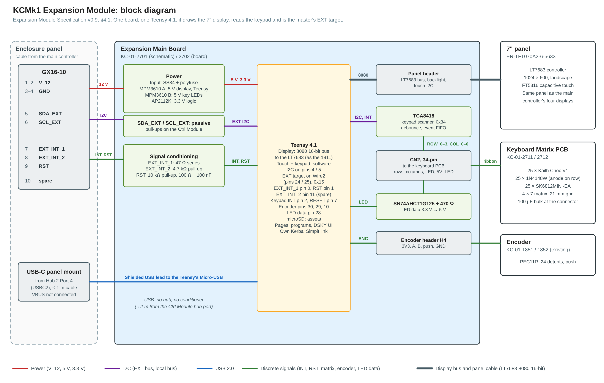
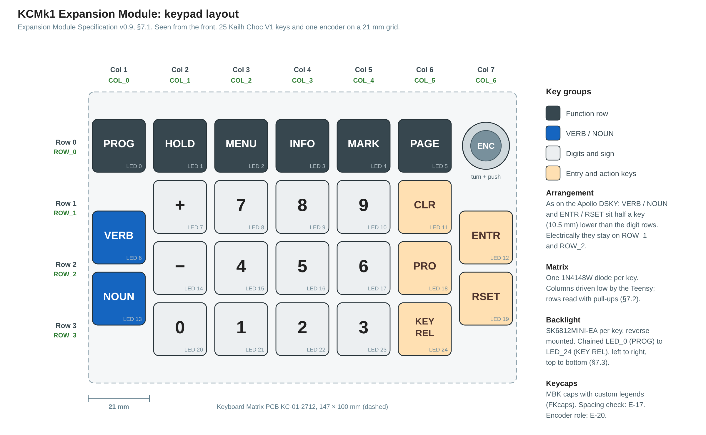

# Kerbal Controller Mk1 — Expansion Module Specification

**Organization:** Jeb's Controller Works  
**Author:** J. Rostoker  
**Version:** 0.10 (Draft)  
**Date:** 2026-11-21  
**Document type:** Developer — Hardware Design Specification

---

## 1. Purpose and Scope

This document specifies the KCMk1 Expansion Module: a separate enclosure with a DSKY-style keypad and one 7" touch display in landscape. It becomes the controller's autopilot interface and also runs programs of its own. It connects to the main controller through the GX16-10 signal connector and the USB-C panel mount that are already fitted, but reserved, on the main enclosure (Hardware Reference §10).

Version 0.4 brings the May 2026 draft in line with the controller as built. The master firmware (`Software/KCMk1_Master`) now runs every autopilot, and the 7" display driver (KC-01-1911) is a proven board. §2.1 lists the decisions this revision rests on.

Version 0.5 records the concept chosen from the mockup review. The expansion has a single landscape screen over the keypad, and the flight graphics for the autopilots go on the Information Displays instead of a second expansion screen (§8.4), so no view is drawn twice.

Version 0.6 puts the whole expansion on one microcontroller. A purpose-built Expansion Main Board carries one Teensy 4.1 that draws the display, reads the keypad through a keypad scanner chip, runs the programs and answers the master on the EXT bus. The separate expansion Teensy, its carrier board, the routing board and the USB hub are gone.

Signal protection on the external interface is defined in Hardware Reference §8.4 and §10, and is unchanged.

---

## 2. Functional Overview

The expansion module provides:

- **A DSKY-style keypad**: 25 keys (Kailh Choc V1, SK6812MINI-EA per-key RGB backlight) and one rotary encoder (§7).
- **One 7" 1024×600 capacitive touch display, in landscape**: the same panel as the main controller's four displays, driven from the Expansion Main Board (§8).
- **The autopilot interface.** The keypad and the display operate the master's autopilots: ascent, aircraft and rover hold, orbital (burn) and landing (§4.3). Once the expansion passes its bench checks, the autopilot consoles move off Information Display 2 (§4.4).
- **Its own programs**: planning, calculators and data pages that do not fly the vessel (§4.5).

Everything runs on **one Teensy 4.1** on the Expansion Main Board (D10). It draws the display, reads the keypad through a TCA8418 keypad scanner and the encoder directly, drives the key backlights, runs the DSKY interface and the programs, and is a target on the master's EXT bus. It has one Kerbal Simpit link for everything the pages and programs show.

### 2.1 Decisions in this revision

| # | Decision | Replaces |
|---|---|---|
| D1 | **Role: both.** The expansion drives the master's autopilots (the master keeps all autopilot logic) and runs its own non-flying programs | The expansion ran the autopilot programs and orbital math and sent commands to the master |
| D2 | **The master polls the expansion on the EXT bus.** The main controller is I2C master on `Wire1` (SDA_EXT / SCL_EXT); the expansion is a target. The expansion pulls EXT_INT_1 to ask for a poll. This is the same pattern as every other board in the system | The expansion was I2C master on SDA_EXT and the main controller a target |
| D3 | **The display circuit is the 7" TFT Display Driver's** (KC-01-1911 V2.1: Teensy 4.1 + LT7683, ER-TFT070A2-6-5633 1024×600 panel, capacitive touch), copied onto the Expansion Main Board with the same Teensy pin map, so the display firmware library (`KerbalDisplayCommon`, `KCMk1_SystemConfig`) works unchanged | New RP2040 + SSD1963 5" boards (KC-01-EX30 / EX31, v0.3); a KC-01-1911 board in a slot (v0.4, v0.5) |
| D4 | **The expansion has its own Kerbal Simpit link** for the flight data its pages and programs show. About 210–240 bytes per update (≈ 2–2.5 kB/s at the 125 ms refresh rate) is not forwarded over EXT | One link for the expansion Teensy and one for the display driver (v0.4, v0.5) |
| D5 | **The autopilot interface moves entirely to the expansion.** The Information Display 2 consoles stay until the expansion's autopilot pages pass their bench checks, and are then removed from Information Display 2 and the manual | Not covered |
| D6 | **Autopilots are operated with keys plus console pages.** The display shows the selected autopilot's page (modes, setpoints, status), like today's consoles. The keys do the work; touch is secondary | Verb / noun entry |
| D7 | **One landscape screen over the keypad.** A single 7" display (1024 × 600) stands above the keypad. The panel is about 205 × 240 mm | Layout A: two 7" displays in portrait, about 260 × 305 mm (v0.4 draft) |
| D8 | **No A/P OFF on the expansion.** Autopilots are switched off from the main controller: the A/P switch, or the RHC stick button. The expansion engages, sets and disengages individual modes only | The consoles' A/P OFF button |
| D9 | **Autopilot flight graphics go on the Information Displays.** The expansion screen shows the page you work with: the program, its modes, setpoints and registers. What the autopilot is doing to the flight (targets, predicted paths, bugs) is drawn on the existing Information Display screens (§8.4) | A graphical left display on the expansion (v0.4 draft) |
| D10 | **One microcontroller and one main board.** The Expansion Main Board (KC-01-2701 / 2702) carries the Teensy 4.1, the display circuit, a TCA8418 keypad scanner, the encoder and LED connections, the GX16-10 signal protection and the power supplies. The keyboard PCB has only switches, diodes and LEDs | An expansion Teensy on a carrier board (EX23), a separate display driver, a routing board (EX10) and a USB hub (v0.5) |

---

## 3. External Connections

The expansion unit has two connectors on its enclosure panel, matching the main enclosure (Hardware Reference §10).

### 3.1 GX16-10 Signal Connector

Both enclosure panels mount a **female socket with male pins**. The cable has **female sockets at both ends**.

| Pin | Signal | Direction | Notes |
|-----|--------|-----------|-------|
| 1 | V_12 | Main → Expansion | 12 V power |
| 2 | V_12 | Main → Expansion | Parallel, for current capacity |
| 3 | GND | — | Power return |
| 4 | GND | — | Power return, parallel |
| 5 | SDA_EXT | Bidirectional | I2C data. The master is bus master (D2). LTC4311 and pull-ups on the Ctrl Module only; passive at the expansion end |
| 6 | SCL_EXT | Master → Expansion | I2C clock, driven by the master. As pin 5 |
| 7 | EXT_INT_1 | Expansion → Main | Active-low, "poll me" (§9.2). 47 Ω series at the expansion end; 47 Ω series and 4.7 kΩ pull-up at the Ctrl Module. Master pin 33 |
| 8 | EXT_INT_2 | Main → Expansion | Spare in v0.6 (§9.2). 4.7 kΩ pull-up at the expansion end, wired to Teensy pin 11 so a later use needs firmware only; no source resistor on the V2.0 Ctrl Module (Hardware Reference §8.4, §15). Master pin 32 |
| 9 | RST | Main → Expansion | Active-low. 47 Ω series at the Ctrl Module; 10 kΩ pull-up and 100 Ω + 100 nF RC filter at the expansion end |
| 10 | SPARE | — | Reserved |

**Expansion terminal CN1** (on the Expansion Main Board, 10-pin DB125-3.81). Its order differs from both the GX16-10 and the Ctrl Module Extension's CN2, so the expansion-side harness is wired by signal name:

| CN1 pin | Signal | GX16-10 pin |
|:-:|---|:-:|
| 10 | V_12 | 1 |
| 9 | V_12 | 2 |
| 8 | GND | 3 |
| 7 | GND | 4 |
| 6 | EXT_INT_2 | 8 |
| 5 | EXT_INT_1 (through 47 Ω on the board) | 7 |
| 4 | RST (RST_EXT) | 9 |
| 3 | SDA_EXT | 5 |
| 2 | SCL_EXT | 6 |
| 1 | Not connected | 10 (SPARE) |

All signal protection components are on the boards, not in the cable. The Ctrl Module Extension's CN2 terminal order differs from the GX16-10 order from pin 5 on, so the main-side harness cross-maps them (Hardware Reference §10.4).

**RST** is the master's display reset line (master pin 2): asserting it reboots the four main displays and the expansion together. At the expansion it reaches the Teensy's RST input (pin 1), as on the 7" display drivers.

### 3.2 USB-C Panel Mount Connector

A USB-C bulkhead feedthrough carries USB 2.0 High Speed from the main controller's Hub 2 Port 4 (USBC2, Hardware Reference §7.7) to the Expansion Main Board. The two panel mounts are joined by a standard USB-C cable, 1 m maximum.

VBUS is not connected at either panel mount; the expansion is powered from V_12 on the GX16-10. The panel mount's internal lead goes straight to the Teensy's Micro-USB. There is no signal conditioner: the link starts at a hub port on the Ctrl Module, and the ≈ 2 m from there to the Teensy is well inside USB 2.0's 5 m (§6, Hardware Reference §8.4).

---

## 4. Internal Architecture

### 4.1 Block Diagram

*Figure 4-1: Expansion Module block diagram. Power is red, I2C purple, USB blue, discrete signals green and the display bus dark grey. Drawn by `assets/gen_expansion_diagrams.py`; the SVG is alongside.*

**Teensy 4.1 pins.** The display pins are those of the KC-01-1911 V2.1 (`KCMk1_SystemConfig.h`), so the display library needs no change. The expansion uses the pins the 1911 leaves free, and the audio pins it no longer needs (the DFPlayer is not fitted).

| Teensy pin | Use | On the 1911 |
|---|---|---|
| 14–23, 26, 27, 38–41; 31–37; 9 | LT7683 8080 16-bit bus and control; backlight | Same |
| 3, 4, 5, 6 | Touch reset, software I2C (SCL_LOCAL, SDA_LOCAL), touch INT. The TCA8418 shares this bus | Same, touch only |
| 24, 25 (Wire2) | EXT bus, target at 0x15 | Module bus |
| 0, 1 | INT_BUS → EXT_INT_1 through 47 Ω; RST from the master through the 100 Ω + 100 nF filter | Same |
| 2 | Keypad INT from the TCA8418 | Not connected |
| 7 | TCA8418 RESET (KEY_RST) | DFPlayer serial RX |
| 10 | Encoder push (BTN_EN, active high) | Not connected |
| 30, 29 | Encoder A, B | Tone amplifier |
| 28 | LED data, through the SN74AHCT1G125 | Not connected |
| 11 | EXT_INT_2 input (spare) | DFPlayer BUSY |
| 8, 12, 13 | Spare | DFPlayer serial TX; not connected |
| microSD | Assets | Same |

### 4.2 I2C Buses

| Bus | Master | Targets | Carries |
|-----|--------|---------|---------|
| EXT (SDA_EXT / SCL_EXT) | Main controller Teensy 4.1 (`Wire1`, pins 17 / 16) | Expansion Teensy 4.1 (`Wire2`, pins 24 / 25), 0x15 | Autopilot commands up; autopilot status and summary down (§9) |
| Local (software I2C, pins 4 / 5) | Expansion Teensy 4.1 | FT5316 touch (0x38), TCA8418 keypad scanner (0x34) | Touch points and key events |

The local bus stays on the Expansion Main Board and the panel cable; it never leaves the expansion.

### 4.3 Autopilot Integration

The master keeps every autopilot: its control laws, the arbiter, the interlocks (A/P INHIB, ENGINE SAFE, the A/P disconnect) and the disconnect reasons. The expansion is a remote console:

- **Commands up.** A key action becomes the same command the Information Display 2 consoles send today: engage or disengage a mode, set a setpoint, A/P OFF, ARM / DISARM. It reaches the master as a short command frame on EXT. The master applies the same rules as for the consoles: refusals are printed on the KSP screen, and a refused command is never echoed.
- **State down.** The master sends the expansion the status frames it sends Information Display 2 today: ascent 0xA5, aircraft 0xA6, rover 0xA7, orbital 0xA8, landing 0xA9 and the 8-byte summary 0xAA. The expansion Teensy draws the page from them.
- **Interlocks and HOLD are unchanged.** The panel switches and the HOLD button work as they do now, with or without the expansion.
- **Flight graphics on the Information Displays (D9).** The master keeps sending the status frames to Information Display 2, which draws the autopilot graphics of §8.4 from them. Information Display 1 does not receive autopilot frames today; for its aircraft targets the master also sends it the aircraft frame, or a short targets frame (E-23).
- **No A/P OFF on the expansion (D8).** Switching every autopilot off stays on the main controller: the A/P switch to INHIB, or the RHC stick button. The expansion disengages one mode at a time (PRO on an engaged mode).

### 4.4 Migration from Information Display 2

1. **Until the expansion passes its bench checks,** the consoles on Information Display 2 stay as they are. The master serves both: it takes commands from either and sends state to both.
2. **Afterwards,** the consoles (ASC, ACAP, RVAP, ORAP, LDAP), the A/P sidebar key and the autopilot rules of the mission screen are removed from Information Display 2. Key 6 becomes MAP, the new ROVER MAP screen (§8.4). The master keeps sending Information Display 2 the autopilot status frames, which now feed the graphics of §8.4 instead of the consoles. The Technical Information Manual and the display references are updated to match.
3. **Without the expansion,** the controller then has no autopilot console; HOLD still works, and the Information Displays still show what an engaged autopilot is doing.

### 4.5 Expansion Programs

Programs that compute or display but do not fly the vessel run on the expansion Teensy, from its own Simpit data. Examples: transfer and phase-angle planning, Δv and burn-time calculators, and orbit and target data pages. The program list is to be defined (E-15). Any future program that needs to fly the vessel is added to the master as an autopilot, and the expansion gets a console page for it.

---

## 5. Board Topology

### 5.1 Boards

| Board | Designator | Description |
|-------|------------|-------------|
| Expansion Main Board | KC-01-2701 (schematic) / 2702 (board) | **New; schematic complete (2026-11-23).** Teensy 4.1 on headers (H1, H2); the display circuit of the KC-01-1911 V2.1 (40-pin panel header H3 for the LT7683 bus, backlight and touch; 10 kΩ pull-up on /RESET; 10 kΩ local I2C pull-ups); TCA8418 keypad scanner with 1 µF + 100 nF decoupling and 10 kΩ pull-ups on INT, RESET and the seven unused keypad pins; SN74AHCT1G125 LED data level shifter on 5V_LED with a 470 Ω series resistor; 34-pin keyboard connector CN2; 5-pin encoder header H4. GX16-10 wiring terminal CN1 (10-pin DB125-3.81; its pin order differs from the Ctrl Module Extension's CN2, so each harness is wired by signal name, §3.1); 47 Ω series on EXT_INT_1; 4.7 kΩ pull-up on EXT_INT_2; RST through a 10 kΩ pull-up, then 100 Ω in series with 100 nF to ground at the Teensy; no LTC4311 and no I2C pull-ups on EXT (the Ctrl Module has them). Power: SS34 + polyfuse input protection, MPM3610 A (5 V for the panel and Teensy), MPM3610 B (5V_LED for the key LEDs and the level shifter), AP2112K (3.3 V) |
| Keyboard Matrix PCB | KC-01-2711 (schematic) / 2712 (board) | Switches, diodes and LEDs only, plus the bulk capacitor (§7.4) |
| Encoder | KC-01-1851 / 1852 | The main controller's existing encoder board (§7.5), on header H4 |
| 7" panel | ER-TFT070A2-6-5633 | The main displays' panel and capacitive touch, on the main board's panel header |

**Retired:** the Expansion Routing Board (KC-01-EX10) and the Expansion Teensy Carrier (KC-01-EX23), merged into the main board in v0.6; KC-01-EX30 and EX31 (v0.3 display boards); KC-01-EX22 (v0.3 encoder board), replaced by the existing Encoder Carrier in v0.8. No KC-01-1911 is used in the expansion.

### 5.2 Power

All power comes from V_12 on the GX16-10, which is the main controller's 12 V supply.

| Consumer | 12 V typical | 12 V peak | Notes |
|----------|-------------|-----------|-------|
| Display panel and Teensy (MPM3610 A) | 0.23 A | 0.25 A | As the 7" display driver: Power Budget 1.3 (480 / 520 mA at 5 V) |
| Key backlight, TCA8418, level shifter (MPM3610 B and AP2112K) | ≈ 0.07 A | ≈ 0.51 A | ≈ 150 mA typical and ≈ 1.1 A peak at 5 V; the peak is all 25 keys at full white |
| **Total** | **≈ 0.30 A (3.6 W)** | **≈ 0.76 A (9 W)** | |

The 12 V supply (10 A) has 4.18 A peak headroom with panels A and B, and 2.87 A with the planned Panel C growth (Power Budget §3). The expansion fits within either.

The key LEDs have their own MPM3610, so their peak (≈ 1.1 A at 5 V) does not share a converter with the display. It is still close to that converter's 1.2 A rating, so the firmware caps the backlight brightness, or the board uses a larger converter for the LEDs (E-02).

---

## 6. USB and Simpit

| Parameter | Value |
|-----------|-------|
| Upstream | USB-C panel mount |
| Conditioner | None (below) |
| Device | The expansion Teensy 4.1, by the panel mount's internal lead straight to its Micro-USB |
| Path length | ≈ 2 m from the Ctrl Module's Hub 2 Port 4: its internal lead, the external cable (1 m maximum) and the expansion's internal lead |
| Internal leads | Shielded USB cable, D+ / D− twisted, shield grounded at the panel mount, kept short |

**No signal conditioner.** A USB hub port starts a fresh cable budget, and USB 2.0 allows 5 m from a hub port to a device, so the ≈ 2 m run needs no booster. The connector junctions and the internal leads are the real risk, so the internal leads are proper USB cable. The link is bench-checked at High Speed with the real cables (E-26); if it is marginal, the Teensy can be forced to Full Speed (12 Mbit/s) in firmware, which is ample for the Simpit link.
| Hub | None: there is one USB device, so open item E-09 (bypass the hub) is closed |

**VBUS:** not connected at either panel mount. The Teensy is powered through VIN, with its Micro-USB VCC not connected, as in the main controller.

**Kerbal Simpit:** the expansion has one Simpit link, so `Settings.cfg` grows from five ports to six. The Technical Information Manual's setup section is updated when the expansion is built.

---

## 7. Keyboard Subsystem

### 7.1 Physical Layout

The keyboard follows the Apollo DSKY layout, with a function row added at the top. All keys are **Kailh Choc V1 White** switches (clicky, CPG135001D03) with **MBK keycaps** with custom legends (FKcaps, part number 90000001) on a **21 mm** grid (E-17).

*Figure 7-1: Keypad layout, seen from the front. The function row is on top and the DSKY rows below. Each key shows its matrix row and column and its place in the LED chain. Drawn by `assets/gen_expansion_diagrams.py`.*

**Key count:** 25 switches and 1 rotary encoder. The encoder takes column 7 of row 0.

**DSKY arrangement:** as on the Apollo DSKY keyboard, VERB and NOUN (column 1) and ENTR and RSET (column 7) sit half a key pitch (10.5 mm) lower than the digit rows, so VERB and ENTR fall between the + and − rows, and NOUN and RSET between the − and 0 rows. In the matrix they stay on ROW_1 and ROW_2; only their position on the board moves.

**Key functions.** The functions below follow D6. The detailed mapping, including which keys select a mode and how a setpoint is chosen, is open item E-11.

| Key | Function |
|-----|----------|
| PROG | Select a program: an autopilot (ascent, aircraft, rover, orbital, landing) or an expansion program |
| VERB / NOUN | Verb and noun entry for the expansion programs, and shortcuts to autopilot actions |
| 0–9, +, − | Numeric and sign entry |
| CLR | Clear the current entry |
| ENTR | Enter: confirm a value |
| PRO | Proceed: engage or disengage the highlighted mode, ARM / DISARM, EXEC a planned burn, or execute the current verb |
| KEY REL | Key release: dismiss the current prompt |
| RSET | Reset: clear a fault or alarm shown on the expansion |
| HOLD | Pause an expansion program and keep its state. Not the panel HOLD button |
| MENU | Open the touch menu: brightness, layout, settings |
| INFO | Show the extended parameters behind the current page |
| MARK | Capture the current state: an orbit snapshot, a reference for a maneuver, or a rover waypoint. A rover mark reaches Information Display 2's ROVER MAP through the master (E-22) |
| PAGE | Cycle the views the current program offers, for example a split page's graphic |
| ENC | Turn: move the highlight, or adjust the highlighted value. Press: confirm. Whether the encoder stays now that the screen has touch is open (E-20) |

### 7.2 Matrix Wiring

The 25 switches are wired as a 4-row × 7-column matrix with one diode per key (1N4148W, SOD-123). A **TCA8418** keypad scanner on the Expansion Main Board scans it: its ROW0–ROW3 and COL0–COL6 pins connect to ROW_0–ROW_3 and COLUMN_0–COLUMN_6 through the 34-pin keyboard connector. The TCA8418 debounces in hardware and queues up to 10 key-press and key-release events; it pulls the keypad INT line (Teensy pin 2) low until the Teensy has read them over the local I2C bus. The diodes let any number of keys be held at once without ghost presses.

**Diode direction.** The TCA8418 holds its rows high with internal pull-ups and drives one column low at a time, so a pressed key passes current from the row, through its diode and switch, into the column. Each diode therefore has its **anode on the row line** and its cathode towards the switch, whose other side is on the column line. This is confirmed by the TCA8418 data sheet (SCPS215G, §8.4.2.1 and §9.1.1), and the keyboard schematic has all 25 diodes this way round. The seven unused keypad pins (ROW4–ROW7, COL7–COL9) are pulled up to 3.3 V through 10 kΩ, as the data sheet's pin table requires. The TCA8418 reports each key as row × 10 + column + 1 and scans every 25 ms, so a press can take up to about 50 ms to appear.

| Parameter | Value |
|-----------|-------|
| Row lines | 4 (ROW_0–ROW_3), to TCA8418 ROW0–ROW3 |
| Column lines | 7 (COLUMN_0–COLUMN_6), to TCA8418 COL0–COL6 |
| Keypad scanner | TCA8418RTWR, I2C 0x34, on the local bus; INT to Teensy pin 2, RESET from pin 7 |
| Teensy GPIO for the encoder | 3 (A, B, push: pins 30, 29, 10) |
| Teensy GPIO for the key LEDs | 1 (pin 28, through an SN74AHCT1G125 to 5 V levels) |

### 7.3 Per-Key RGB Backlight

One SK6812MINI-EA (LCSC C5378731) per key sits reverse-mounted on the back of the keyboard PCB and shines through a cutout into the Choc V1 housing. The LEDs are daisy-chained DOUT → DIN from LED_0 (PROG), left to right and top to bottom. LED_DIN comes in from the Expansion Main Board on the keyboard connector (pin 33), from the SN74AHCT1G125 level shifter through 470 Ω (the LEDs run at 5 V and need a 5 V data level); LED_DOUT returns on pin 2 and is not used. A 100 µF capacitor at the connector holds up the 5 V rail against the LEDs' switching current. Each LED has a 100 nF decoupling capacitor (C1525) placed close to VDD.

### 7.4 Keyboard PCB (KC-01-2711 / 2712)

| Parameter | Value |
|-----------|-------|
| Board dimensions | 147 mm × 100 mm |
| Key grid | 21 mm × 21 mm |
| Switch footprint | Kailh Choc V1, direct solder (hand solder after JLCPCB assembly) |
| LED placement | SK6812MINI-EA reverse mount on the back, cutout per key |
| Finish | Black solder mask, white silkscreen (the board can show between the keys) |
| Connector | CN1: 34-pin IDC box header (2 × 17, 2.54 mm), ribbon to the Expansion Main Board's CN2; the two connectors have the same pinout |
| Matrix | 4 rows × 7 columns, 25 positions populated |

**CN1 (34-pin keyboard connector):**

| Pins | Signal |
|------|--------|
| 1, 3, 4 | COLUMN_6, COLUMN_4, COLUMN_5 |
| 29, 30, 31, 32 | COLUMN_2, COLUMN_3, COLUMN_0, COLUMN_1 |
| 21, 22, 19, 20 | ROW_0, ROW_1, ROW_2, ROW_3 |
| 33 | LED_DIN |
| 2 | LED_DOUT (not used) |
| 7–14 | 5 V (5V_LED from MPM3610 B) |
| 5, 6, 15–18, 23–28, 34 | GND |

**BOM:**

| Ref | Component | LCSC # | Qty | Assembly |
|-----|-----------|--------|-----|----------|
| SW1–SW25 | Kailh Choc V1 White, clicky (CPG135001D03) | Self-source | 25 | Hand solder |
| D1–D25 | 1N4148W SOD-123, anode on the row line | C81598 | 25 | SMT (JLCPCB) |
| LED1–LED25 | SK6812MINI-EA | C5378731 | 25 | SMT (JLCPCB) |
| C1 | 100 µF 10 V electrolytic (RVT1A101M0505) | C3347 | 1 | SMT (JLCPCB) |
| C2–C26 | 100 nF 16 V X7R 0402 | C1525 | 25 | SMT (JLCPCB) |
| CN1 | 2 × 17 IDC box header, 2.54 mm | C20920 | 1 | THT (JLCPCB) |

### 7.5 Encoder (KC-01-1851 / 1852)

The expansion uses the main controller's existing Encoder board. Its outputs are RC-filtered, and the push switch is active high (a pull-down on BTN_EN, the switch to VCC). It connects to the main board's header H4: 1 3V3, 2 ENC_A, 3 ENC_B, 4 BTN_EN, 5 GND.

| Parameter | Value |
|-----------|-------|
| Encoder | PEC11R-4220F-S0024 (Bourns), LCSC C143797 |
| Shaft | 20 mm flatted, 2 mm bushing |
| Detents | 24 per revolution, with push switch |
| Panel | 3 mm cover |
| Mounting | Height adjustable independently of the keyboard PCB |

---

## 8. Display Subsystem

### 8.1 Hardware

The panel is the main controller's standard 7" display: an ER-TFT070A2-6-5633 1024×600 panel with its LT7683 controller and FT5316 capacitive touch. It is driven from the Expansion Main Board by the circuit of the KC-01-1911 V2.1 (D3): the Teensy 4.1's 8080 16-bit bus, the backlight control and the touch controller on the local bus, with the same pins, and a microSD card on the Teensy for assets. The expansion firmware is built on `KerbalDisplayCommon`, like the other displays.

The display runs in landscape (D7), the panel's native orientation, as on the main controller. No rotation or touch remapping is needed, so open item E-18 is closed.

### 8.2 Pages

The one screen shows the page you work with. Every page has the same frame: the PROG / VERB / NOUN indicators and the status lamps across the top, and the page body below.

| Page | Body |
|------|------|
| **P00 index** | The program list: the autopilots and the expansion programs |
| **Autopilot pages** | The selected autopilot's modes, setpoints and status, and the disconnect reason, like today's consoles. Every mode and setpoint is numbered (N01, N02, …) so that NOUN plus two digits jumps to it |
| **Expansion program pages** | The program's data registers. A program with a graphic of its own (a transfer planner, for example) splits the page: registers on the left, graphic on the right. PAGE cycles its views |

A DSKY-style layout (PROG, VERB and NOUN boxes, registers R1–R3, status lamps) is available to the expansion programs that ask for it. Program numbers are open item E-19.

### 8.3 Touch

Touch is secondary: settings (brightness, layout), the MENU key's menus, and soft buttons for functions that do not warrant a hard key. Flight-critical actions always have a key.

### 8.4 Information Display Changes

The autopilot flight graphics are added to the main controller's Information Displays (D9). Each is drawn over or beside the current screen, and appears only while the autopilot concerned is armed or engaged; otherwise the screen looks as it does today. Every graphic keeps the tick marks of the indicator it sits on. The data comes from the autopilot status frames (§4.3) and Simpit. The firmware work is open item E-21.

| Screen | Change | Data |
|--------|--------|------|
| **ASCENT** (Info Display 2) | Redesigned (mockup option B, revised). The ATMO, V.VRT and V.ORB bars give way to a trajectory profile beside a compact altitude scale: altitude against downrange, the path flown, the predicted path to the target, the atmosphere and target lines, and the current Ap. V.VRT and V.ORB become numbers above it. The FPA dial and HDG tape are compacted and carry sky-blue bugs for the commanded pitch and heading. The atmosphere becomes a horizontal bar across the bottom, in today's ATMO colour bands. The STAGE box is removed; a white-on-red STAGE overlay on the profile appears when the current stage's Δv is spent (0.5 m/s or less, today's rule) and clears when you stage. The right column is unchanged | Ascent frame 0xA5; downrange is summed from horizontal speed, and the predicted path is a simple simulation on the display, so it is approximate |
| **POWERED DESCENT** (Info Display 2) | While BRAKE is armed and the radar altitude is above 500 m, the drift grid shows a braking profile: radar altitude against time, the path flown, the fall with no burn, the ignition point and the braking curve. Below 500 m the drift grid returns. The STG.BRN box becomes BRAKE IGN, the countdown to ignition (orange under 30 s) | Landing frame 0xA9 |
| **ORBIT** (Info Display 2) | While the orbital autopilot has a plan for an Ap, Pe or INC burn, the orbit after the burn is drawn dashed in sky blue, with the burn point and the new apsides; changing values read "now → planned"; a PLAN line names the burn and the time to EXEC. For a KSP maneuver node only the node point is marked, because Simpit gives its Δv but not its direction | Orbital frame 0xA8 |
| **NAVIGATION** (Info Display 2) | The aircraft autopilot's selected heading as a sky-blue bug on the compass ring. An AUTOPILOT box below T+INT lists the engaged modes and their targets, only while an aircraft mode is engaged | Aircraft frame 0xA6 |
| **AIRCRAFT** (Info Display 1) | The engaged aircraft modes in the title bar, and each mode's target in sky blue: under ALT.SL and IAS, as a bug on the heading tape, on V.VRT for V/S and on the pitch scale for ATT | Aircraft frame, newly sent to Info Display 1 (E-23) |
| **ROVER MAP** (Info Display 2, new, key 6) | A north-up map around the rover: the trail driven, the heading line, the target (violet) and the marks taken with the expansion's MARK key. Takes key 6, freed by the A/P consoles (§4.4) | Positions by dead reckoning (ground speed × ground-track heading), as Simpit sends no latitude or longitude; the target is placed from its distance and bearing. Marks come from the expansion through the master (E-22) |

The ASCENT, DESCENT, ORBIT and NAVIGATION changes can be made before the expansion is built, since Information Display 2 already receives the status frames.

---

## 9. I2C Addresses and the EXT Protocol

### 9.1 Addresses

| Address | Device | Bus | Notes |
|---------|--------|-----|-------|
| 0x15 | Expansion Teensy 4.1 | EXT | Proposed. It follows the display carriers (0x10–0x14) so that logs and tools never show two devices at one address |
| 0x34 | TCA8418 keypad scanner | Local | Fixed by the part |
| 0x38 | FT5316 touch controller | Local | Fixed by the part, as on the 7" displays |

The encoder and the key LEDs are wired to the Teensy's pins and have no I2C address.

### 9.2 EXT Protocol (outline)

The protocol follows the display-carrier pattern (I2C spec §15). The frames are defined in a new I2C spec section when the firmware is designed (E-10).

| Direction | Frame | When |
|---|---|---|
| Master → expansion | Control (debug, demo, flight scene), as for the carriers | Every 500 ms, as a heartbeat |
| Master → expansion | Autopilot status 0xA5–0xA9 and summary 0xAA, as sent to Information Display 2 today | On change, at the console rates |
| Master reads expansion | Status: ready, Simpit link, and the number of commands queued | Every poll |
| Master reads expansion | Command frame: the console command format, one per read | While EXT_INT_1 is low |

- **EXT_INT_1** (expansion → master): the expansion pulls it low while it has commands queued, and the master reads them at once instead of waiting for the next poll.
- **EXT_INT_2** (master → expansion): spare. The frames arrive by write anyway, so nothing needs it; it is wired to Teensy pin 11 with its pull-up, so a later use needs firmware only.
- **If the expansion stops answering,** the master treats it as absent. It stops sending frames and re-probes every 5 s, as it does for the Sys Info Display (`SYSINFO_REPROBE_MS`). The expansion is optional, so its absence is not an error at boot.

---

## 10. Open Items

| # | Item | Type |
|---|------|------|
| E-02 | 5 V budget for the key LEDs on MPM3610 B: ≈ 1.1 A peak against its 1.2 A rating; a firmware brightness cap or a larger converter | Power |
| E-05 | Closed by D3: 7" ER-TFT070A2-6-5633 panel on the KC-01-1911 driver | — |
| E-06 | Closed by D10: one Teensy draws the screen, so no content frames pass between boards | — |
| E-07 | Closed: the master is bus master on EXT (D2). The expansion address is proposed as 0x15 (§9.1) | — |
| E-09 | Closed by D10: one USB device, no hub (§6) | — |
| E-10 | EXT frame definitions and the master-side EXT service (`Wire1`, EXT_INT_1 / 2); a new I2C spec section | Firmware |
| E-11 | Key mapping for the autopilots: PROG numbers, mode selection, setpoint entry and engage (D6) | Firmware / UI |
| E-12 | Enclosure (D7): one landscape 7" display over the keypad, about 205 × 240 mm; depth; the Expansion Main Board's outline and mounting behind the panel | Mechanical |
| E-13 | EXT bus speed over the ≈ 1 m GX16-10 cable: confirm 400 kHz with the LTC4311, or fall back to 100 kHz | Bench check |
| E-14 | Kerbal Simpit with six ports: KSP-side load, and the `Settings.cfg` layout | Bench check |
| E-15 | The expansion program list | Design |
| E-16 | Retire the Information Display 2 consoles after the expansion's bench checks (§4.4): InfoDisp firmware, display references, TIM | Firmware / docs |
| E-17 | MBK keycaps with custom legends (FKcaps), part number 90000001 (25 per keyboard): legend method and whether a legend can shine through for the per-key RGB; key spacing (MBK caps are sized for 18 × 17 mm Choc spacing; the keyboard PCB uses a 21 mm grid) | Hardware |
| E-18 | Closed by D7: the display is in landscape, its native orientation (§8.1) | — |
| E-19 | Program numbers for the autopilots and the expansion programs | Design |
| E-20 | The encoder's role now that the screen has touch: keep it to move the highlight and adjust the selected value, or drop it for a 26th key | Design |
| E-21 | Information Display firmware for §8.4: the ASCENT redesign, the DESCENT braking profile and BRAKE IGN, the ORBIT planned orbit, the NAVIGATION heading bug and AUTOPILOT box, the AIRCRAFT targets, and the new ROVER MAP screen; display references and TIM | Firmware / docs |
| E-22 | The MARK path: a short command from the expansion to the master, forwarded to Information Display 2 for the ROVER MAP | Firmware |
| E-23 | Autopilot data for Information Display 1: the aircraft frame 0xA6, or a short targets frame, from the master | Firmware |
| E-24 | Expansion Main Board (KC-01-2702) and keyboard PCB (KC-01-2712) layout. Schematics complete and reviewed (2026-11-23). At layout: check that 5V and 5V_LED stay separate nets (both converter sub-sheets name their output port "+5V"); confirm the resistor values in the BOM | Hardware |
| E-25 | Closed: the TCA8418 data sheet confirms pulled-up rows and driven columns; the keyboard diodes have their anodes on the row lines (§7.2) | — |
| E-26 | USB bench check: the expansion link at High Speed over the real path (Ctrl Module lead, external cable, expansion lead); the Full Speed firmware fallback if it is marginal | Bench check |

---

## 11. Not in Scope

- The main controller's hardware. The GX16-10, USBC2, EXT bus and EXT_INT lines are already allocated.
- Panel C, the planned button and display growth panel, which is separate from this unit.
- The Kerbal Simpit plugin: extra serial ports need no plugin changes.

In scope later, when the firmware is designed: the master's EXT service (E-10), the Information Display 2 console retirement (E-16) and the Information Display changes (E-21 to E-23).

---

## 12. Revision History

| Version | Date | Description |
|---------|------|-------------|
| 0.1 | 2026-05-23 | Initial draft: architecture, connectivity, board topology, open items |
| 0.2 | 2026-05-23 | Major revision. Display processors changed from Teensy 4.0 to RP2040; display driver from RA8875 to SSD1963; keyboard from ATtiny816 shift-register modules to a direct Teensy 4.1 GPIO matrix; keypad reduced from 28 to 25 keys plus 1 encoder; external interface from 50-pin IDC to GX16-10 plus USB-C panel mount; expansion Teensy 4.1 made I2C master on SDA_EXT; TUSB212 USB signal conditioner added; LTC4311 on SDA_EXT / SCL_EXT at both ends; series resistors and RST RC filter documented. Board designators assigned (KC-01-EX10 to EX31); keyboard PCB BOM finalized; display roles confirmed (left graphical, right data / program); DSKY layout finalized with the function row. Open items E-01, E-03, E-04 and E-08 closed |
| 0.3 | 2026-05-23 | Signal architecture corrections. A single LTC4311 on SDA_EXT / SCL_EXT, on the Ctrl Module only; the I2C lines are passive at the expansion end. Pull-ups placed: 4.7 kΩ on EXT_INT_1 at the Ctrl Module, 4.7 kΩ on EXT_INT_2 and 10 kΩ on RST at the Expansion Routing Board. The full signal path is documented per signal |
| 0.4 | 2026-11-21 | Brought in line with the controller as built (decisions D1–D6, §2.1). The master keeps all autopilot logic, and the expansion is its autopilot interface and runs its own non-flying programs. The master is I2C master on EXT, the expansion a target at 0x15 (proposed), with EXT_INT_1 as "poll me". The displays are two standard 7" TFT Display Drivers (KC-01-1911); EX30 and EX31 retired. The expansion Teensy and both display drivers each have a Simpit link (eight Simpit ports in all). Autopilot consoles move from Information Display 2 to the expansion after its bench checks; keys plus console pages. Power re-estimated (≈ 0.6 A typical, ≈ 1.0 A peak at 12 V). Open items E-05, E-07 and E-09 closed; E-10 to E-16 added. Then, from the mockup review: layout A with portrait displays (D7), no A/P OFF on the expansion (D8), MBK keycaps from FKcaps; E-17 to E-19 added |
| 0.5 | 2026-11-21 | Single-screen concept from the mockup review. One 7" display in landscape over the keypad, about 205 × 240 mm (D7 revised), on one KC-01-1911. The autopilot flight graphics move to the Information Displays (D9, §8.4): ASCENT redesign with a trajectory profile, horizontal atmosphere bar and STAGE overlay; DESCENT braking profile and BRAKE IGN; ORBIT planned orbit; NAVIGATION heading bug and AUTOPILOT box; AIRCRAFT targets on Info Display 1; a new ROVER MAP screen on Info Display 2's key 6. The master keeps sending Info Display 2 the autopilot frames after the consoles retire. Hub ports: Teensy and display, two spare; seven Simpit ports. Power re-estimated (≈ 0.37 A typical, ≈ 0.75 A peak at 12 V). E-18 closed; E-20 to E-23 added. Figures 4-1 (block diagram) and 7-1 (keypad layout) replace the text diagrams |
| 0.6 | 2026-11-21 | One microcontroller (D10). A new Expansion Main Board (KC-01-EX11 / EX12) carries one Teensy 4.1 with the KC-01-1911 V2.1 display circuit and pin map (D3 revised), a TCA8418 keypad scanner, the encoder and LED connections (with a 74AHCT1G125 level shifter), an optional tone amplifier for a key click, the GX16-10 signal protection, the TUSB212 and the power supplies (a second MPM3610 for the key LEDs). The expansion Teensy, its carrier EX23, the routing board EX10 and the USB hub are retired. One Simpit link (six ports in all); EXT_INT_2 spare, wired to pin 11. §7.2 diode direction corrected (anode on the row). Power re-estimated (≈ 0.30 A typical, ≈ 0.76 A peak at 12 V). Figure 4-1 redrawn. E-06 closed, E-09 closed again; E-24 and E-25 added |
| 0.7 | 2026-11-23 | TUSB212 USB signal conditioner dropped: the link starts at a Ctrl Module hub port, and the ≈ 2 m run to the Teensy is well inside USB 2.0's 5 m. The internal leads are shielded twisted-pair USB cable, the panel mount's lead goes straight to the Teensy, and a bench check with a Full Speed fallback is added (E-26). Figure 4-1 updated |
| 0.8 | 2026-11-23 | Aligned with the completed schematics (main board and keyboard). Pin map: EXT_INT_1 on pin 0 through 47 Ω, TCA8418 RESET on 7, encoder on 30 / 29 / 10, LED data on 28; pins 8, 12, 13 spare. The tone amplifier is dropped. RST filter as built (10 kΩ pull-up, 100 Ω + 100 nF). The encoder is the existing Encoder Carrier KC-01-1851 / 1852 (EX22 retired). The keyboard has one 34-pin connector instead of J1 / J2, and a 100 µF bulk capacitor. Diode direction confirmed against the TCA8418 data sheet; E-25 closed, E-24 updated. Figure 4-1 updated |
| 0.9 | 2026-11-23 | Board numbers assigned: Expansion Main Board KC-01-2701 / 2702, keyboard KC-01-2711 / 2712. The expansion terminal CN1 pinout is recorded (§3.1); its order differs from the main side's CN2, so the harness is wired by signal name. Figure 4-1 updated |
| 0.10 | 2026-11-24 | Keyboard BOM (§7.4) matches the layout export of 2026-11-23: C1 is the 100 µF bulk capacitor, C2–C26 the 100 nF LED decoupling, and CN1 (C20920) is fitted by JLCPCB. The switches are the Choc V1 White (clicky); the text said tactile. The keycaps are part number 90000001, and the keyboard PCB is black with white silkscreen (§7.4) |
