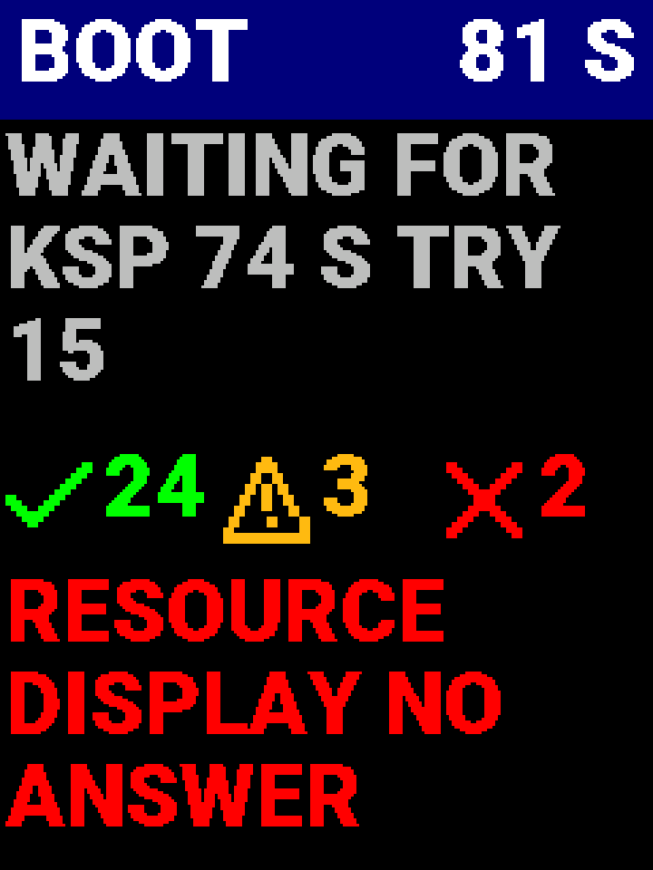
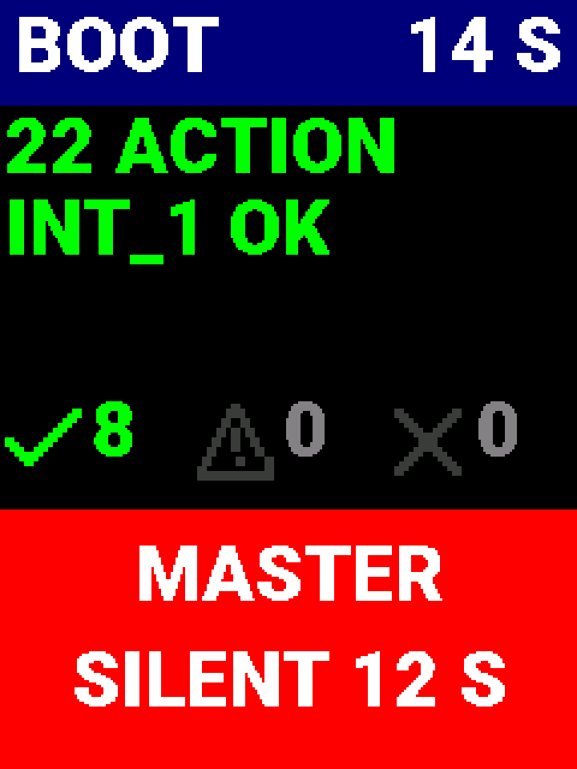
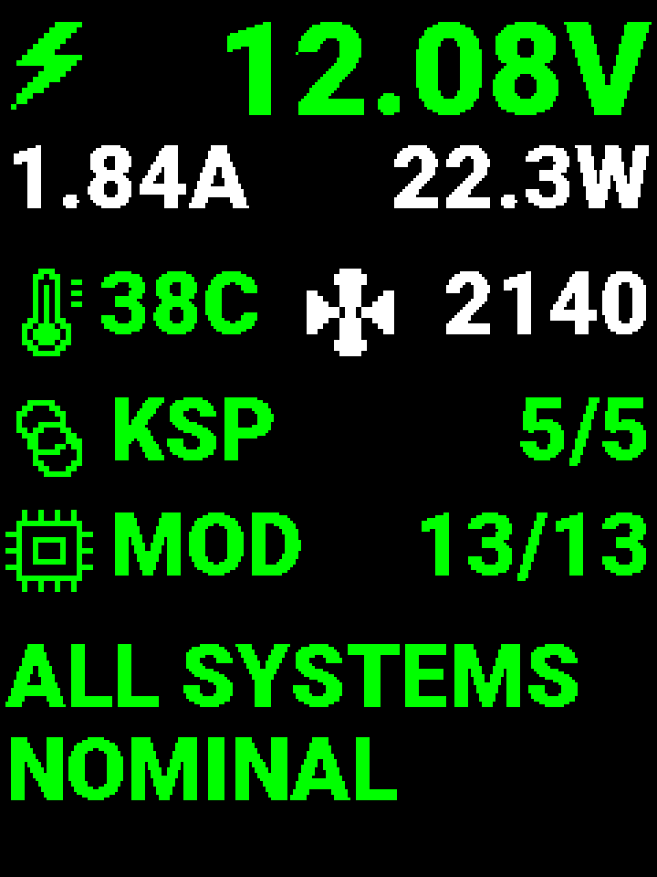
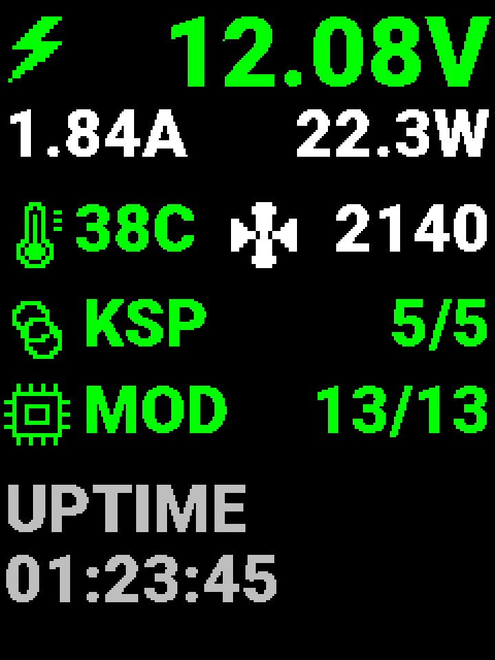
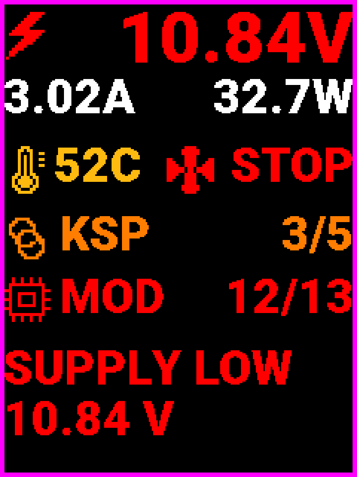
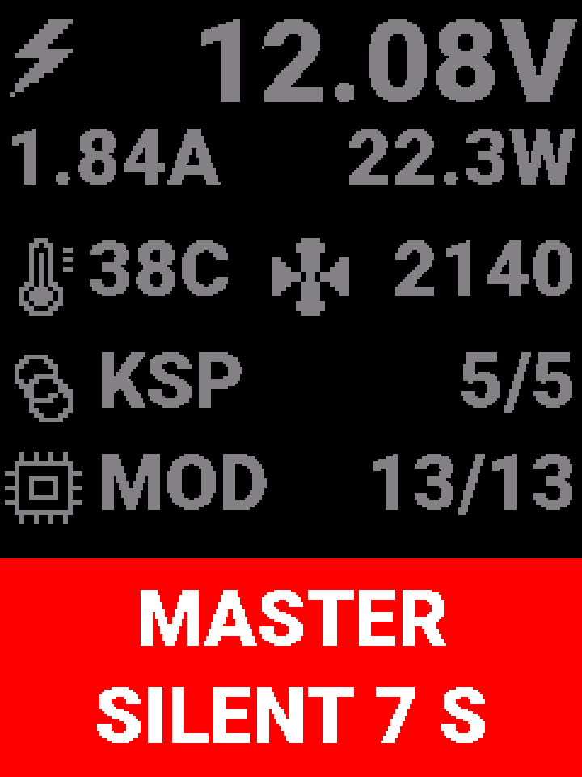
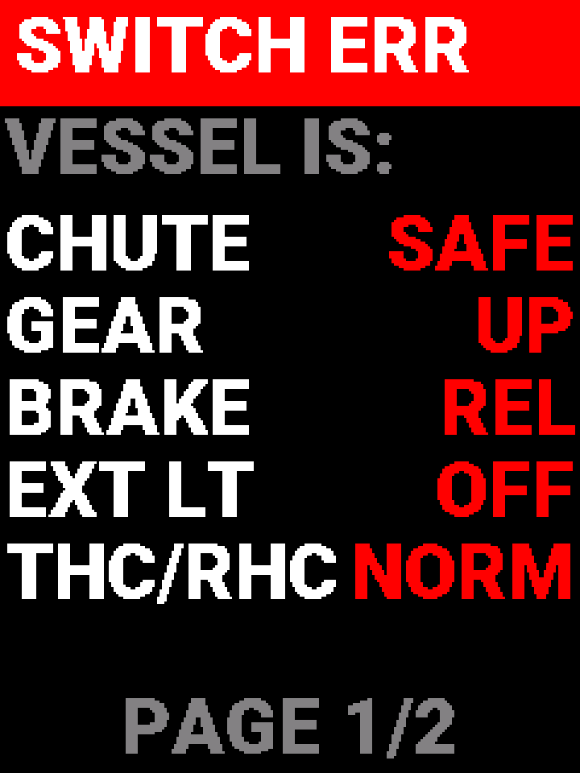

# KCMk1 Sys Info Display — Design

| | |
|---|---|
| **Document type** | Developer — design for approval |
| **Location** | `Documents/Developer/Sys_Info_Display_Design.md` |
| **Status** | Draft 2, for review. Nothing is built yet. The master side of the link exists (`Software/KCMk1_Master/sysinfo.cpp`, I2C spec §15.4); the display firmware does not |
| **Board** | 2" TFT Display Driver, KC-01-1901 / 1902 V2.0: XIAO RP2350, **ER-TFTM020-2** 240×320 IPS (ST7789), microSD. Panel A2 slot P2, I2C 0x14 |
| **Builds on** | `Master_Firmware_Design.md` §5 and §14; `Hardware_Inventory.md` §5.7 and §8.12; `I2C_Protocol_Specification.md` §15.4; the ER-TFTM020-2 datasheet (Eastrising, rev 1.0, 2023-07-07) |
| **Mockups** | `assets/sysinfo/*.png` (1:1) and `*_x3.png` (3×), from `assets/gen_sysinfo_mockups.py`. They are drawn with the panels' own fonts. The script refuses any text below the size rule of §1.1 |

---

## At a glance

The Sys Info Display is the small portrait screen on Panel A2, between THROTTLE and FUNC CTRL. It has no touch and no buttons: it shows what the master sends it.

- **Boot screen,** from power-on until KSP connects or demo mode is switched on:
  - the master's newest boot line;
  - counts of OK, warning and error lines;
  - the newest problem.
- **Status screen,** after boot:
  - the 12 V supply;
  - board temperature and fan;
  - KSP links up (master and the four 7" displays);
  - modules present.

  Below these, a two-line message area names any problem in turn, or reads `ALL SYSTEMS NOMINAL`.
- **SWITCH ERR,** while any switch disagrees with the vessel: each switch and the vessel's state.
- **MASTER SILENT** if no frame arrives for 5 s, on either screen.

**Readability drives the design.** At about 600 mm from the eye, the ER-TFTM020-2's 0.1275 mm pixels make ordinary small text unreadable. Every character on this screen is at least 2.8 mm tall (§1.1). That allows about 11 characters a line and 8 lines, so the screens show few things, large, and name a problem only when there is one.

Decided in the review of 2026-10-31:

| # | Decision |
|---|---|
| D1 | **Icons are built into the firmware.** The microSD card is optional and only replaces the power-on splash; a missing card is not an error |
| D2 | **The status screen adds module health:** modules present / missing / in FAULT, I2C error count, master uptime and firmware version. The STATUS frame grows to carry it (§7.2) |
| D3 | **The backlight follows the master,** as the four 7" displays do (#47): the same BACKLIGHT frame, flight and standby levels, 5 % floor, 300 ms ramp (§6) |
| D4 | **Everything must be readable on the ER-TFTM020-2** (owner, 2026-10-31): the size rule of §1.1, applied to every string by the mockup script and, later, by `panel_lint.py` |
| D5 | **Portrait orientation,** 240 wide × 320 tall (owner, 2026-10-31), matching the A2 window. The ST7789 runs in a portrait rotation (0 or 2), chosen on the bench so the image is upright as mounted (§9.3 #1) |

Everything else in this draft is a **proposal** to confirm. The questions are collected in §10.

---

## Contents

1. [Hardware and readability](#1-hardware-and-readability)
2. [Firmware structure](#2-firmware-structure)
3. [Boot screen](#3-boot-screen)
4. [Status screen](#4-status-screen)
5. [SWITCH ERR](#5-switch-err)
6. [Backlight](#6-backlight)
7. [Protocol changes](#7-protocol-changes)
8. [Master changes](#8-master-changes)
9. [Verification](#9-verification)
10. [Questions for review](#10-questions-for-review)

---

## 1. Hardware and readability

### 1.1 The panel and the size rule

From the ER-TFTM020-2 datasheet:

| Item | Value | What it means here |
|---|---|---|
| Format | 240 × 320, IPS, ST7789, 4-wire SPI | Used **portrait** (the A2 window is taller than wide, KC-01-1030) |
| Active area | 30.00 × 40.80 mm | |
| Dot pitch | 0.125 × 0.127 mm | Text height is set by the 0.1275 mm vertical pitch (40.80 / 320) |
| Brightness, contrast | 400 cd/m², 500:1 | Indoor panel, **not sunlight-readable**: saturated colours on black, no dim text for anything that matters |
| Viewing angle | 80° all four ways | Fine for a panel seen from the side |
| Backlight | 4 LEDs in parallel, 60 mA; BLK high = on | PWM on BLK (§6) |
| Supply | 3.0–3.5 V, up to 90 mA | For `Power_Budget.md` |
| Image sticking | A fixed image held for more than 2 h can leave a ghost. Advice: block patterns rather than thin lines; shift borders now and then; black or mid-grey backgrounds | §2.4 |

**Size rule.** The common legibility guidance (ANSI/HFES 100, ISO 9241-303) asks for a capital letter to subtend at least **16 minutes of arc**, and 20–22′ is preferred. The design viewing distance is **600 mm** (an arm's length to Panel A2; §10 Q1). That gives:

| | Cap height | Pixels (0.1275 mm) |
|---|---|---|
| Minimum, 16′ | 2.8 mm | **22 px** |
| Preferred, 20′ | 3.5 mm | 27 px |

Measured on the panels' fonts (capital H):

| Font | Cap height | At 600 mm | Characters per 240 px | Use |
|---|---|---|---|---|
| KcmTerm 16 | 10 px, 1.3 mm | 7′ | 30 | **Not usable** (Draft 1's boot log) |
| Roboto Black 20 | 14 px, 1.8 mm | 10′ | 18 | Not usable |
| Roboto Black 28 | 20 px, 2.6 mm | 15′ | 13 | Not usable (just under) |
| KcmTerm 36 | 24 px, 3.1 mm | 17.5′ | 12 | Usable, but its 2 px strokes look faint next to Roboto; not used |
| **Roboto Black 32** | 23 px, 2.9 mm | **17′** | ~11 | **All text** |
| **Roboto Black 48** | 34 px, 4.3 mm | **25′** | ~8 | The bus voltage, the headline value |

So the screen carries **Roboto Black 32 and 48 only**. Icons are 32 px.

### 1.2 Pins

From the KC-01-1901 V2.0 schematic. GPIO numbers are from Seeed's XIAO RP2350 pinout and are confirmed at the first build (§9.3).

| XIAO pin | GPIO | Net | Use |
|---|---|---|---|
| D0 | 26 | BACKLITE | Backlight PWM (panel BLK, H3 pin 8) |
| D1 | 27 | TFT_CS | ST7789 chip select (10 k pull-up R3) |
| D2 | 28 | TFT_DC | ST7789 data / command |
| D3 | 5 | RESET | ST7789 reset |
| D4 | 6 | SDA_BUS | I2C data, slot pin 11 (RP2350 **I2C1**) |
| D5 | 7 | SCL_BUS | I2C clock, slot pin 12 (I2C1) |
| D6 | 0 | INT_BUS | Slot pin 13 → master INT_2. Not used by this protocol: driven high (idle) |
| D7 | 1 | SD_CS | microSD chip select (10 k pull-up R4) |
| D8 | 2 | SCK | SPI0 clock (panel and card) |
| D9 | 4 | MISO | SPI0 in (card only) |
| D10 | 3 | MOSI | SPI0 out |

- **Power:** the board has its own 12 V → 5 V (MPM3610) → 3.3 V (AP2112K) supplies. The panel runs on 3.3 V.
- **Not connected:** slot pins 9 (3.3 V), 14 (RST) and 16. The master cannot reset this board; its own watchdog does (§2.3).
- **SPI sharing:** the panel and the card share SPI0. The card is read only at power-on (§3.4), so the loop never shares the bus.

## 2. Firmware structure

### 2.1 Toolchain

- **Core:** Earle Philhower's `arduino-pico`, board *Seeed XIAO RP2350*.
- **Panel driver:** `Adafruit_ST7789`, for the init sequence and to push pixels. All drawing is our own, into a frame buffer.
- **Frame buffer:** 240 × 320 × 16 bit = 150 KB of the RP2350's 520 KB.
  - A change is drawn into the buffer, then the whole frame is pushed at up to 62.5 MHz SPI (about 20 ms).
  - A push happens only when something changed, and at most 10 times a second. No flicker, and no partial redraws to get wrong.
- **Fonts:** Roboto Black 32 and 48 from the shared ILI9341_t3-format set in `KerbalDisplayCommon/src/fonts_ili`, the same faces as the 7" panels. The glyph drawer is a few dozen lines over that format.
- **Icons:** 16 × 16 1-bit arrays, drawn at 2× (32 px).
- **Card:** the core's `SD` library on SPI0 with SD_CS.

### 2.2 Sketch layout

`Software/Displays/KCMk1_SysInfo/`, tabs as in the other display sketches:

| Tab | Content |
|---|---|
| `KCMk1_SysInfo.ino` | `setup()`, `loop()`, version |
| `AAA_Config.ino` | Pins, thresholds, timings, colours, icons (text art, `#` = lit) |
| `I2CSlave.ino` | `Wire1` slave at 0x14: the receive callback queues whole frames; the request callback answers the 4-byte status |
| `Frames.ino` | Takes frames off the queue and updates the model |
| `Gfx.ino` | Frame buffer, fills, text, icons, the anti-sticking shift, push to the panel |
| `Screen_Boot.ino` | Boot screen |
| `Screen_Status.ino` | Status screen and its message list |
| `Screen_SwitchErr.ino` | SWITCH ERR, and the switch name table |
| `Backlight.ino` | Level choice, ramp, PWM |
| `SdSplash.ino` | Optional splash from the card |

### 2.3 Run loop

- **I2C callbacks** run in interrupt context. They only copy each frame (≤ 44 bytes) into an 8-deep queue; a full queue drops the oldest frame. The request callback answers from a status word the loop keeps.
- **`loop()`:**
  1. drain the queue;
  2. check the 5 s silence timer;
  3. step the message rotation and the backlight ramp;
  4. redraw if anything changed (≤ 10 Hz);
  5. feed the watchdog.
- **Watchdog:** the RP2350 hardware watchdog, 2 s. A reset restarts only this display. The master sees it answer again and replays the boot, or sends BOOT_DONE (`sysinfo.cpp`, late start).
- **Model:** the newest boot line and the newest warning / error line, with the running counts. The newest STATUS, SWITCH_ERR, CONTROL and BACKLIGHT frames, as they arrived.

### 2.4 Image sticking

The status screen can sit unchanged for hours, the case the datasheet warns about. So:
- **No thin lines.** Groups are separated by space and solid colour blocks, never by 1–2 px rules (datasheet §8.3).
- **Black background,** as the datasheet advises for long-held images.
- **Shift:** every 10 minutes the whole image moves to the next of five positions: centre, then 2 px up, right, down, left. Every layout keeps a 2 px margin, so nothing is cut off. The move is too small to notice.
- **The message area changes** every 2.5 s (§4.3), so its block is never held.
- **Screen saver** outside a flight scene (§10 Q5): after 10 minutes with no alert and no change in the link or module counts, the screen goes black. It wakes on entering a flight scene, on any alert, or on any change to KSP or MOD.

## 3. Boot screen

 

*Left: a boot with warnings and errors, now waiting for KSP. Right: the master stopped sending 12 s ago, after its last step.*

### 3.1 Layout

| Area | y (px) | Content |
|---|---|---|
| Title | 0–43 | `BOOT` left, seconds since power-up right; white on navy |
| Newest line | 42–145 | The master's newest boot line, word-wrapped, up to 3 rows, coloured by severity |
| Counts | 160–200 | ✓ OK lines (green), ⚠ warnings (yellow), ✕ errors (red). A count of 0 is grey |
| Newest problem | 206–319 | The newest warning or error line, up to 3 rows, in its colour; `NO FAULTS` in green if none |

### 3.2 Lines

- **Severity colours** (BOOT_LINE `attr` bits 1:0): info light grey, OK green, warning yellow, error red.
- **REPLACE** (attr bit 7) overwrites the newest line: this is the live `WAITING FOR KSP  74 S  TRY 15`. A replaced line does not count again.
- **Wrapping** is by pixel width at word breaks; runs of spaces collapse. A line longer than 3 rows is cut. The master's lines need no change, but §8.2 proposes shorter ones that fit in two rows.
- **Full log:** the whole boot is on the master's Serial (unchanged) and is replayed to a display that starts late.

### 3.3 Master silent

- No frame of any kind for **5 s** while the boot screen is up: the problem area becomes a red block reading `MASTER` / `SILENT n S`.
- The newest line above it stays, so the stalled step is visible. It clears on the next frame. The CONTROL heartbeat (every 500 ms) keeps it from tripping during slow steps.

### 3.4 Splash (optional)

- At power-on the display shows a splash for 2 s, or until the first BOOT_LINE, whichever comes later. Lines that arrive meanwhile are queued, not lost.
- The built-in splash is the `KCMk1` wordmark in Roboto Black 48.
- If a card mounts and holds `/KCMK1/SPLASH.BMP` (240 × 320, uncompressed 16- or 24-bit), that is shown instead. The card is read once, then left alone. Status read flag bit 1 = *card mounted*; a clear bit is not an error.

### 3.5 Leaving the boot screen

BOOT_DONE switches to the status screen, unchanged from today. A display that starts late gets the boot replayed. If boot is already over, it gets BOOT_DONE and goes straight to status.

## 4. Status screen

   

*Left to right:*
1. *normal;*
2. *the message area on a service item;*
3. *low supply, hot board with the fan stopped, two displays down, a module missing, demo on (magenta border);*
4. *no frame for 7 s.*

### 4.1 Layout

| Row | y (px) | Content | Font |
|---|---|---|---|
| Voltage | 0–45 | Bolt icon; **bus voltage**, right-aligned, `12.08V` | Roboto Black 48 |
| Current, power | 46–80 | `1.84A` left, `22.3W` right | 32 |
| Thermal | 92–126 | Thermometer, **board temperature** `38C`; fan icon, **rpm** `2140` (or `STOP`) | 32 |
| KSP links | 138–172 | Link icon, `KSP`, **links up / 5** | 32 |
| Modules | 180–214 | Chip icon, `MOD`, **present / 13** | 32 |
| Messages | 228–296 | Two lines (§4.3) | 32 |

Demo mode puts a 3 px **magenta border** round the whole screen. That is the only way to show it without small text, and it reads as a frame, not a value.

### 4.2 Colours and thresholds (proposed)

| Row | Green | Yellow | Orange | Red |
|---|---|---|---|---|
| Voltage | ≥ 11.5 V | 11.0–11.5 V | | < 11.0 V (the master's `POWER_LOW_V`) |
| Current, power | white: no limit proposed (§10 Q3) | | | |
| Temperature | < 50 °C | 50–59 °C | | ≥ 60 °C. The fan reaches 100 % at 50 °C (`board.cpp`) |
| Fan rpm | white | | | `STOP`, when the duty is above 0 and the rpm reads 0 |
| KSP | 5 / 5 | | fewer | |
| MOD | 13 / 13 | | | fewer present; any FAULT turns it orange |
| Not valid | `--` in grey, when its `valid` bit is clear | | | |

Each colour comes with a word or a number that says the same thing, so nothing depends on colour alone.

### 4.3 Message area

Two lines of Roboto Black 32, about 11 characters each. The firmware keeps a list and shows each entry for **2.5 s**. **Problems come first, worst first.** With no problems it shows `ALL SYSTEMS / NOMINAL` in green, then the service items in light grey.

| Entry | Line 1 | Line 2 | Colour |
|---|---|---|---|
| Master silent | (replaced by the red block, §4.4) | | |
| Supply low | `SUPPLY LOW` | `10.84 V` | red / yellow |
| Board hot | `BOARD TEMP` | `62 C` | red / yellow |
| Fan stopped | `FAN STOPPED` | `DUTY 100 %` | red |
| A sensor missing | `POWER MON` / `FAN CTRL` | `NO READING` | yellow |
| Master's own KSP link down | `MASTER` | `NO KSP LINK` | orange |
| A 7" display not answering | `RESOURCE` (`ANNUNCIATOR`, `INFO DISP 1`, `INFO DISP 2`) | `NO ANSWER` | red |
| A 7" display without its link | `INFO DISP 2` | `NO KSP LINK` | orange |
| A module missing | `GPWS` (the master's short name) | `MISSING` | red |
| A module in FAULT | `THROTTLE` | `FAULT` | orange |
| I2C errors rising | `I2C BUS` | `17 ERRORS` | yellow (shown while the count rose in the last minute) |
| Demo | `DEMO MODE` | `ON` | magenta |
| Debug | `DEBUG` | `ON` | sky |
| *All well* | `ALL SYSTEMS` | `NOMINAL` | green |
| *Service* | `UPTIME` / `MASTER FW` / `SYSINFO FW` / `FAN DUTY` / `I2C ERRORS` | `01:23:45` / `v0.10.0` / `v1.0.0` / `40 %` / `0` | light grey |

The longest fixed string, `ANNUNCIATOR`, is 225 px of the 236 available.

### 4.4 Master silent

If no frame arrives for 5 s after BOOT_DONE:
- every value turns grey but is kept, so the last reading stays visible;
- the message area becomes a red block reading `MASTER` / `SILENT n S`.

This is new: today's spec covers only the boot screen (§7.4).

## 5. SWITCH ERR

 

- **Takes the whole screen** on a SWITCH_ERR frame with n > 0, and gives it back on n = 0. A small window over the status screen cannot hold readable text.
- **Title** `SWITCH ERR`, white on red. Under it, `VESSEL IS:` in grey.
- **One row per switch:** its name (white) left, and the vessel's state right (red). The switch is in the other position, since every one has two, so a row reads *GEAR — vessel is UP*.
  - Up to **5 rows** a page. More errors (the protocol allows 10) page every 3 s, with `PAGE 1/2` at the bottom.
  - The widest row, `THC/RHC` with `NORM`, fits with 4 px to spare.
- **Backlight** at the flight level while it shows (§6).
- **Switch table** (id → name, first / second position), copied from `kSw[]` in `switches.cpp`. Ids 1–8 are Switch Group 1, 9–16 Switch Group 2. An unknown id shows as `SW nn`, so a table that falls behind the master is visible:

| Id | Switch | 0 | 1 | | Id | Switch | 0 | 1 |
|---|---|---|---|---|---|---|---|---|
| 1 | MSTR | OPER | RESET | | 9 | CHUTE | SAFE | ARM |
| 2 | DISP | OPER | CLR | | 10 | GEAR | UP | DOWN |
| 3 | SCE | NORM | AUX | | 11 | BRAKE | REL | LOCK |
| 4 | UPTLM | INHIB | XMIT | | 12 | EXT LT | OFF | ILLUM |
| 5 | LTG | NORM | TEST | | 13 | SAS | OFF | ENAB |
| 6 | A/P | INHIB | ARM | | 14 | RCS | OFF | ENAB |
| 7 | ENGINE | SAFE | ARM | | 15 | THC/RHC | NORM | PREC |
| 8 | THRTL | STD | FINE | | 16 | AUDIO | MUTE | LIVE |

## 6. Backlight

As the 7" displays (#47; `KCM_Display.h` `kcmBacklight*`):
- **Levels:** flight % and standby % from the master's BACKLIGHT frame. Defaults before the first frame are 70 / 20 %. Floor 5 % (`KCM_BL_MIN_PCT`), 300 ms ramp (`KCM_BL_RAMP_MS`). PWM on D0 to the panel's BLK input.
- **Standby level:** the status screen while the master is not in a flight scene (new CONTROL bit 2, §7.1). This matches the 7" panels, which dim on their standby screens.
- **Flight level:** in a flight scene, and always on the boot screen, SWITCH ERR, MASTER SILENT, or any red value. An alert is never shown dimmed.
- **Off:** while the screen saver is on (§2.4).
- **The panel is not sunlight-readable** (datasheet), so the standby level and the 5 % floor are checked on the real panel under the room's lighting (§9.3).

## 7. Protocol changes

To go into `I2C_Protocol_Specification.md` §15.4 as v2.21. Every change keeps an older master or an older display working.

### 7.1 CONTROL (0xB0)

`ctrl` gains **bit 2 = flight scene** (the master's SCENE_CHANGE state). An older master sends 0, which reads as *not in flight*: the status screen uses the standby level.

### 7.2 STATUS (0xB3): 13 → 27 bytes

Bytes 0–12 unchanged. Appended:

| Byte | Field | Notes |
|---|---|---|
| 13 | fan duty, % | `g_bs.fanDuty`; valid with bit 2 |
| 14 | module count | 13 today (`MOD_COUNT`); higher mask bits are ignored |
| 15–16 | present mask, u16 | bit n = module n answering. Order: UI, FUNCTION, ACTION, STABILITY, VEHICLE, TIME, AUX, ROTATION, TRANSLATION, GPWS, PRE-WARP, THROTTLE, DUAL ENC |
| 17–18 | FAULT mask, u16 | status byte bit 2 in the module's last packet (as the input test screen) |
| 19–20 | I2C errors, u16 | NACKs, short reads and other errors since boot (`busStats()`), saturating |
| 21–24 | master uptime, u32 s | `millis() / 1000` |
| 25–26 | master version | major, minor |

The display also keeps the master's module short names, in the same order, for the message area. A 13-byte STATUS (an older master) shows `MOD --` in grey and leaves out the module and service entries.

### 7.3 BACKLIGHT (0xB8): new for 0x14

`[0xB8, flight %, standby %, 0]`, the frame the 7" displays already take (§15.3). The master sends it to 0x14 along with the others: every 2 s, and at once on a change.

### 7.4 Behaviour

- **MASTER SILENT** applies on the status screen too (§4.4), not only during boot.
- **Status read** `[0xAF, flags, fwMajor, fwMinor]`: flag bit 1 means *card mounted*. A card is optional (D1).

## 8. Master changes

### 8.1 Required

| File | Change |
|---|---|
| `sysinfo.h/.cpp` | `SI_STATUS_LEN` 27, and `SiStatus` gains fan duty. `sendStatus()` appends §7.2 from `modulePresent()`, the last packets' FAULT bits, `busStats()`, `millis()` and the version. `sendControl()` sets bit 2 from `g_vessel.flightScene` |
| `carriers.cpp` | `pushBacklight()` also writes 0x14, through `sysinfo`, so an absent display is not written |
| `board.cpp` | Passes `fanDuty` into `SiStatus` |
| `tools/tests` | The new STATUS layout, CONTROL bit 2, and the backlight frame to 0x14 |
| `config.h` | Version 0.10.0 |

### 8.2 Proposed: boot lines that fit two rows

Each of today's lines fits in three rows; many would fit in two if shortened. For example:

| Today | Proposed |
|---|---|
| `WAITING FOR KSP  74 S  TRY 15` | `WAIT KSP 74 S` (the try count goes to Serial only) |
| `RESOURCE DISPLAY NO ANSWER` | `RES DISP NO ANSWER` |
| `KSP RUNNING? SIMPIT COM PORT? USB?` | `CHECK KSP / SIMPIT / USB` |
| `2C THROTTLE    INT_5    LEARNED` | `THROTTLE INT_5 LEARNED` |

Serial keeps the long forms. This is optional (§10 Q6).

## 9. Verification

### 9.1 Host checks (no hardware)

These follow `Software/Displays/tools`:
- **`host_compile.py`:** builds the sketch against host stubs (`Wire1`, `SPI`, `SD`, and an `Adafruit_ST7789` that captures the frame buffer).
- **`render_screen.py`:** a scenario for each mockup here, drawn by the firmware's own code. The renders replace these mockups in the user docs.
- **`behaviour_selftest.py`:** frames in, model and screen state out. It covers:
  - REPLACE, the counts and wrapping;
  - the 5 s silence on both screens, and recovery;
  - a 13-byte STATUS;
  - SWITCH_ERR open, close, paging and an unknown id;
  - message order and rotation;
  - backlight level by screen, flight bit and alert;
  - the shift and the screen saver;
  - a full frame queue.
- **`panel_lint.py`:** extended to this sketch. A new hard check: no font below the 22 px cap rule, and no string wider than its box at the fonts' real widths.

### 9.2 Master host tests

`test_stage8.cpp`: STATUS bytes 13–26, CONTROL bit 2, BACKLIGHT to 0x14 only while present.

### 9.3 Bench (with the board)

| # | Check |
|---|---|
| 1 | The §1.2 GPIO map against the XIAO RP2350 (I2C1 on GPIO 6 / 7; SPI0 pins), and the image upright in portrait as mounted (else rotation 2) |
| 2 | The ST7789 at 62.5 MHz on this wiring; drop to 40 MHz if the image tears |
| 3 | **Readability on the mounted panel** at the real eye distance: every screen, at the flight level and at the standby level, in the room's normal light |
| 4 | Backlight: no flicker at low duty; the 5 % floor and the standby level readable |
| 5 | Splash: a card with `/KCMK1/SPLASH.BMP` shows it; no card and a bad card both show the wordmark |
| 6 | Power-on order: the display ahead of the master, and behind it (replay) |
| 7 | Watchdog: a hung loop restarts the display within 2 s, and the master brings it back to status |
| 8 | Image sticking: a day on the status screen leaves no ghost on the next screen |
| 9 | Power draw of the board (the panel is up to 90 mA), for `Power_Budget.md` |

## 10. Questions for review

| # | Question | Proposal |
|---|---|---|
| Q1 | Design eye distance to Panel A2 | 600 mm. At 500 mm, Roboto Black 28 would pass and allow 13 characters a line; at 700 mm, 32 is just under the 16′ minimum (14.4′) |
| Q2 | Status rows: voltage, current / power, thermal, KSP, MOD, two message lines | As proposed |
| Q3 | A current warning? | None. The supply's fuse protects; add yellow at 8 A if wanted |
| Q4 | Temperature thresholds | 50 / 60 °C |
| Q5 | Screen saver outside flight after 10 min (datasheet §8.3) | Yes |
| Q6 | Shorter master boot lines (§8.2) | Yes, with the long forms kept on Serial |
| Q7 | Demo shown as a magenta border plus a message entry | Yes |

---

## Revision history

| Draft | Date | Changes |
|---|---|---|
| 1 | 2026-10-31 | First draft: hardware map from KC-01-1901, three screens with mockups, D1–D3, protocol v2.21 proposal |
| 2 | 2026-10-31 | **Redesigned for readability on the ER-TFTM020-2** (D4); portrait confirmed (D5). Draft 1's text was 1.2–1.8 mm tall (7–10′ at 600 mm). New size rule: a 22 px (2.8 mm, 16′) minimum, so Roboto Black 32 / 48 only. Boot screen: the newest line, counts and newest problem, in place of a log. Status: six large rows and a rotating message area, in place of a dense list. SWITCH ERR takes the whole screen and pages. From the datasheet: active area 30.00 × 40.80 mm, image-sticking measures (no thin lines, a 2 px shift every 10 min, a screen saver), not sunlight-readable, backlight on BLK. The mockup script enforces the size rule and the margins |
