# Info Display — Screen Reference

**Document type:** User
**Location:** `Documents/User/Info_Display_Screen_Reference.md`
**Applies to:** KCMk1_InfoDisp firmware 1.15.3

The controller carries two Info Displays, each a 1024 × 600 touchscreen running the
same firmware. **Info Display 1** (panel A1, sidebar on the left) is the *vehicle
panel*: it always shows an instrument for the vehicle you are flying. **Info Display
2** (panel B1, sidebar on the right) is the *mission panel*: it follows the mission
phase, and it alone carries the autopilot consoles. Every screen can be reached from
either unit; only the sixth sidebar key differs.

Every picture in this document is a true rendering: the firmware's own drawing code,
run on a computer against a model of the display controller, in the flight state the
caption describes. Layout, fonts, colours and thresholds are therefore the panel's.
Thresholds quoted here are the firmware defaults in `AAA_Config.ino` and the shared
`KCMk1_SystemConfig.h`.

## Common elements

### Title bar and the AUTO / MAN chip

Each screen's name is centred in the title bar. At the right of the bar a small
outlined chip says who chose the screen:

| Chip | Meaning |
|---|---|
| **AUTO** (grey outline) | The panel's automatic screen selection chose this screen. |
| **MAN** (green outline) | You chose it with a sidebar key, and the panel is holding your choice. |

A manual choice means *not this, now* rather than *never*. It is released when the
situation the panel was responding to changes (its automatic choice changes), when you
press the key of the screen the panel currently wants, or when you switch vessel or
enter a new flight scene.

### Sidebar keys

Six keys run down the outboard edge. A key's caption shows its family name while
another screen is up, and the active mode's name while one of its screens is showing
(that key is then highlighted). Pressing a key from another screen goes to its
automatic choice; pressing it again cycles its modes.

| Key | Caption at rest | Screens, in cycle order | First press goes to |
|---|---|---|---|
| 1 | PFD | SPACECRAFT → AIRCRAFT → ROVER (Info Display 2 adds VEHICLE INFO) | The PFD that suits the vessel |
| 2 | LNCH | PRE-LAUNCH (automatic on the pad), then ASCENT ↔ CIRCULARIZATION | The mode that fits the flight phase |
| 3 | ORB | ORBIT → ORBIT ADVANCED → MANEUVER | ORBIT |
| 4 | TGT | TARGET → DOCKING → NAVIGATION | DOCKING inside 200 m of a target, else TARGET |
| 5 | LNDG | POWERED DESCENT ↔ RE-ENTRY | POWERED DESCENT |
| 6 | VEH on Info Display 1, A/P on Info Display 2 | VEHICLE INFO (Info Display 1); the five autopilot consoles (Info Display 2) | See the autopilot section |

The sidebar keys are the only touch targets on most screens. The exceptions are the
reference chip on the two PFDs, the PRE-LAUNCH board (a tap dismisses it), and the
autopilot consoles.

### Automatic screen selection

Each panel re-checks its choice every frame. To stop it flapping, an automatic switch
waits at least **4 s** after the previous one and at least **10 s** after a sidebar
press, and every numeric rule has a release band wider than its trigger.

**Info Display 1** answers one question, what instrument suits this vehicle:

| Priority | Condition | Screen |
|---|---|---|
| 1 | Vessel type is Rover | ROVER |
| 2 | Vessel type is Plane and the vessel is in an atmosphere | AIRCRAFT |
| 3 | Anything else, including EVA | SPACECRAFT |

**Info Display 2** follows the mission. The first rule that matches wins:

| Priority | Condition | Screen |
|---|---|---|
| 0 | An autopilot is armed or engaged | That autopilot's console |
| 1 | On the pad or runway (pre-launch), any vessel type | PRE-LAUNCH |
| 2 | Descending with periapsis in the body's re-entry corridor, while still above the atmosphere or faster than Mach 3. Once chosen it holds to touchdown, through the parachute phase, unless the engines thrust (a powered landing) or the vessel is a plane below Mach 3 | RE-ENTRY |
| 3 | Descending faster than 5 m/s below 10 km radar altitude (not a plane in an atmosphere) | POWERED DESCENT |
| 4 | A Plane flying in an atmosphere, apoapsis below its top | NAVIGATION |
| 5 | A target within 200 m | DOCKING |
| 6 | Landed or splashed | TARGET if one is set, else VEHICLE INFO |
| 7 | Climbing with periapsis below the orbit-safe altitude (not a rover or EVA) | ASCENT / CIRCULARIZATION |
| 8 | A manoeuvre node with ignition less than 10 min away, including during the burn | MANEUVER |
| 9 | A target between 200 m and 2,000 m | TARGET |
| 10 | On EVA | TARGET |
| 11 | Everything else | ORBIT |

The **orbit-safe altitude** is the higher of the body's atmosphere top and its highest
terrain: 70 km at Kerbin, 7.1 km at the Mun. Aircraft screens key off the vessel type
KSP reports, so a plane must be typed **Plane** in KSP to get AIRCRAFT and NAVIGATION.

### Colours

| Appearance | Meaning |
|---|---|
| Grey label, left of a value | Readout name; labels never change colour except where noted |
| Green value | Nominal |
| Yellow value | Caution: approaching a limit |
| White on red | Alarm: act now |
| Dark grey `---` | No data, or the value does not apply right now |
| Cyan | A console edit or command sent but not yet confirmed |
| Bright green, violet, magenta, cyan, blue markers | KSP navball colours: prograde, target, normal, radial, manoeuvre |

Where a table says "yellow 150–299", the bounds are inclusive of whole units: values are
compared after truncation to whole numbers unless the table gives decimals.

### Number formats

| Quantity | Format |
|---|---|
| Distance, altitude | Two decimals below 1,000 m (`310.00 m`); whole metres with separators to 999,999 m (`124,665 m`); then km, Mm, Gm |
| Speed | One decimal below 1,000 m/s (`842.0 m/s`); whole numbers with separators from 1,000 (`2,200 m/s`) |
| Time | `48 s`; `15 m: 06 s` under an hour; `1h 09m` from one hour; `3d 04h` from one Kerbin day (6 h). A leading `-` means the moment has passed. Autopilot consoles use the compact `m:ss`. |

### Standby

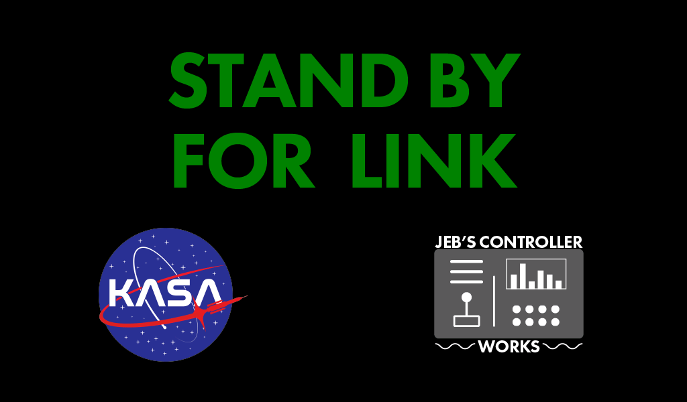

Outside a flight scene, and until the KerbalSimpit link to KSP is up, both units show
the standby splash. It needs no action; the panel switches to its flight screen when
a flight scene starts.

## Vehicle screens (key 1, PFD)

### SPACECRAFT (caption SPC)

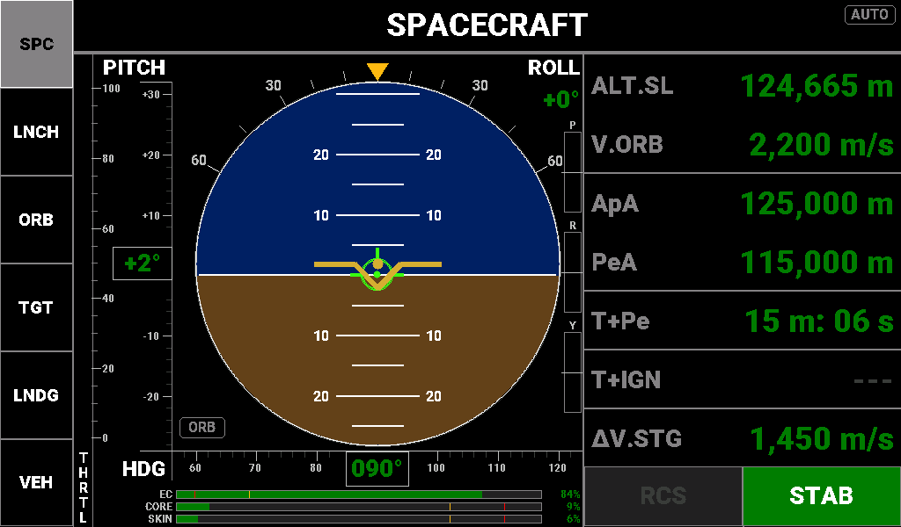

*A ship in a 115 × 125 km, 6° Kerbin orbit, nose prograde, SAS in stability assist.*

**Purpose.** The primary flight display for everything that is not a rover or an
aircraft in an atmosphere: rockets, capsules, probes, landers, stations and a Kerbal on
EVA. An attitude ball fills the centre; the right column carries the orbital numbers
flown from ascent through orbit and burns.

**Reaching it.** Key 1. Info Display 1 selects it automatically for every vessel
except a rover or a plane in an atmosphere. On Info Display 2 it is reached only by
hand.

**Layout.**
- **Attitude ball (centre).** Royal-blue sky, brown ground, white horizon. The gold
  wing symbol is fixed and level; the ball moves behind it. Centre to rim is 30°.
  - Pitch ladder: a rung every 5°, labelled every 10°.
  - Red chevrons appear past 32° of pitch and point back toward the horizon; they clear
    below 28°.
  - Navball markers, drawn while within about 25° of the nose: prograde and retrograde
    in bright green, normal and anti-normal in magenta, radial in cyan, target and
    anti-target in violet (with a target set), and the manoeuvre node in blue (with a
    node). Prograde, normal and radial follow the active velocity reference.
- **Bank scale and roll pointer (top arc).** Ticks at 0, ±10, ±20, ±30, ±45 and ±60°.
  The yellow pointer is a sky pointer: it turns with the horizon, so in a left bank it
  sits right of the top mark, and it stops at ±60°. The **ROLL** value beside it is a
  signed whole number of degrees and is always green on this screen.
- **PITCH tape (left of the ball).** Signed labels every 10°, with the boxed pitch
  value. Triangles on its edge mark the velocity vector (green), the target (violet)
  and the node (blue); a marker off the scale parks at the end.
- **HDG tape (below the ball).** About ±34° visible, N in yellow, the boxed heading in
  three digits, and the same three marker triangles.
- **THR bar (far left).** Throttle, 0–100 %, in orange. It is a control input, so it
  has no colour thresholds.
- **P / R / Y rate bars (right of the ball).** Pitch, roll and yaw rate, filling white
  from the centre line to ±10 °/s. Up is positive on all three: nose up, roll right,
  nose right. A bar sitting on its centre line means no rotation on that axis.
- **EC / CORE / SKIN bars (bottom strip).** Each bar and its percentage share one
  colour, with caution and alarm ticks drawn on the bar.
  - EC (electric charge): green from 20 %, yellow 5–19 %, red below 5 %.
  - CORE and SKIN (hottest part's temperature as a share of its limit): green up to
    75 %, yellow 76–90 %, red above 90 %.
- **Reference chip ORB / SRF (lower left of the ball).** Which velocity the screen uses;
  see Buttons.
- **TRIM.** Cyan text above the right end of the heading tape while trim hold is on.

**Reading the screen.**
- Fly attitude on the ball: put the wing symbol on the marker you want to point at.
  During RCS work and burns, watch the P/R/Y bars; centred bars mean the craft has
  stopped rotating.
- In orbit, the right column gives the orbit and the next burn. T+IGN turns yellow in
  the last minute; once the engine is lit for a node, the row becomes ΔV.REM, the Δv
  the node still needs. Cut the engine at zero.
- Below the velocity-switch altitude, row 5 shows vertical speed instead.
- Watch EC and the temperature bars on long coasts and during re-entry.

**Special states.**
- **Velocity reference.** The panel uses orbital velocity (V.ORB) above 6 % of the
  body's radius while climbing or level, or above 5.5 % while descending (36 km and
  33 km at Kerbin), and surface velocity (V.SRF) below. The swap redraws the screen.
- **Row 4** shows **T+AP** or **T+PE**, whichever apsis comes sooner.
- **Row 5** has three modes: **V.VRT** below the switch altitude, **T+IGN** above it,
  and **ΔV.REM** while a node burn is running (node set, throttle above 1 %, ignition
  time passed). Pinning the reference chip does not change row 5.
- **Dashes.** ALT.SL, V.ORB / V.SRF, APA, PEA and T+AP dash out when KSP sends neither
  a positive apoapsis nor a positive periapsis. T+IGN dashes with no node.
- **Escape trajectory.** APA shows `∞`.
- **EVA.** With a Kerbal on EVA, rows 2–6 become ALT.RDR, V.SRF, DIST, V.CLOSE and EC,
  and row 1 always shows V.ORB, so orbital and surface speed are both on screen: the
  pair tells station-keeping from drifting.

**Readouts (right column).**

| Label | Description | Colour coding / thresholds |
|---|---|---|
| ALT.SL | Altitude above sea level | Green always |
| V.ORB / V.SRF | Orbital or surface speed, following the velocity reference | Green always |
| APA | Apoapsis altitude | Green always; `∞` on escape |
| PEA | Periapsis altitude; negative while suborbital | Green always |
| T+AP / T+PE | Time to whichever apsis comes sooner | Green always |
| V.VRT | Vertical speed, signed (row 5, low altitude) | Green always: reported, never alarmed here |
| T+IGN | Time to ignition: node time minus half the burn duration (row 5, high altitude) | Green at 60 s or more; yellow under 60 s; white on red once ignition time has passed; `---` with no node |
| ΔV.REM | Δv the node still needs (row 5, during the burn) | Green always |
| ΔV.STG | Δv left in the current stage | Green from 300 m/s; yellow 150–299 m/s; white on red below 150 m/s |

On EVA the rows read:

| Label | Description | Colour coding / thresholds |
|---|---|---|
| V.ORB | Orbital speed (always shown on EVA) | Green always |
| ALT.RDR | Height above the terrain | Green always |
| V.SRF | Surface speed | Green always |
| DIST | Distance to the target | Green; `---` with no target |
| V.CLOSE | Closing speed; negative means closing | Green; `---` with no target |
| EC | Suit charge | Green from 20 %; yellow 5–19 %; white on red below 5 % |

**Buttons.**
- **RCS** and **SAS mode** (bottom of the column) are indicators; switch them with the
  panel hardware.
  - RCS: white on green when on, dark grey when off.
  - SAS shows the active mode in navball colours: STAB white on green; PRO and RETR on
    bright green; NRM and ANRM on magenta; RAD+ and RAD- on sky blue; TGT and ATGT on
    violet; MNVR on blue; `SAS` in dark grey when SAS is off.
- **ORB / SRF chip** is the one touch control. A tap pins the other velocity reference,
  or returns to automatic if the automatic rule already wants it. A grey outline means
  automatic, green means pinned. A pin releases by itself when the automatic answer
  changes.

### AIRCRAFT (caption ACFT)

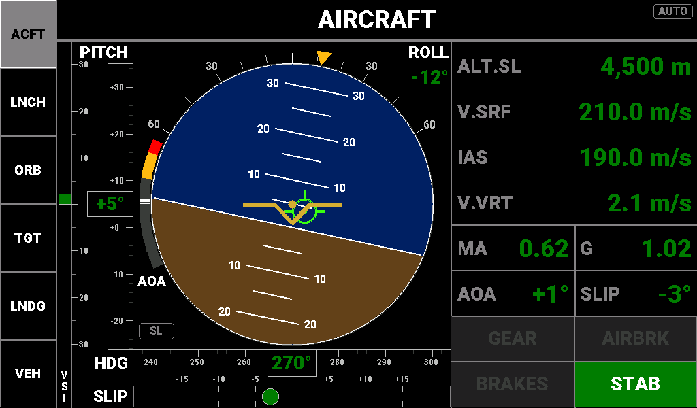

*A jet at 4,500 m, 190 m/s indicated, in a 12° left bank.*

**Purpose.** The primary flight display for a vessel typed Plane while it is in an
atmosphere: the same attitude ball, with aircraft instruments around it (vertical
speed, slip and angle of attack) and airspeeds, Mach and G on the right.

**Reaching it.** Key 1, second in its cycle. Info Display 1 selects it automatically
for a Plane in an atmosphere and hands back to SPACECRAFT when it leaves.

**Layout.**
- **Attitude ball, tapes and bank scale** as on SPACECRAFT, except the ball shows only
  surface prograde and retrograde (plus target and node when set), and the tapes carry
  only the green velocity triangle.
- **VSI bar (far left).** Vertical speed, ±30 m/s, zero at the ball's centre height,
  climbing upward. In cruise the fill is always green. On an approach (gear down, or
  below the radar-altimeter handover height) it turns yellow below −5 m/s and red below
  −8 m/s.
- **AoA arc (left edge of the ball).** −25° to +25°, zero at 9 o'clock. Dark grey,
  yellow from +10° to +20°, red from +20° to +25°: only stall-side angles are coloured.
  The white pointer is the current angle of attack.
- **SLIP strip (bottom).** A ball on a ±20° scale that moves right when the nose points
  right of the flight path. Green up to 5°, yellow above 5°, red above 15°.
- **IAS trend chevrons** (magenta, beside IAS). One, two or three chevrons predict the
  airspeed change over the next 6 s: one from 2 m/s, two from 6, three from 12.
- **SL / RDR chip.** Which altitude row 1 shows; see Buttons.

**Reading the screen.** Fly attitude on the ball and speed on IAS, keep the slip ball
centred, and treat the AoA arc and AOA row as the stall warning (IAS has no stall
colour). AoA is nose pitch minus flight-path pitch, so it is most accurate wings-level.
On approach, lower the gear or descend below 750 m radar altitude: row 1 switches to
radar altitude and V.VRT and the VSI begin to alarm on landing descent rates. A yellow
GEAR button in flight means the gear is down above 160 m/s.

**Special states.**
- Row 1 switches to **ALT.RDR** below 750 m radar altitude and back to **ALT.SL** above
  850 m. The gap stops it flickering at one height.
- The landing bands on V.VRT and the VSI follow the automatic radar test or gear down;
  pinning RDR with the chip does not turn them on.
- AOA and SLIP dash out below 0.5 m/s surface speed.

**Readouts (right column).**

| Label | Description | Colour coding / thresholds |
|---|---|---|
| ALT.SL / ALT.RDR | Altitude above sea level, or radar altitude (one decimal under 10 m, whole metres under 100 m, nearest 5 m above) | ALT.SL green always. ALT.RDR green from 500 m; yellow 50–499 m; white on red below 50 m |
| V.SRF | Surface speed | Green always |
| IAS | Indicated airspeed, with trend chevrons | Green always |
| V.VRT | Vertical speed, signed | Cruise: green always. Approach: green from −5 m/s; yellow below −5 to −8 m/s; white on red below −8 m/s |
| MA | Mach number | Yellow 0.85–1.20 (transonic); green otherwise |
| G | Load factor | Green from −2.0 to 4.0 g; yellow above 4.0 or below −2.0; white on red above 9.0 or below −5.0 |
| AOA | Angle of attack, signed whole degrees | Green below +10°; yellow +10° to +19°; white on red from +20°; `---` below 0.5 m/s |
| SLIP | Heading minus surface track, signed whole degrees | Green below 5°; yellow 5°–14°; white on red from 15°, either side; `---` below 0.5 m/s |

The **ROLL** value at the top of the ball is green up to 60° of bank, yellow above 60°
and white on red above 90°.

**Buttons.** All are indicators except the chip.

| Button | State | Colours |
|---|---|---|
| GEAR | On the ground, down / up | White on green / white on red |
| GEAR | In flight, down | White on green; on yellow above 160 m/s surface speed |
| GEAR | In flight, up | Dark grey |
| AIRBRK | Deployed / stowed | Dark grey on cyan / dark grey |
| BRAKES | On / off on the ground / off in flight | White on green / white on red / dark grey |
| SAS mode | Any | As on SPACECRAFT |

The **SL / RDR chip** works like SPACECRAFT's: a tap pins the other altitude source or
returns to automatic.

### ROVER (caption ROVR)

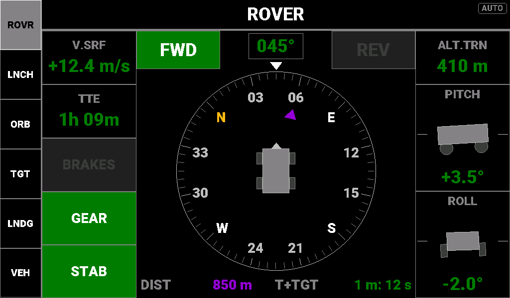

*A rover on the Mun at 12.4 m/s, heading 045°, driving to a flag 850 m away.*

**Purpose.** The driving instrument: a heading-up compass with the target bearing,
speed and direction, battery endurance, and how far the vehicle is tilting. It answers
where am I pointed, can I get there on this charge, and am I about to tip over.

**Reaching it.** Key 1, third in its cycle. Info Display 1 selects it whenever the
vessel is typed Rover.

**Layout.**
- **Compass card (centre).** Turns so your heading is always at 12 o'clock, under the
  white nose triangle; the heading box above it gives the heading in three digits. N is
  yellow, E/S/W white, and the numbers are tens of degrees.
- **Target marker.** A violet triangle at the target's bearing relative to the nose,
  shown while a target is set. At 12 o'clock you are pointed straight at it.
- **FWD / REV blocks (top corners).** The wheel-throttle command: FWD white on green
  above +1 %, REV on yellow below −1 %, both muted in neutral. They show the command,
  not the direction you are actually moving.
- **Left column:** V.SRF, ENDUR, then the BRAKES, GEAR and SAS indicators.
- **Right column:** ALT.TRN, then the PITCH and ROLL tilt pictures with their values.
  The pictures (side view with the front to the right, and rear view) show the tilt; the
  numbers beneath carry the warning colours. The pictures stop turning at ±45°.
- **DIST / T+TGT strip (bottom).** Range and time to the target, shown while a target
  is set.

**Reading the screen.** Steer until the violet triangle sits under the nose and watch
DIST count down. T+TGT says whether the battery lasts the trip: green with more than a
fifth of your endurance to spare, yellow when the trip uses more than four fifths, and
white on red when the battery runs out first. It is one-way only; a green T+TGT does
not mean you can drive back. A yellow, negative V.SRF means you are rolling backwards,
whatever FWD/REV says. On slopes, PITCH and ROLL turn yellow then red as you near
rollover; roll has the tighter limits.

**Special states.**
- With no target, the marker and the whole bottom strip disappear.
- T+TGT shows `---` when you are not closing on the target faster than 0.5 m/s.
- ENDUR shows `---` until it has enough samples (about 6 s after boot or a vessel
  switch) or while the drain is too small to matter (under 0.002 % per second, more
  than about 14 h at full charge). It shows `CHG` in green while the battery is
  charging. Endurance is sampled on every screen, so it has a value the moment ROVER
  appears.

**Readouts (right column).**

| Label | Description | Colour coding / thresholds |
|---|---|---|
| ALT.TRN | Terrain elevation under the rover (altitude above sea level minus radar altitude) | Green always |
| PITCH | Slope along the vehicle, signed, positive nose up | Green below 20°; yellow 20°–29.9°; red text from 30° |
| ROLL | Sideways lean, signed, positive right side down | Green below 15°; yellow 15°–24.9°; red text from 25° |

**Other readouts.**

| Label | Description | Colour coding / thresholds |
|---|---|---|
| Heading box | Vessel heading | Green always |
| V.SRF | Surface speed with direction sign, ±99.9 m/s | Green moving forward; yellow moving backward; dark grey `+0.0` when stopped |
| ENDUR | Time to an empty battery at the drain measured over the last ~48 s | Green from 1 h; yellow under 1 h; white on red under 10 min; `CHG` green; `---` dark grey |
| DIST | Distance to the target | Violet |
| T+TGT | Time to reach the target at the current closing speed | Green with endurance to spare; yellow from 80 % of ENDUR; white on red at or beyond ENDUR; green while ENDUR is `---` or `CHG` |

**Buttons.** Indicators only.
- BRAKES: white on green when on, dark grey when off.
- GEAR: white on green when deployed (the normal driving state), dark grey when
  retracted.
- SAS: active mode in navball colours, as on SPACECRAFT.

### VEHICLE INFO (caption VEH)

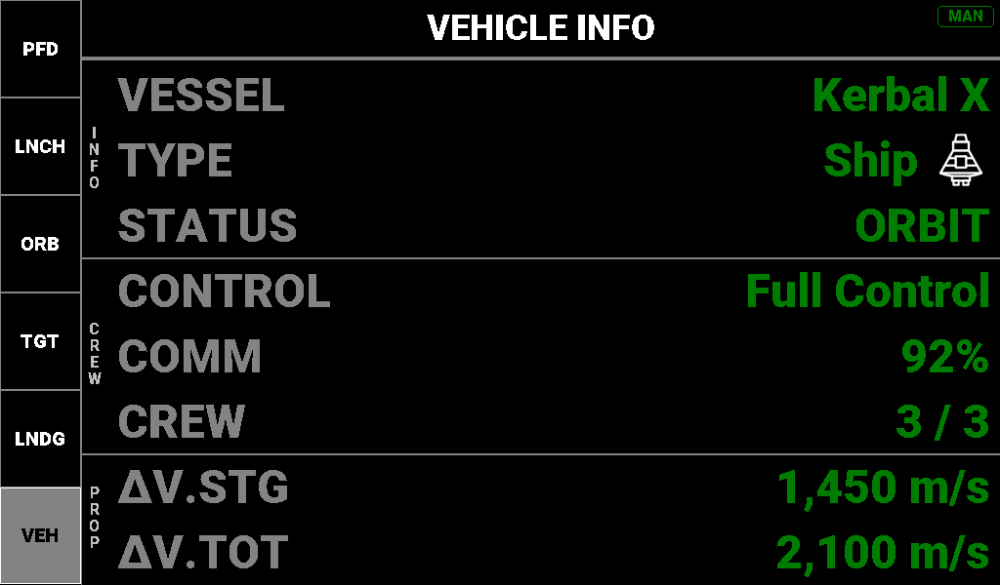

*The orbiting ship from the SPACECRAFT picture.*

**Purpose.** A text summary of the active vessel: identity, situation, control, comms,
crew and Δv reserves. A status check for the pad, after landing or when switching
vessels, not a flying instrument.

**Reaching it.** Info Display 1: key 6 (VEH), a single screen. The panel never chooses
it there, so it always shows MAN and hands back to the PFD when the PFD choice changes.
Info Display 2: the fourth stop on key 1, and chosen automatically when landed or
splashed with no target set.

**Layout.** Eight full-width rows in three groups marked INFO, CREW and PROP at the
left edge. The TYPE row ends with the vessel-type icon used on the Annunciator.

**Reading the screen.** Read top to bottom. A sky-blue STATUS ending `· RECOVERABLE`
means the vessel can be recovered. Anything but a green "Full Control" limits what you
can command. A yellow or red COMM means the probe link is weak or lost. Compare
ΔV.STG with ΔV.TOT to judge whether the stage and the mission have the Δv left.

**Readouts.**

| Label | Description | Colour coding / thresholds |
|---|---|---|
| VESSEL | Vessel name | Green always |
| TYPE | Vessel type and its icon | Ship green; Probe magenta; Relay violet; Rover olive; Lander navy; Plane sky blue; Station maroon; Base brown; EVA dark green; debris, objects, flags, science and parts dark red |
| STATUS | PRE-LAUNCH, IN FLIGHT, SUB-ORBITAL, IN ORBIT, ESCAPE ORBIT, LANDED, SPLASHED or DOCKED, with `· RECOVERABLE` when it applies | Sky blue when recoverable; green otherwise |
| CONTROL | Control level | Full Control green; Limited Manned dull yellow; Limited Probe orange; No Control white on red |
| COMM | CommNet signal | Green from 50 %; yellow 1–49 %; white on red at 0 % |
| CREW | Crew aboard / capacity | Green always |
| ΔV.STG | Current-stage Δv | Green from 300 m/s; yellow 150–299 m/s; white on red below 150 m/s. On the last stage the caution threshold rises to 500 m/s so the two Δv rows agree |
| ΔV.TOT | Total vessel Δv | Green from 500 m/s; yellow 150–499 m/s; white on red below 150 m/s |

**Buttons.** None.

## Launch screens (key 2, LNCH)

The LAUNCH key has three modes, one per part of the launch arc. While LAUNCH is
showing, the key's caption is the current mode: **PRE**, **ASC** or **CIRC**.

1. **PRE-LAUNCH** is armed whenever KSP reports the vessel as pre-launch. Info Display 2
   brings it up automatically; on Info Display 1 press LNCH.
2. **PRE-LAUNCH → ASCENT** happens at launch, or when you tap the board. Either keeps
   the screen on AUTO. Pressing the PRE key also moves on, but sets MAN for the whole
   flight, which stops step 3; tap the board instead. Once dismissed, the board does not
   return while you stay on the pad.
3. **ASCENT → CIRCULARIZATION** happens by itself when the throttle is at or below 2 %
   *and* apoapsis is at or above the orbit-safe altitude (70 km at Kerbin). The switch
   then latches, so opening the throttle for the circularisation burn does not send the
   screen back. It returns to ASCENT only when the vessel is landed, splashed or back on
   the pad, or when apoapsis falls below the orbit-safe altitude. A throttle-down for
   max Q or a staging gap does not count, because apoapsis is not yet high enough.
4. On ASC or CIRC, pressing the key again flips between the two and sets MAN; the
   automatic switch then stays off until you change vessel or start a new flight.

Info Display 2 keeps LAUNCH up while you are climbing with periapsis below the
orbit-safe altitude, and moves to ORBIT (or MANEUVER, with a burn due) once periapsis
clears it.

### PRE-LAUNCH (caption PRE)

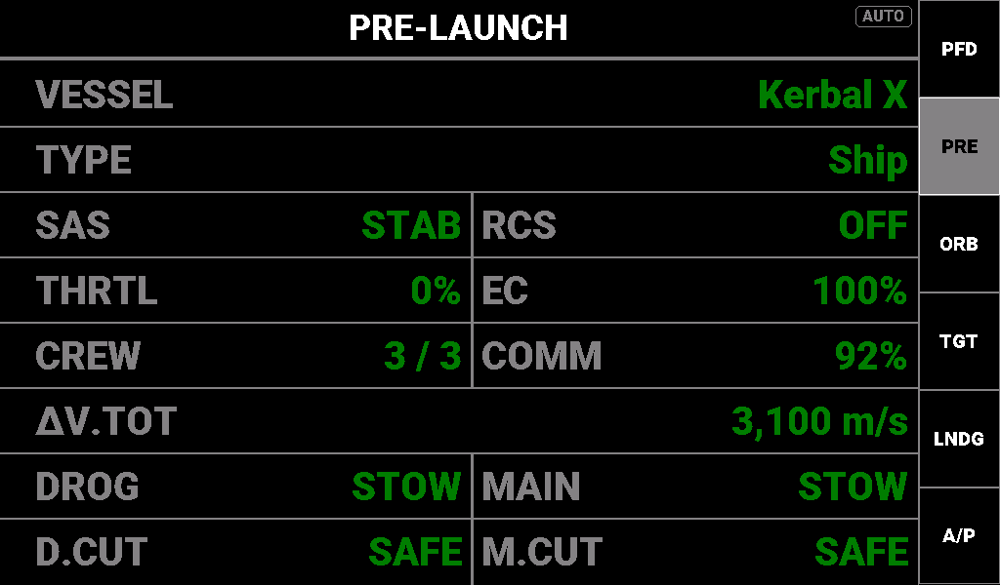

*A ship on the pad, everything set for launch.*

**Purpose.** A go / no-go board to read before staging: identity, control state, power,
crew, comms, total Δv and the parachute action groups. Every value should be green.

**Layout.** Eight full-width rows; rows 3–5 and 7–8 are split into two cells. No
graphics.

**Reading the screen.** Scan the right edge of each cell for anything not green.
White on red is a no-go: SAS off, RCS on, throttle open, EC below 75 %, comms below
10 %, total Δv below 150 m/s, or a parachute group already active. Yellow is a caution:
SAS in a mode other than STAB, EC 75–89 %, comms 10–49 %, total Δv 150–499 m/s.
Percentages are truncated, so 89.9 % EC reads 89 % and shows yellow.

**Readouts.**

| Label | Description | Colour coding / thresholds |
|---|---|---|
| VESSEL | Vessel name | Green always |
| TYPE | KSP vessel type | Green always |
| SAS | SAS mode: OFF, STAB, PROGRADE, RETRO, NORMAL, ANTI-NRM, RAD-OUT, RAD-IN, TARGET, ANTI-TGT, MANEUVER | STAB green; any other mode yellow; OFF white on red |
| RCS | RCS on or off | OFF green; ON white on red |
| THRTL | Throttle | 0 % green; anything else white on red |
| EC% | Electric charge | Green from 90 %; yellow 75–89 %; white on red below 75 % |
| CREW | Crew aboard / capacity | Green always |
| COMM | CommNet signal | Green from 50 %; yellow 10–49 %; white on red below 10 % |
| ΔV.TOT | Total vessel Δv | Green from 500 m/s; yellow 150–499 m/s; white on red below 150 m/s |
| DROGUE | Drogue-deploy action group (custom group 1) | STOWED green; ARMED! white on red |
| MAIN | Main-deploy action group (custom group 3) | STOWED green; ARMED! white on red |
| D.CUT | Drogue-cut action group (custom group 2) | SAFE green; FIRED! white on red |
| M.CUT | Main-cut action group (custom group 4) | SAFE green; FIRED! white on red |

**Buttons.** None; a tap anywhere on the board moves on to ASCENT.

### ASCENT (caption ASC)

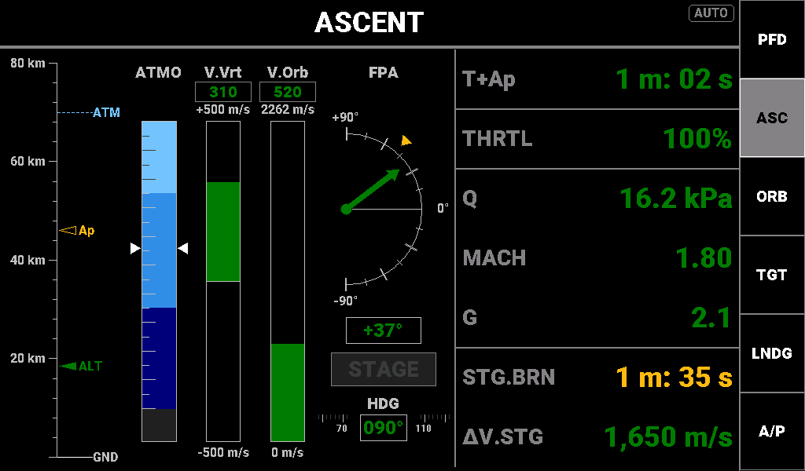

*Full throttle at 18.5 km, Mach 1.8, apoapsis 46 km.*

**Purpose.** The instruments for the powered climb. The left side shows the
trajectory as pictures (altitude and apoapsis, atmosphere depth, vertical and orbital
speed, flight-path angle and heading); the right column carries the numbers that have
no picture.

**Layout.**
- **Altitude ladder (far left).** A scale from GND upward that grows as you climb
  (2, 5, 10, 20, 40, 80 km, then the target orbit plus 30 km) and never shrinks during
  the flight. The filled green **ALT** triangle is your altitude; the hollow yellow
  **Ap** triangle is apoapsis (always hollow by design). A dashed sky-blue **ATM** line
  marks the top of the atmosphere, and a dashed green **TGT ORB** line marks the target
  orbit (the orbit-safe altitude plus 20 km: 90 km at Kerbin) once the scale reaches it.
- **ATMO gauge.** How deep in the atmosphere you are, sea level at the top: sky blue
  (dense), mid blue, then navy, with a dark segment at the bottom for vacuum. The two
  white triangles mark the current depth. It has no number; Q is the atmospheric
  number to watch.
- **V.Vrt bar.** Vertical speed, −500 to +500 m/s, filling up in green while climbing
  and down in red while descending. The box above gives the value, green when climbing,
  red when descending.
- **V.Orb bar.** Orbital speed, from 0 to the circular-orbit speed at the target orbit
  (the top label). A full bar means orbital speed. The box above it shows *surface*
  speed below 6 % of the body's radius (36 km at Kerbin) and orbital speed above.
- **FPA dial.** Flight-path angle: +90° straight up, 0° at the horizon. The green
  needle is your actual flight path; the yellow triangle is the target angle for a
  gravity turn (vertical below 1,500 m, then easing to 0° at the target orbit). The
  box gives the angle.
- **STAGE.** Dark until the current stage's Δv is spent (0.5 m/s or less), then white
  on red: stage now.
- **HDG tape.** Heading, with a yellow bug at the due-east launch azimuth (090°) and a
  green triangle for your direction of travel above 20 m/s. Markers within about 18°
  of your heading hide behind the heading box, so no bug showing means you are within
  about 18° of 090°.

**Reading the screen.** Keep the green FPA needle on the yellow target triangle. Watch
the hollow Ap triangle climb toward the TGT ORB line. Back off the throttle if Q goes
yellow (20 kPa) or red (40 kPa); it peaks around 5–8 km. STG.BRN and ΔV.STG warn of
staging before the STAGE light does. T+AP turning yellow means apoapsis is less than
30 s away. Cut the throttle once apoapsis is above the atmosphere; the screen moves to
CIRCULARIZATION by itself.

**Special states.** T+AP dashes with no apoapsis, on the pad or landed. Q and MACH dash
outside the atmosphere. A closed throttle shows white on red here, because during the
ascent it is an event; CIRCULARIZATION has no throttle alarm.

**Readouts (right column).**

| Label | Description | Colour coding / thresholds |
|---|---|---|
| T+AP | Time to apoapsis | Green from 30 s; yellow under 30 s; red if negative; `---` with no apoapsis |
| THRTL | Throttle | Green above 0 %; white on red at 0 % |
| Q | Dynamic pressure, ½ρv² | Green below 20 kPa; yellow 20–39.9 kPa; white on red from 40 kPa; `---` outside the atmosphere |
| MACH | Mach number | Green always; `---` outside the atmosphere |
| G | Load factor | Green below 4.0 g; yellow 4.0–8.9 g; white on red from 9.0 g |
| STG.BRN | Seconds of thrust left in the current stage | Green from 120 s; yellow 60–119 s; white on red below 60 s |
| ΔV.STG | Δv left in the current stage | Green from 300 m/s; yellow 150–299 m/s; white on red below 150 m/s |

### CIRCULARIZATION (caption CIRC)

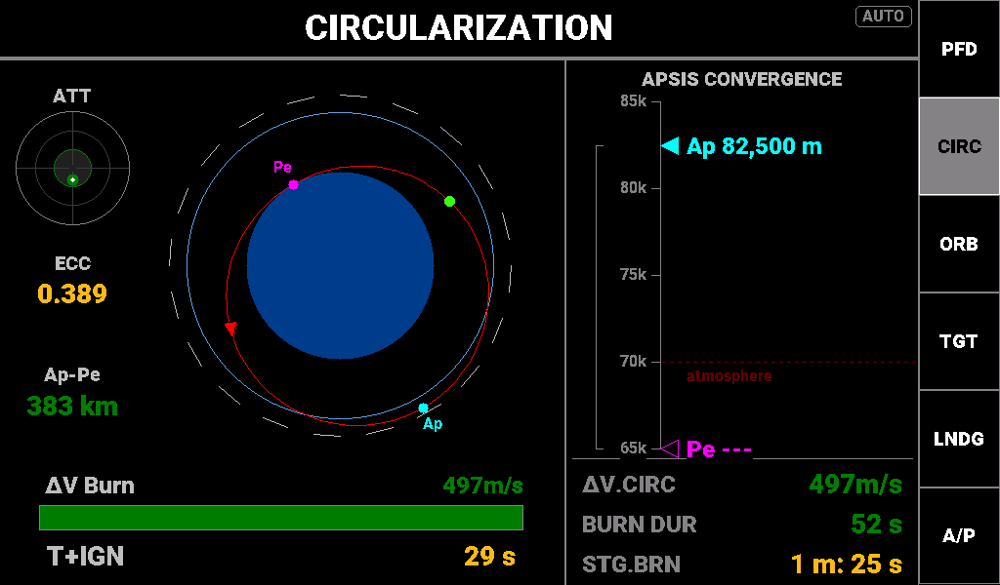

*Coasting to an 82.5 km apoapsis, 29 s before ignition, with a circularisation node
placed at apoapsis and SAS holding the node.*

**Purpose.** For the coast to apoapsis and the circularisation burn. The left side shows
the orbit you have and the burn aids; the right third is the apsis convergence tape,
periapsis climbing to meet apoapsis above the orbit-safe floor; the three rows beneath
it say whether this stage can finish the burn.

**Layout.**
- **ATT disc (top left).** How far your nose is from the manoeuvre node's burn
  direction. The dot shows where to point: green within 5°, yellow from 5° to 15°, red
  beyond. It stops at the 15° ring, and is grey and centred with no node.
- **ECC and AP-PE (left rail).** The orbit's eccentricity and the height difference
  between apoapsis and periapsis.
- **Orbit diagram (centre).** The body, its atmosphere ring, a dashed circle at the
  target orbit, and your orbit, compressed so its shape reads clearly. The orbit line is
  green with periapsis above the atmosphere, yellow with periapsis inside it, red with
  periapsis below the surface. Ap is cyan, Pe magenta, the vessel a green dot; a chevron
  shows the direction of travel.
- **ΔV Burn bar (bottom).** With a node placed, the node's remaining Δv, draining as you
  burn. Green, or yellow when the stage has less than 1.1 × the node's Δv. With no node,
  the bar is empty and the value shows the panel's own estimate in grey (`est 74m/s`).
- **T+IGN (bottom row).** Countdown to the start of the burn.
- **APSIS CONVERGENCE tape (right).** A vertical scale with the cyan **Ap** and magenta
  **Pe** markers and a grey bracket spanning the gap between them. The dashed dark-red
  line is the orbit-safe floor, labelled *atmosphere* or *terrain*. A marker below the
  bottom of the scale is drawn hollow with `---`, typically a suborbital periapsis at the
  start of the burn; it fills in once it comes on scale.

**Reading the screen.**
1. **Place a KSP manoeuvre node at apoapsis.** T+IGN, BURN DUR, the ATT disc and the ΔV
   bar all work from the node; without one they show `---` or stay grey.
2. Point at the node until the ATT dot is green in the centre ring.
3. Light the engine when T+IGN turns white on red (under 10 s).
4. During the burn the ΔV bar drains, the magenta Pe marker climbs toward the cyan Ap
   marker, and the bracket closes.
5. You are done when ECC turns green (below 0.020) and the orbit line is green. The
   mission panel then hands over to ORBIT.

**Special states.** ECC and AP-PE dash with no apoapsis. ΔV.CIRC dashes when there is no
usable estimate (no apoapsis, or already circular). On a suborbital coast the estimate
uses the true ellipse, periapsis below the surface included, so it agrees with a KSP
circularisation node (497 m/s in the picture).

**Readouts (right column).**

| Label | Description | Colour coding / thresholds |
|---|---|---|
| Ap marker | Apoapsis on the tape | Cyan; hollow with `---` below the scale |
| Pe marker | Periapsis on the tape | Magenta; hollow with `---` below the scale |
| ΔV.CIRC | Δv to circularise at apoapsis, estimated from apoapsis and periapsis | Green always; `---` with no usable estimate |
| BURN DUR | Burn duration of the next node | Green always; `---` with no node |
| STG.BRN | Seconds of thrust left in the current stage | Green from 120 s; yellow 60–119 s; white on red below 60 s |

**Other readouts.**

| Label | Description | Colour coding / thresholds |
|---|---|---|
| ECC | Eccentricity, three decimals | Green below 0.020; yellow from 0.020; `---` with no apoapsis |
| AP-PE | Apoapsis minus periapsis | Green always; `---` with no apoapsis |
| ΔV Burn value | The node's remaining Δv, or `est` and the panel's estimate with no node | Node: green, or yellow when stage Δv is below 1.1 × the node's; estimate grey |
| T+IGN | Node time minus half the burn duration | Green from 60 s; yellow 10–59 s; white on red under 10 s, including once ignition has passed; `---` with no node |

## Orbit screens (key 3, ORB)

A first press of ORB always lands on ORBIT; pressing it again cycles ORBIT → ORBIT
ADVANCED → MANEUVER.

### ORBIT (caption ORB)

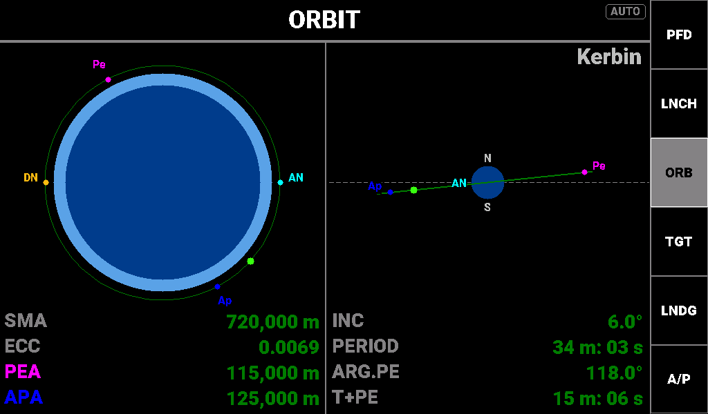

*The same 115 × 125 km orbit, shortly after apoapsis.*

**Purpose.** A picture of the current orbit drawn two ways: face-on (shape, apsides,
atmosphere) and edge-on (inclination), with eight readouts beneath. This is where the
mission panel rests when nothing more urgent is happening.

**Layout.**
- **Body name (top right).** The body you are orbiting.
- **Plan view (left).** The orbit seen face-on, ascending node to the right, travel
  counter-clockwise. The ellipse is always drawn the same size, so its *shape* shows
  eccentricity but its size does not show the orbit's size; read SMA for that.
  - The body is drawn to scale against the orbit, with its atmosphere as a lighter ring
    (Eve, Kerbin, Duna, Jool and Laythe).
  - **Orbit line colour:** green with both apsides above the orbit-safe altitude (the
    atmosphere top, or the highest terrain on an airless body); yellow with either
    apsis below it; orange on an escape trajectory.
  - **Pe** (magenta) and **Ap** (blue) dots with labels. Pe is hidden when periapsis is
    at or below sea level; Ap is hidden on escape.
  - **AN** (cyan) and **DN** (yellow) node dots, drawn when inclination is above 0.5°.
  - The **vessel** is a bright-green dot on the line.
  - On escape the view shows the hyperbola in orange; more than two body radii up it
    switches to a view of the whole sphere of influence (dashed grey circle).
- **Inclination view (right).** The orbit seen edge-on along the line of nodes: a
  dashed equator through the body, N above and S below, and the orbit line tilted by
  the inclination in the same colour as the plan view. The vessel dot slides along it
  and crosses the body at the nodes; Pe and Ap dots show how far north or south of the
  equator each apsis lies.
- **Readout strip (bottom):** four rows under each view.

**Reading the screen.** The line colour is the quick check: green is a stable orbit,
yellow means part of the orbit dips into the atmosphere (it will decay or aerobrake)
or, on an airless body, below the highest terrain (it may hit the ground),
orange means you are leaving the sphere of influence. Use the plan view to see where
Pe and Ap lie relative to the vessel, and the fourth right-hand row for how long until
the next one. A near-flat line in the inclination view means an equatorial orbit; to
change plane, burn as the vessel dot crosses the body. The diagram redraws in small
steps, so during a burn its shape moves in jumps while the numbers change smoothly.

**Special states.** PEA shows `---` with periapsis at or below sea level on a closed
orbit; APA and PERIOD show `∞` on escape. The PEA and APA labels are drawn in the
marker colours (magenta, blue) so each label names its dot.

**Readouts (left half, under the plan view).**

| Label | Description | Colour coding / thresholds |
|---|---|---|
| SMA | Semi-major axis; negative on escape | Green always |
| ECC | Eccentricity, four decimals; 1 or more on escape | Green always |
| PEA | Periapsis altitude | Green; label magenta; `---` at or below sea level |
| APA | Apoapsis altitude | Green; label blue; `∞` on escape |

**Readouts (right half, under the inclination view).**

| Label | Description | Colour coding / thresholds |
|---|---|---|
| INC | Inclination | Green always |
| PERIOD | Orbital period | Green; `∞` on escape |
| ARG.PE | Argument of periapsis | Green always |
| T+PE / T+AP | Time to the next apsis; the label follows whichever comes next | Green; `---` when not available |

**Buttons.** None.

### ORBIT ADVANCED (caption ORB+)

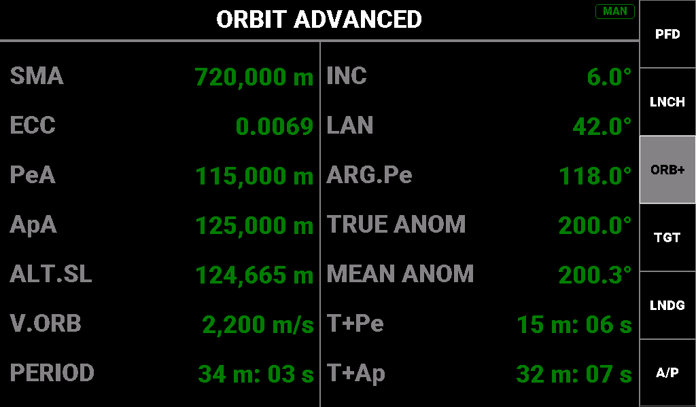

*The same orbit as the ORBIT picture.*

**Purpose.** All fourteen orbital elements as text, for detailed planning: shape and
size on the left, orientation and position on the right. SMA, ECC, PEA, APA and PERIOD
use the same names and formats as ORBIT, so the two screens compare directly.

**Reaching it.** Press ORB on ORBIT. The panel never chooses it, so it shows MAN.

**Reading the screen.** True and mean anomaly give the vessel's position on the orbit;
LAN with ARG.PE fixes the orbit's orientation in space.

**Readouts (left column).**

| Label | Description | Colour coding / thresholds |
|---|---|---|
| SMA | Semi-major axis | Green always |
| ECC | Eccentricity | Green always |
| PEA | Periapsis altitude | Green; `---` below sea level |
| APA | Apoapsis altitude | Green; `∞` on escape |
| ALT.SL | Current altitude above sea level | Green always |
| V.ORB | Orbital speed | Green always |
| PERIOD | Orbital period | Green; `∞` on escape |

**Readouts (right column).**

| Label | Description | Colour coding / thresholds |
|---|---|---|
| INC | Inclination | Green always |
| LAN | Longitude of the ascending node | Green always |
| ARG.PE | Argument of periapsis | Green always |
| TRUE ANOM | True anomaly | Green always |
| MEAN ANOM | Mean anomaly | Green always |
| T+PE | Time to periapsis | Green; `---` when not available |
| T+AP | Time to apoapsis | Green; `∞` on escape; `---` when not available |

**Buttons.** None.

### MANEUVER (caption MNVR)

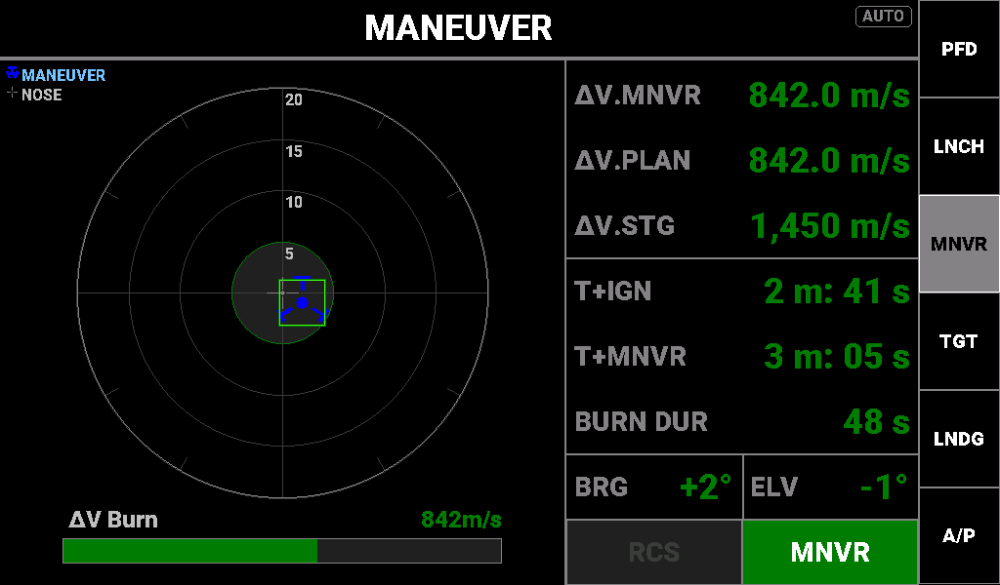

*An 842 m/s node 3 minutes out, nose within 2° of the burn vector, SAS holding the node.*

**Purpose.** Lines you up for and times the next manoeuvre node: a reticle shows the
burn vector against your nose, and the right-hand panel gives the node's Δv, the stage's
Δv, the ignition countdown, burn duration and pointing error.

**Reaching it.** Press ORB twice from ORBIT. Info Display 2 selects it when a node's
ignition is less than 10 minutes away, including during the burn, and holds it until
ignition moves more than about 12 minutes out or the node is removed.

**Layout.**
- **Reticle.** Rings at 5°, 10°, 15° and 20° from the nose; the 5° zone is the shaded
  disc with a green ring. The grey cross at the centre is your nose.
- **Manoeuvre marker.** The blue KSP node symbol, placed by where the burn vector is
  relative to your nose in the vessel's own frame, so pitch and yaw move it as expected
  at any roll. Its distance from the centre is the angle off the nose. Beyond about 17°
  it pins to the rim in dim navy: the direction is still right, but read BRG and ELV for
  the true error.
- **Alignment box.** A bright-green square around the marker when the total error is
  under 5°.
- **ΔV Burn bar.** The node's remaining Δv as a share of the stage's Δv, full when the
  node needs more than the stage has. Green, or yellow when the stage has less than
  1.1 × the node's Δv.

**Reading the screen.**
1. Select MNVR on SAS (the SAS button turns green), or steer until the marker sits on
   the cross. The green box confirms you are within 5°.
2. Watch T+IGN: yellow at 60 s, white on red at 10 s, which means light the engine now.
3. During the burn the bar and ΔV.MNVR count down.
4. A yellow ΔV.STG means the stage has less than 10 % margin over the burn; expect to
   stage partway through.

**Special states.** With no node, the screen shows **NO MANEUVER** in white on red and
rebuilds as soon as a node appears. T+IGN and T+MNVR dash while the node has no Δv;
BURN DUR dashes with no burn duration. BRG and ELV are coloured axis by axis while the
box uses the combined angle, so at 4° and 4° both read green but the box is absent.

**Readouts (right column).**

| Label | Description | Colour coding / thresholds |
|---|---|---|
| ΔV.MNVR | Δv remaining on the next node | Green always |
| ΔV.PLAN | Total Δv of all planned nodes | Green always |
| ΔV.STG | Δv in the current stage | Green; yellow when below 1.1 × ΔV.MNVR |
| T+IGN | Time to ignition: node time minus half the burn duration | Green from 60 s; yellow under 60 s; white on red under 10 s, including once passed |
| T+MNVR | Time to the node itself | Green; yellow under half the burn duration (the burn should be running); white on red once passed |
| BURN DUR | Estimated burn duration | Green always |
| BRG | Burn vector right (+) or left (−) of the nose | Green under 5°; yellow 5°–9°; white on red from 10° |
| ELV | Burn vector above (+) or below (−) the nose | As BRG |

**Buttons.** Indicators only.
- RCS: white on green when on, dark grey when off.
- SAS: MNVR white on green (the right mode for a burn); STAB black on sky blue
  (acceptable, holding attitude); any other mode white on red (wrong for a burn);
  `SAS` dark grey when off.

## Target screens (key 4, TGT)

A first press of TGT opens DOCKING when a target is within 200 m, otherwise TARGET;
pressing it again cycles TARGET → DOCKING → NAVIGATION. TARGET and DOCKING share one
scope design, at two magnifications.

**How the scope works (TARGET and DOCKING).** The grey cross at the centre is your
nose. Markers are drawn in the vessel's own frame, so screen-up is always the craft's
roof and screen-right its right side, the same axes as the RCS translation keys; rolling
the craft swings the markers round the cross, and the rings stay put. A marker's
distance from the centre is its true angle off the nose. Past the scope's pin limit a
marker stops at the rim and dims to half brightness: its direction is still right, but
read the angle readouts for the true value. When the target or your velocity is behind
you, the anti-target or retrograde symbol replaces it. A legend at the top left names
the markers.

### TARGET (caption TGT)

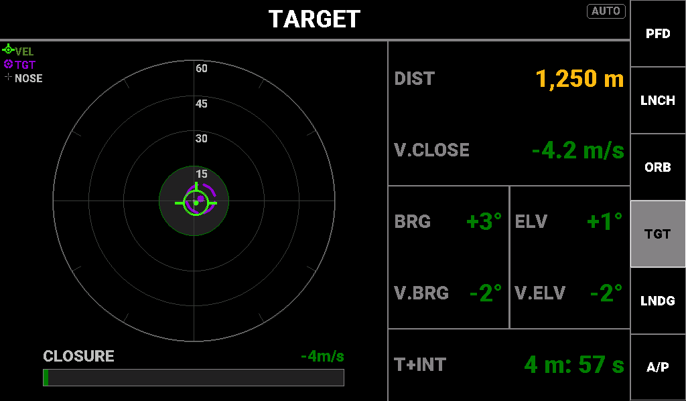

*Closing on a target 1,250 m away at 4.2 m/s, nose 3° off and the approach 2° off.*

**Purpose.** The rendezvous scope for the middle distance: where the target is
relative to your nose, where your velocity relative to the target is heading, and the
range, closure rate and time to intercept. Use it to aim the approach and set the
closing speed before DOCKING takes over inside 200 m.

**Reaching it.** Key 4 as above. Info Display 2 selects it with a target between 200 m
and 2,000 m (once shown it holds from 150 m to 2,400 m), when landed or splashed with a
target set, and on EVA. Info Display 1 never selects it.

**Layout.**
- **Scope.** ±60° full scale. Rings at 15° (green ring around a shaded disc, the good
  zone), 30°, 45° and 60° (the rim), labelled up the vertical axis. Markers pin beyond
  about 51°.
- **TGT marker** (violet, KSP target symbol): the direction to the target.
- **VEL marker** (green, prograde symbol): the direction of your velocity relative to
  the target. It moves the way you thrust.
- **CLOSURE bar** (under the scope): closure speed, full at 250 m/s, with the signed
  value at the right of its label. Green while closing or holding station, yellow when opening,
  red when closing faster than 500 m/s inside 5,000 m.

**Reading the screen.**
1. Point the nose at the TGT marker; BRG and ELV read 0°.
2. Translate until VEL sits on TGT; V.BRG and V.ELV read 0°. They turn yellow at the
   15° ring and white on red at the 30° ring.
3. Keep V.CLOSE negative and moderate; T+INT shows how long you have.
4. When DIST turns white on green (under 200 m), change to DOCKING. In AUTO the panel
   does this itself.

**Special states.** With no target set the screen shows **NO TARGET SET** in white on
red, and the scope returns by itself when you set one. V.BRG and V.ELV show `---` when
the total approach error is over 90° (you are moving away from the target).

**Readouts (right column).**

| Label | Description | Colour coding / thresholds |
|---|---|---|
| DIST | Range to the target | White on green under 200 m (time for DOCKING); yellow under 5,000 m; green otherwise |
| V.CLOSE | Closure rate; negative is closing | White on red faster than 500 m/s inside 5,000 m; yellow when opening (0.05 m/s or more); green when closing or holding station (reads 0.0) |
| BRG | Target bearing from the nose, right positive | Green always |
| ELV | Target elevation from the nose, up positive | Green always |
| V.BRG | Approach-path error left/right: how far right of the target your velocity points | Green under 15°; yellow from 15°; white on red from 30°; `---` past 90° total |
| V.ELV | Approach-path error up/down | As V.BRG |
| T+INT | Time to intercept, DIST ÷ closure speed | Green; `---` unless closing faster than 0.5 m/s |

**Buttons.** None.

### DOCKING (caption DOCK)

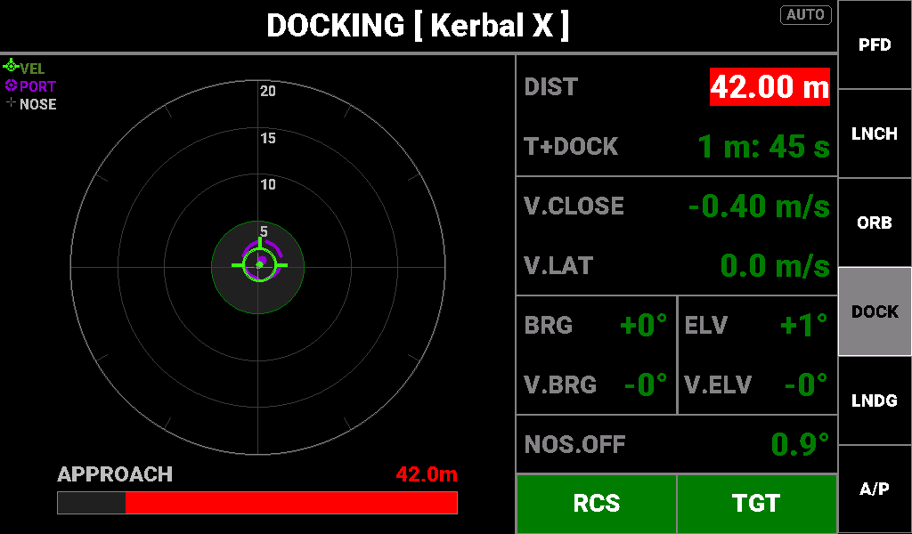

*42 m from the port, closing at 0.4 m/s, nose within 1° of the port, RCS on and SAS on
TARGET.*

**Purpose.** The final-approach reticle for the last 200 m: the TARGET scope at three
times the magnification, with the drift, alignment and time-to-contact figures you fly
the docking on. The title bar carries the vessel name, for example
`DOCKING [ Kerbal X ]`.

**Reaching it.** Key 4: the first press opens it inside 200 m. Info Display 2 selects
it with a target 200 m or closer (it holds to 250 m once shown).

**Layout.**
- **Reticle.** ±20° full scale. Rings at 5° (green, shaded good zone), 10°, 15° and
  20°. Markers pin beyond about 17°; NOS.OFF gives the true angle.
- **PORT marker** (violet): the direction to the target port.
- **VEL marker** (green): your velocity relative to the port. It moves the way you
  thrust: if it sits up and right of the cross, translate left and down to centre it.
  On the cross there is no drift across your nose; on PORT you are flying straight down
  the approach line.
- **APPROACH bar** (under the reticle): fills from the right as you close, empty at
  250 m and full at contact, with the distance at the right of its label. Green, yellow
  under 200 m, red under 50 m.

**Reading the screen.**
1. Put PORT on the cross; NOS.OFF turns green under 5°.
2. Walk VEL onto PORT with RCS translation; V.BRG and V.ELV turn green under 5°.
3. Keep V.LAT green (under 0.1 m/s).
4. Hold V.CLOSE negative: it turns white on red if you close faster than 2 m/s inside
   100 m.
5. T+DOCK turns yellow at 30 s and white on red at 10 s: contact is imminent.

**Special states.**
- **DOCKED** fills the screen in white on green when KSP reports a docking. It stays
  until you undock or switch vessel; the focus change KSP makes just after docking does
  not clear it.
- **NO TARGET SET** fills the screen in white on red while no target is set.
- V.BRG and V.ELV show `---` past 90° of total error. A small negative angle can show
  as `-0°`.

**Readouts (right column).**

| Label | Description | Colour coding / thresholds |
|---|---|---|
| DIST | Range to the target port | White on red under 50 m; yellow under 200 m; green otherwise |
| T+DOCK | Time to contact, DIST ÷ closure speed | White on red under 10 s; yellow under 30 s; green otherwise; `---` unless closing |
| V.CLOSE | Closure rate, always signed, two decimals; negative is closing | White on red faster than 2 m/s inside 100 m; yellow when opening (0.005 m/s or more); green when closing or holding station (reads ±0.00) |
| V.LAT | Lateral drift: speed across the line to the port, one decimal | Green under 0.1 m/s; yellow from 0.1; white on red from 0.5 |
| BRG | Port bearing from the nose, right positive | Green always |
| ELV | Port elevation from the nose, up positive | Green always |
| V.BRG | Approach-path error left/right | Green under 5°; yellow from 5°; white on red from 10°; `---` past 90° total |
| V.ELV | Approach-path error up/down | As V.BRG |
| NOS.OFF | Total angle between your nose and the port, one decimal | Green under 5°; yellow from 5°; white on red from 10° |

**Buttons.** Indicators only.
- RCS: white on green when on, dark grey when off.
- SAS: TGT white on green (the right mode for docking); STAB black on cyan; any other
  mode white on red; `SAS` white on red when SAS is off.

### NAVIGATION (caption NAV)

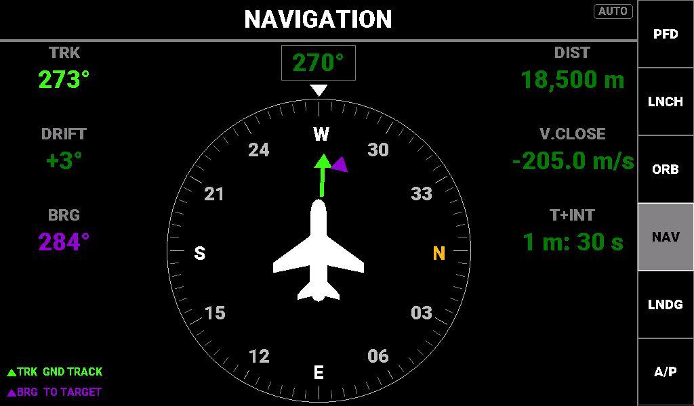

*Heading 270°, tracking 273° with 3° of drift, a target 18.5 km away at bearing 284°.*

**Purpose.** A heading-up plan view for flight in an atmosphere, the partner to the
AIRCRAFT display on the other panel: where the nose points, where the aircraft is
actually going over the ground, the angle between the two (drift, or crab), and the
bearing, range and time to a target. DRIFT appears on no other screen.

**Reaching it.** Key 4: one or two further presses past TARGET (a first press never
lands here). Info Display 2 selects it for a vessel typed **Plane** that is flying in an
atmosphere with apoapsis below its top; a spaceplane whose apoapsis has left the
atmosphere gets ORBIT instead.

**Layout.**
- **Compass card.** Rotates so your heading is always at 12 o'clock, under a fixed
  white nose triangle; the heading box above it shows the heading. N is yellow; ticks
  every 5°. The white aircraft at the centre is you.
- **Ground-track marker and line** (bright green): the direction you are moving over
  the ground. The wedge between the line and 12 o'clock is the drift angle. Hidden
  below 5 m/s.
- **Target marker** (violet): the bearing to the target. Drawn on top where the two
  markers meet.
- **Left column:** TRK, DRIFT and BRG. **Right column:** DIST, V.CLOSE and T+INT.
- **Legend** (bottom left): TRK GND TRACK in green, BRG TO TARGET in violet.

**Reading the screen.** If the green line leans right of 12 o'clock you are drifting
right; DRIFT gives the angle and turns yellow at 10°. To fly to the target, turn until
the violet marker sits under the nose; to arrive with the wind allowed for, put the
violet marker on the green one instead. NAV works without a target; only the target
figures dash out.

**Special states.** Below 5 m/s surface speed the track marker goes and TRK and DRIFT
show `---`. With no target, the violet marker goes and BRG, DIST, V.CLOSE and T+INT show
`---`. T+INT also dashes unless you are closing faster than 0.5 m/s.

**Readouts (right column).**

| Label | Description | Colour coding / thresholds |
|---|---|---|
| DIST | Range to the target | Green; `---` with no target |
| V.CLOSE | Closing speed; negative is closing | Green; `---` with no target |
| T+INT | Time to intercept, DIST ÷ closing speed | Green; `---` with no target or when not closing faster than 0.5 m/s |

**Other readouts (left column).**

| Label | Description | Colour coding / thresholds |
|---|---|---|
| TRK | Ground track: the direction of surface velocity | Bright green; `---` below 5 m/s |
| DRIFT | Track minus heading, signed whole degrees | Green under 10°; yellow from 10° either way; `---` below 5 m/s |
| BRG | Absolute bearing to the target | Violet; `---` with no target |

**Buttons.** None.

## Landing screens (key 5, LNDG)

A first press of LNDG always opens POWERED DESCENT; pressing it again toggles POWERED
DESCENT ↔ RE-ENTRY.

### POWERED DESCENT (caption DESC)

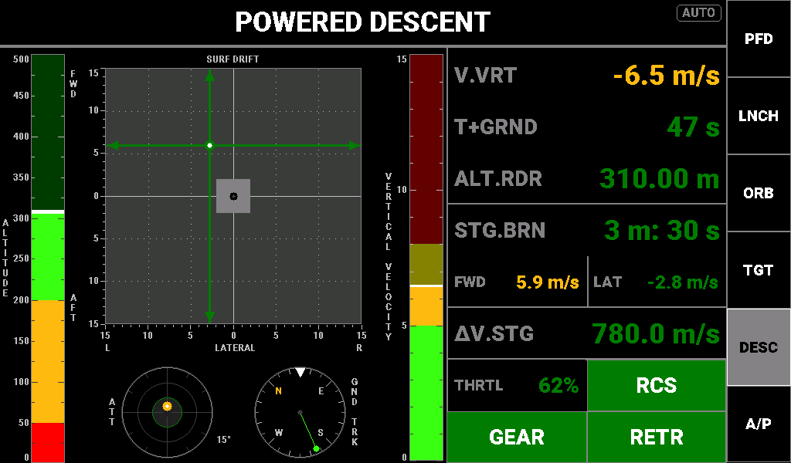

*310 m over the Mun, descending at 6.5 m/s and drifting forward at 5.9 m/s, gear down.*

**Purpose.** The landing screen for a powered touchdown on any body: radar altitude,
descent rate, drift over the ground and how upright the lander is, each against limits
that tighten as touchdown approaches, with time to ground, fuel and the gear, RCS and
SAS states.

**Reaching it.** Key 5. Info Display 2 selects it when descending faster than 5 m/s
below 10 km radar altitude (it holds to 12 km), unless the vessel is a plane in an
atmosphere.

**Layout.**
- **ALTITUDE tape** (far left): radar altitude 0–500 m, filled up to a white marker,
  green above 200 m, yellow 50–200 m, red below 50 m. Above 500 m it reads full. Below
  50 m it rescales to 0–50 m (back above 55 m) with a red marker.
- **SURF DRIFT cross-pointer** (centre): horizontal speed over the ground, ±15 m/s per
  axis. The vertical needle is left/right drift, the horizontal needle fore/aft (up is
  forward); where they cross is your drift, and the black centre dot is zero. The
  lighter square marks ±2 m/s; dotted lines mark ±5 and ±10 m/s. Needle colour follows
  the combined drift against the same limits as FWD and LAT.
- **ATT bullseye** (below left): tilt from vertical, the dot's direction following
  roll. Rim 15°, rings at 5° and 10°. Green under 2°, yellow 2°–5°, red from 5°. Centre
  the dot to stand the lander upright.
- **GND TRK compass** (below right): heading-up rose with the nose at the top; the
  green arrow shows which way you are moving over the ground. Hidden at 1 m/s or less.
- **VERTICAL VELOCITY tape**: descent rate 0–15 m/s, green to 5, yellow 5–8, red 8–15.
  Empty while climbing.

**Reading the screen.**
1. For touchdown keep the vertical-velocity fill and V.VRT green (slower than 5 m/s).
2. Fly the needle crossing onto the centre dot. As T+GRND falls the FWD and LAT limits
   tighten, down to yellow at 1 m/s and red at 2 m/s in the last 10 s.
3. Keep the ATT dot inside the green ring.
4. Have GEAR green before T+GRND turns yellow.
5. Watch STG.BRN and ΔV.STG for fuel.

**Special states.** T+GRND shows `---` in orbit, on an escape path, without radar
altitude, or when not descending. FWD and LAT are capped at ±99.9 m/s.

**Readouts (right column).**

| Label | Description | Colour coding / thresholds |
|---|---|---|
| V.VRT | Vertical speed; negative is descending | Green; yellow faster than 5 m/s down; white on red faster than 8 m/s down |
| T+GRND | Estimated time to ground | Green; yellow under 30 s; white on red under 10 s. Colours relax only 3 s clear of a limit (yellow again at 13 s, green at 33 s); `---` when not applicable |
| ALT.RDR | Radar altitude | Green; yellow under 200 m; white on red under 50 m |
| STG.BRN | Burn time left in the current stage | Green; yellow under 120 s; white on red under 60 s, including 0 s |
| FWD | Forward (+) / aft (−) drift | Set by T+GRND. Over 60 s or `---`: yellow from 20 m/s, no red. 30–60 s: yellow from 5, white on red from 15. 10–30 s: yellow from 2, white on red from 8. 10 s or less: yellow from 1, white on red from 2 |
| LAT | Right (+) / left (−) drift | As FWD |
| ΔV.STG | Δv left in the current stage | Green; yellow under 300 m/s; white on red under 150 m/s |
| THRTL | Throttle | Green always |

**Buttons.** Indicators only.
- RCS: white on green when on, dark grey when off.
- GEAR: white on green when down, dark grey when up.
- SAS shows the mode's name. STAB, RETR and RAD+ (radial out, the Landing Autopilot's
  vertical reference) are white on green; any other mode is white on red, wrong for a
  landing; `SAS` is white on red when SAS is off.

### RE-ENTRY (caption ENTR)

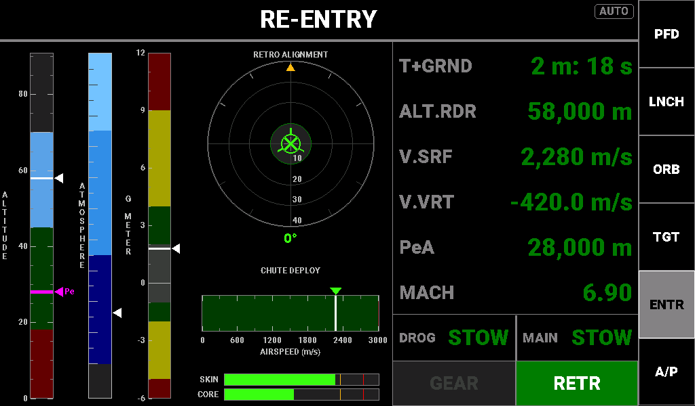

*A capsule at 58 km on Kerbin, periapsis 28 km in the corridor, nose retrograde.*

**Purpose.** The atmospheric entry screen: whether periapsis is in the entry corridor,
how deep in the atmosphere you are, the G load, whether the heat shield faces the
airflow, when each parachute is safe to deploy, and part temperatures.

**Reaching it.** Key 5, a second press. Info Display 2 selects it on a body with an
atmosphere when you are descending with periapsis below the top of the safe corridor
and are above the atmosphere or faster than Mach 3. Once up it stays through the rest of
the descent, parachutes included, until touchdown; thrusting engines hand a powered
landing to POWERED DESCENT, and a plane goes to NAVIGATION below Mach 3. Only an engaged
autopilot and PRE-LAUNCH outrank it.

**Layout.**
- **ALTITUDE (corridor) tape** (far left): altitude above sea level, 0 to 1.3 × the
  atmosphere top, in km. White marker: you. Magenta marker and Pe: periapsis. The bands
  rise for fast entries:
  - **Red**, too steep: below 18 km at Kerbin.
  - **Green**, the safe corridor: up to 45 km at Kerbin.
  - **Cyan**, aerobraking only: up to the atmosphere top (light-grey line).
  - **Near-black**: above the atmosphere, no re-entry.
- **ATMOSPHERE bar**: air density relative to sea level, scaled so that thin upper air
  still registers. The marker parks in the bottom slot in vacuum, and on bodies without
  sea-level density data (density is known for Kerbin, Eve, Duna, Jool and Laythe).
- **G METER**: −6 to +12 g. Green −2 to +4 g (grey nominal band −1 to +2 g), yellow to
  +9 g and −5 g, red beyond.
- **RETRO ALIGNMENT ball**: the marker shows where the airflow comes from (surface
  retrograde). Centred, the nose points retrograde and the heat shield faces the
  airflow. Green under 10°, yellow 10°–30°, red from 30°; AoA under the ball gives the
  angle. The yellow pointer at the top shows bank; the rings are labelled down the lower
  axis.
- **CHUTE DEPLOY bar**: your airspeed against each chute's safe speed, tagged MAIN
  (green) and DROG (yellow). Green zone: main safe; yellow: drogue only; red: neither.
  The zones slide left as the air thickens (about 250 and 500 m/s at Kerbin sea level);
  in thin air a safe speed beyond the end of the scale has no line or tag, and the zone
  colour alone says which chutes are safe. The triangle over your speed takes the same
  colours.
- **SKIN / CORE bars**: the hottest part's temperature as a share of its limit; yellow
  from 75 %, red from 90 %, ticked at both.

**Reading the screen.**
1. Before entry, put the magenta Pe marker in the green band; PEA reads green. Red is
   too steep; cyan means you will only aerobrake.
2. Hold the retrograde marker inside the green ring; SAS RETR shows green.
3. Watch the G meter and SKIN/CORE for loads and heating.
4. Deploy a chute only when its row reads STOW in green and the CHUTE DEPLOY triangle
   is green (main) or at least yellow (drogue).
5. Low down, ALT.RDR and V.VRT pick up the landing limits.

**Special states.** Row 0 reads T+ATM while you are above the atmosphere with
periapsis inside it, and T+GRND otherwise; row 1 reads ALT.SL above the atmosphere and
ALT.RDR inside it. Chute states are remembered until a vessel switch, and CUT is final.

**Readouts (right column).**

| Label | Description | Colour coding / thresholds |
|---|---|---|
| T+ATM | Time until you enter the atmosphere (row 0, above the atmosphere) | Green; `---` with no estimate |
| T+GRND | Time to ground (row 0, inside the atmosphere) | Green; yellow under 30 s; white on red under 10 s, with the same 3 s relax margin as POWERED DESCENT; `---` when not descending |
| ALT.SL | Altitude above sea level (row 1, above the atmosphere) | Green always |
| ALT.RDR | Radar altitude (row 1, inside the atmosphere) | Green; yellow under 500 m; white on red under 50 m |
| V.SRF | Surface speed | Green always |
| V.VRT | Vertical speed | Below 500 m radar altitude: yellow faster than 5 m/s down, white on red faster than 8 m/s down. Green otherwise |
| PEA | Periapsis altitude | By corridor band: white on red too steep; green in the corridor; cyan aerobraking; light grey above the atmosphere |
| MACH | Mach number | Yellow 0.85–1.20 (transonic); green otherwise |
| DROG | Drogue state: STOW, ARM, OPEN or CUT | STOW: green; yellow from 85 % of the drogue's dynamic-pressure limit; white on red at the limit. ARM (cyan): deployed, but the air is too thin to open it. OPEN: yellow while still partly open above 2,500 m; green below; white on red if opened over the limit. CUT: red |
| MAIN | Main chute state | As DROG, with the main chute's limit and full opening at 1,000 m |

The chutes are read from custom action groups: 1 deploys the drogue, 2 cuts it, 3
deploys the main and 4 cuts it.

**Buttons.** Indicators only.
- GEAR: white on green when down, dark grey when up.
- SAS: STAB or RETR white on green; any other mode white on red with its name; `SAS`
  white on red when off above Mach 3, dark grey when off at lower speed.

## Autopilot consoles (key 6 on Info Display 2, A/P)

The autopilots run on the master controller; these consoles set them up and show what
they are doing. They exist on Info Display 2 only, so there is exactly one place that
sends autopilot commands.

### Common behaviour

**The A/P key.** Captioned **A/P** at rest, and with the console's short name (ASC,
ORAP, LDAP, ACAP, RVAP) while one is on screen. It fills green while any autopilot is
armed, engaged or executing.

- **First press** picks a console for the situation, checking in this order:
  1. On the pad (pre-launch), any vessel: ASCENT.
  2. A rover that is landed or splashed: ROVER.
  3. A Plane in an atmosphere: AIRCRAFT.
  4. Any other vessel that is landed or splashed: LANDING.
  5. Descending inside an atmosphere: LANDING.
  6. Descending faster than 5 m/s below 10 km radar altitude: LANDING.
  7. Throttle above 2 %, climbing, periapsis below the surface: ASCENT.
  8. Otherwise: ORBITAL.
- **Repeat presses** cycle only the consoles the vessel type can use:
  - Rockets and most craft: ASC → ORAP → LDAP.
  - Planes: ACAP → ORAP → LDAP.
  - Rovers on the ground: RVAP only; off the ground, RVAP → ORAP → LDAP.
  - Kerbals on EVA, flags and debris: no cycle.
- **Automatic return.** With the chip on AUTO, Info Display 2 goes back by itself to the
  console whose autopilot is flying the vessel (priority ORBITAL, LANDING, AIRCRAFT,
  ROVER, ASCENT). A console with nothing engaged never appears on its own.

**Banner** (the strip under the title):
- Left: the engaged modes in large green text (for example `ALT  HDG  IAS`), or
  `A/P OFF` in grey. The ascent console shows its phase here.
- Centre: a note in orange, either a disconnect or refusal reason (shown for about five
  seconds) or status text such as a burn phase, `IGN IN m:ss`, `SLOPE LIMIT` or
  `STOPPING`.
- Right: `body · vessel` in grey, then the overall state, `ENGAGED`, `ARMED` or
  `EXECUTING` in bright green, or `A/P OFF` in grey. A trailing `...` means a tap is
  still waiting for the master to confirm it. The banner never shows a state the
  autopilot has not reached.

**Mode buttons** have three states, shown in the legend on every console:

| State | Appearance | Meaning |
|---|---|---|
| OFF | Black, thin grey outline | Mode off. A tap engages it. |
| PENDING | Black, cyan outline and text | Your tap is sent but not yet confirmed. A second tap reverses it. Drops back after 3 s if the master refuses. |
| ENGAGED | Green fill | Mode engaged. A tap disengages it. |

Engaging a mode captures the current value as its setpoint, so engagement is bumpless.
Modes in the same group exclude each other.

**Setpoint boxes and keypad.** Tap a boxed value to open the on-screen keypad; the
header gives the field and its range. ENT (green) sends the value, clamped to the range;
the red X cancels; OFF (where offered) disables the function; +/- changes sign where
the field allows it. A box is grey while its mode is off, green while engaged, and cyan
while an edit waits for confirmation. You can edit a setpoint at any time; an engaged
mode retargets to the new value, and setting a box never engages its mode. A rejected
edit stays cyan until you enter a value the autopilot accepts.

**A/P OFF** (orbital, landing, aircraft and rover consoles) turns off *every*
autopilot: it disarms the ascent autopilot, drops all aircraft and rover modes, aborts
any burn or approach hold, and drops all landing modes.

**Pilot input disconnects every autopilot.** Moving the rotation or translation stick
past 10 % for 150 ms, touching the throttle lever while an autopilot drives it, moving
an undriven lever more than 2 %, or pressing a lever button disconnects everything. The
banner shows `STICK` or `A/T OFF: LEVER`. Only one autopilot can steer and one drive
the throttle at a time; engaging another takes over and the previous owner drops with
`OTHER AP`.

**Disconnect and refusal reasons** (orange, banner centre): `STICK`, `A/T OFF: LEVER`,
`BRAKES`, `AIRBORNE`, `ROLL LIMIT`, `NO ATMO`, `TELEMETRY`, `ASCENT ARMED`, `REFUSED`,
`NO NODE`, `NO TARGET`, `SOI CHANGE`, `FUEL`, `LANDED`, `OTHER AP`, `FLARE`, `ARRIVED`,
`ALIGN`, `HANDOFF`, `REPLANNED`. The meaning of each is given with its console below.

### ASCENT AUTOPILOT (caption ASC)

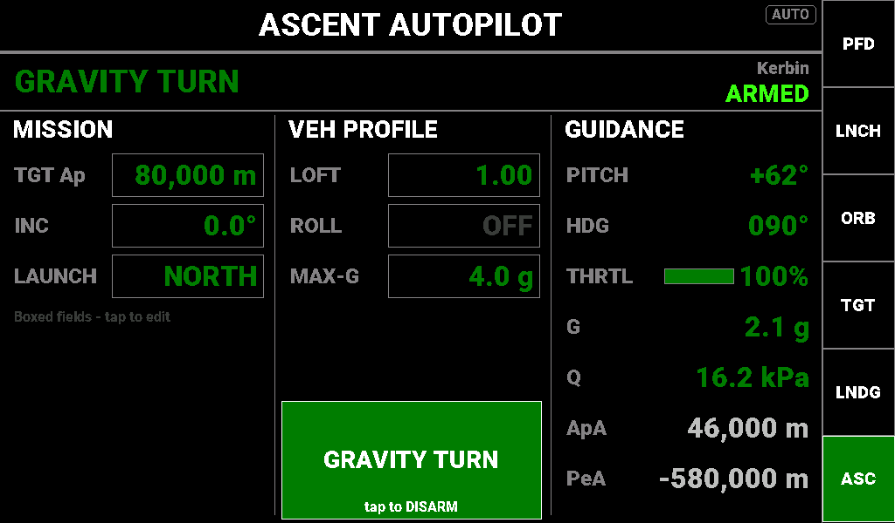

*Armed for an 80 km equatorial orbit, flying the gravity turn.*

**Purpose.** Sets up and arms the launch-to-orbit autopilot: target apoapsis,
inclination, launch direction and vehicle profile. Once armed it flies the vertical
rise, gravity turn, coast and circularisation burn, then hands control back. One
ARM / DISARM button controls it; there are no mode buttons.

**Layout.**
- **MISSION.** TGT AP (target apoapsis, m); INC (target inclination, 0–180°); LAUNCH
  (NORTH or SOUTH, toggled by a tap).
- **VEH PROFILE.** LOFT (trajectory shape, 0.5–2.0: below 1 is aggressive, above 1
  lofted); ROLL (roll hold, ±180°, or OFF); MAX-G (acceleration limit, 0–20 g, or OFF).
- **ARM button.** Disarmed: orange `ARM`. Armed: shows the current phase, filled in the
  phase colour, with "tap to DISARM". While a tap is pending its border turns cyan and
  the hint reads `ARMING...` or `DISARMING...`.
- **GUIDANCE.** Read-only commanded and live values.

**Operating it.**
1. Set TGT AP, INC and LAUNCH, then the profile. Each value is cyan until confirmed.
2. Tap **ARM**. The banner shows `ARMED`, and the A/P key turns green.
3. Launch. The banner and button step through VERTICAL, GRAVITY TURN, COAST,
   CIRCULARIZE and COMPLETE.
4. To stop, tap the button (DISARM), or take the stick or throttle.

**Special states.** Phase colours: IDLE grey; VERTICAL and GRAVITY TURN green; COAST
and CIRCULARIZE cyan; COMPLETE sky blue; ABORT white on red. After a pilot-input
disconnect the console simply shows IDLE / DISARMED, with no reason line. The banner
gives the body name only.

**Readouts (GUIDANCE column).**

| Label | Description | Colour coding / thresholds |
|---|---|---|
| PITCH | Commanded pitch above the horizon | Green always |
| HDG | Commanded heading | Green always |
| THRTL | Commanded throttle, bar and percentage | Green always |
| G | Current load factor | Green; with MAX-G set, yellow from 90 % of MAX-G and red at MAX-G |
| Q | Dynamic pressure, Pa below 1,000, kPa above | Green always |
| APA | Current apoapsis | Light grey always |
| PEA | Current periapsis, negative while suborbital | Light grey always |

### ORBITAL AUTOPILOT (caption ORAP)

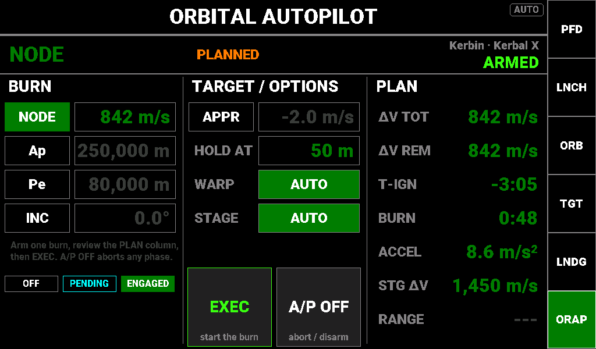

*An 842 m/s node burn armed and planned, waiting for EXEC.*

**Purpose.** Executes one of four burns (the next manoeuvre node, an apoapsis change, a
periapsis change, or a plane change to a target inclination) and runs a rendezvous
approach-rate hold. Burns take two steps: arming plans the burn and fills the PLAN
column; **EXEC** starts it. It never time-warps unless you ask.

**Layout.**
- **BURN.** NODE (box shows the node's Δv, or `NO NODE`), AP and PE (target altitudes,
  m), INC (target inclination). Only one burn can be armed.
- **TARGET / OPTIONS.** APPR engages the approach hold at once (it is not a burn); its
  box is the closing-rate setpoint, −20 to +5 m/s, negative closing. HOLD AT is the
  stand-off distance, 5–5,000 m. WARP and STAGE toggle automatic time-warp and staging
  (AUTO green, OFF black).
- **EXEC.** Bright green and live once a burn is PLANNED. In WARP READY with WARP on
  AUTO it reads **WARP**: a tap warps to ignition. Grey otherwise.
- **A/P OFF.** Aborts and turns everything off.

**Operating it.**
1. For a node burn, create the node in KSP; for AP, PE or INC, enter the target.
2. Tap the burn's mode button. When it turns green the banner shows `PLANNED` and the
   PLAN column fills.
3. Check ΔV TOT, T-IGN, BURN, and STG ΔV against ΔV TOT.
4. Tap **EXEC**. The banner shows `ALIGNING`, then `WARP READY` (tap WARP, or wait),
   then `BURNING`; ΔV REM counts down in bright green and the banner ends on `DONE`.
5. For an approach hold, set the closing rate and HOLD AT, then tap **APPR**.

**Special states.** Phase text in the banner centre: PLANNED, ALIGNING, WARP READY,
WARPING, BURNING and ABORT in orange, DONE in sky blue. Reasons: `NO NODE` (no node, or
it was removed); `REFUSED` (no valid plan, stale telemetry, or closing too fast for the
range); `FUEL` (the burn needs more Δv than the stage has with auto-stage off, or the
stage ran dry); `NO TARGET`; `ALIGN` (not pointed within 2° after 30 s); `REPLANNED`
(the orbit changed after EXEC; tap EXEC again). The AP, PE and INC boxes cannot be edited
while BURNING.

**Readouts (PLAN column).**

| Label | Description | Colour coding / thresholds |
|---|---|---|
| ΔV TOT | Planned burn Δv | Green with a plan; `---` otherwise |
| ΔV REM | Δv still to burn | Bright green while burning; green otherwise; `---` with no plan |
| T-IGN | Time to ignition, counting toward zero, then up after ignition | Orange under 30 s and after ignition; green otherwise; `---` with no plan |
| BURN | Burn duration | Green; `---` with no plan |
| ACCEL | Acceleration estimate, m/s² | Green; `---` with no estimate |
| STG ΔV | Δv in the current stage | Orange when a plan needs more than the stage has; green otherwise |
| RANGE | Distance to the target | Green with a target; `---` without |

### LANDING AUTOPILOT (caption LDAP)

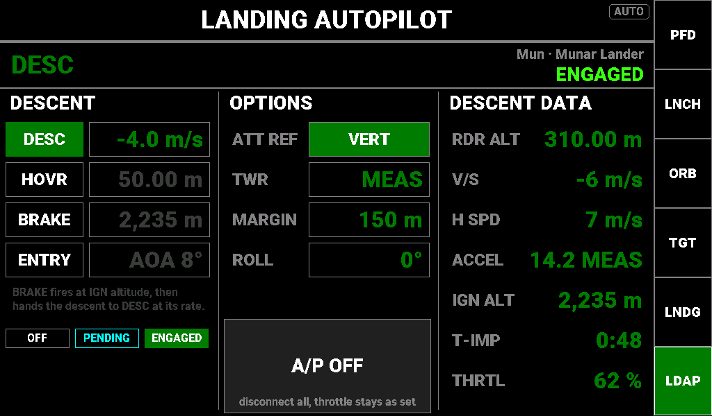

*Holding −4 m/s on descent 310 m over the Mun, radial attitude reference.*

**Purpose.** Four landing modes: **DESC** holds a vertical speed with the throttle,
**HOVR** holds a radar altitude, **BRAKE** arms a suicide burn that fires at a computed
ignition altitude and then hands over to DESC, and **ENTRY** holds a re-entry angle of
attack and roll. DESC, HOVR and BRAKE exclude each other; ENTRY is separate.

**Layout.**
- **DESCENT.** DESC (rate, −50 to +20 m/s); HOVR (height above ground, 2–5,000 m);
  BRAKE (box shows the computed ignition altitude, not editable); ENTRY (angle of
  attack, −30 to +40°).
- **OPTIONS.** ATT REF toggles RETRO (surface retrograde, kills horizontal speed) and
  RADIAL (straight up, a vertical descent). TWR overrides the thrust-to-weight used for
  BRAKE (0–20, or OFF to use the measured or estimated value, shown MEAS or EST).
  MARGIN adds metres to the ignition altitude (0–5,000). ROLL is the ENTRY roll angle.
- **A/P OFF.** Disconnects everything; the throttle is left where it is.

**Operating it.**
1. Set DESC to your touchdown rate (for example −4 m/s) and choose ATT REF.
2. On a fast approach tap **BRAKE**: IGN ALT shows the ignition altitude and the banner
   counts down `IGN IN m:ss`. At ignition the banner shows `FIRING`; when vertical
   speed reaches the DESC rate, DESC takes over.
3. Or tap **DESC** for a rate-controlled descent, or **HOVR** to hold the current height.
4. On touchdown the throttle goes to zero, everything disconnects and the banner shows
   `LANDED`.
5. For re-entry, set the ENTRY angle and ROLL and tap **ENTRY**. Rockets disconnect at
   250 m/s; planes hand over to the aircraft autopilot (`HANDOFF`).

**Special states.** The BRAKE box and IGN ALT turn orange when the burn is marginal,
needing more than 90 % of the available acceleration. Reasons: `REFUSED` (on the ground,
stale telemetry, or less than 1.2 g available for BRAKE); `LANDED`; `HANDOFF`; `FUEL`
(annunciated, the throttle is kept).

**Readouts (DESCENT DATA column).**

| Label | Description | Colour coding / thresholds |
|---|---|---|
| RDR ALT | Radar altitude | Green always |
| V/S | Vertical speed | Orange when time to impact is under 30 s; green otherwise |
| H SPD | Horizontal speed | Green always |
| ACCEL | Acceleration estimate and its source (MEAS, EST or TWR) | Green; `---` with no estimate |
| IGN ALT | Computed BRAKE ignition altitude | Orange when marginal; green; `---` when unknown |
| T-IMP | Time to impact at the current descent rate | Orange under 30 s; green; `---` when not descending |
| THRTL | The landing autopilot's commanded throttle | Green while DESC, HOVR or BRAKE is engaged; grey otherwise |

### AIRCRAFT AUTOPILOT (caption ACAP)

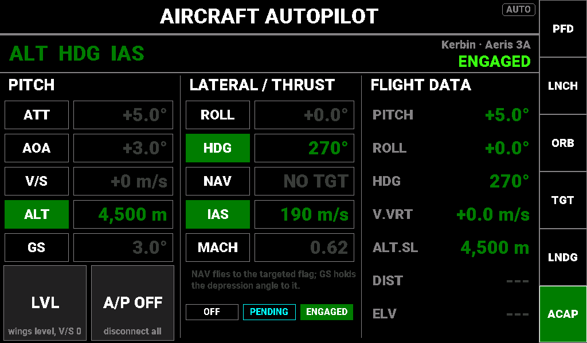

*Cruise holds engaged: 4,500 m, heading 270°, 190 m/s.*

**Purpose.** Hold modes for aircraft in three groups: **pitch** (ATT, AOA, V/S, ALT, GS),
**lateral** (ROLL, HDG, NAV) and **thrust** (IAS, MACH, driving the motorised throttle
lever). One mode per group can be engaged and the groups combine freely; ALT + HDG + IAS
is normal cruise. NAV and GS fly an approach to a targeted flag.

**Layout.**
- **PITCH.** ATT (pitch attitude, ±45°); AOA (−10 to +25°); V/S (±100 m/s); ALT (0–70,000
  m); GS (glide slope, the depression angle to the target, 1–10°).
- **LVL** engages ROLL 0° and V/S 0 in one tap. **A/P OFF** disconnects everything.
- **LATERAL / THRUST.** ROLL (±60°); HDG; NAV (box shows the bearing to the target, or
  `NO TGT`); IAS (20–1,500 m/s); MACH (0.10–6.00).
- Commanded throttle is not shown: with IAS or MACH engaged, the throttle lever itself
  is the readout.

**Operating it.**
1. In level flight, tap **ALT**, **HDG** and **IAS**; each captures its current value.
2. To change a target, tap its box and enter the new value.
3. For an approach, target a flag and engage **NAV** and **GS**. GS drops at 200 m range
   (`FLARE`); the flare is yours.
4. Tap **LVL** to recover, **A/P OFF** or any stick or lever input to hand back.

**Special states.** Reasons: `REFUSED` (no atmosphere, stale telemetry, or IAS/MACH with
the throttle module in precision mode); `NO TARGET` (NAV or GS without a target);
`NO ATMO` (out of the atmosphere for more than 2 s); `FLARE`. `LEVER OFF` in grey means
the autothrottle is engaged but the throttle module is not following it. An attitude
mode turns stock SAS off; a full disconnect returns SAS to stability assist.

**Readouts (FLIGHT DATA column).**

| Label | Description | Colour coding / thresholds |
|---|---|---|
| PITCH | Live pitch | Green always |
| ROLL | Live bank | Green always |
| HDG | Live heading | Green always |
| V/S | Live vertical speed | Green always |
| ALT | Altitude above sea level | Green always |
| DIST | Distance to the target | Green with a target; `---` without |
| TGT EL | Elevation angle to the target, negative below you | Green with a target; `---` without |

### ROVER AUTOPILOT (caption RVAP)

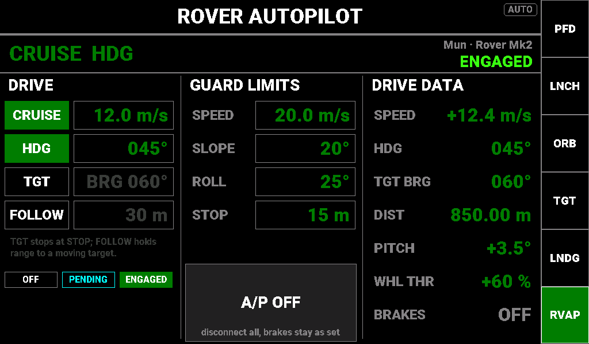

*Cruise at 12 m/s on heading 045° on the Mun.*

**Purpose.** Drive modes: **CRUISE** holds a signed ground speed (negative is reverse),
**HDG** steers to a heading, **TGT** drives to the target and stops short of it, and
**FOLLOW** holds a range to a moving target. Guard limits cap speed on slopes and stop
the rover if it rolls too far.

**Layout.**
- **DRIVE.** CRUISE (−10 to +60 m/s); HDG; TGT (box shows the target bearing, or
  `NO TGT`); FOLLOW (range, 5–500 m). HDG, TGT and FOLLOW all steer, so only one can be
  engaged.
- **GUARD LIMITS.** SPEED (cruise cap, 1–60 m/s); SLOPE (5–45°: cruise speed is scaled
  down on steeper grades); ROLL (5–60°: beyond it the rover stops and brakes); STOP (TGT
  stop distance, 2–200 m).
- **A/P OFF.** Disconnects everything; the brakes are left as they are.

**Operating it.**
1. Check the guard limits.
2. Tap **CRUISE** (it captures your speed) and edit its box for a new speed; tap **HDG**
   to hold your heading.
3. To drive to a target, set one, engage **TGT** with CRUISE, and set STOP. Inside
   200 m the banner shows `STOPPING`; at the STOP distance the rover brakes and the
   banner shows `ARRIVED`.
4. Engage **FOLLOW** to shadow a moving vessel at its range.
5. Stop with **A/P OFF**, the brakes (which drop CRUISE with `BRAKES`), or any stick or
   lever input.

**Special states.** `SLOPE LIMIT` while the slope guard is reducing speed. Reasons:
`ROLL LIMIT` (roll passed the limit; cruise drops and the brakes stay on until you
release them); `AIRBORNE` (not touching the ground for more than half a second);
`REFUSED` (engaged off the ground or with stale telemetry, or the target was lost).

**Readouts (DRIVE DATA column).**

| Label | Description | Colour coding / thresholds |
|---|---|---|
| SPEED | Signed ground speed; negative when moving backward | Orange while the slope guard acts or while STOPPING; green otherwise |
| HDG | Live heading | Green always |
| TGT BRG | Bearing to the target | Green with a target; `---` without |
| DIST | Distance to the target | Orange while STOPPING; green with a target; `---` without |
| PITCH | Live pitch, the slope | Orange while the slope guard acts; green otherwise |
| WHL THR | Commanded wheel throttle | Green while CRUISE or FOLLOW is engaged; grey otherwise |
| BRAKES | Brakes on or off | ON yellow; OFF grey |
