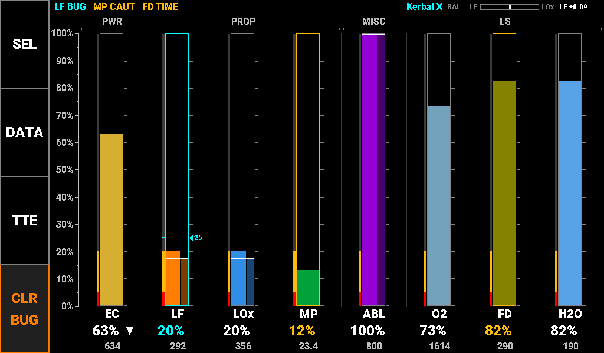
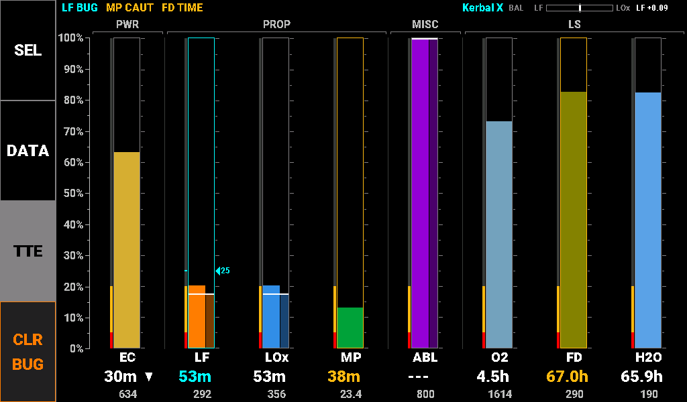
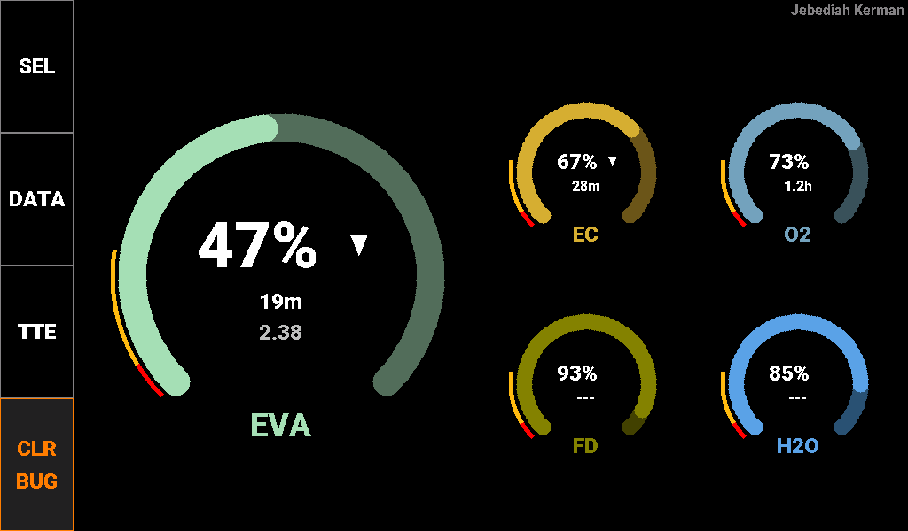
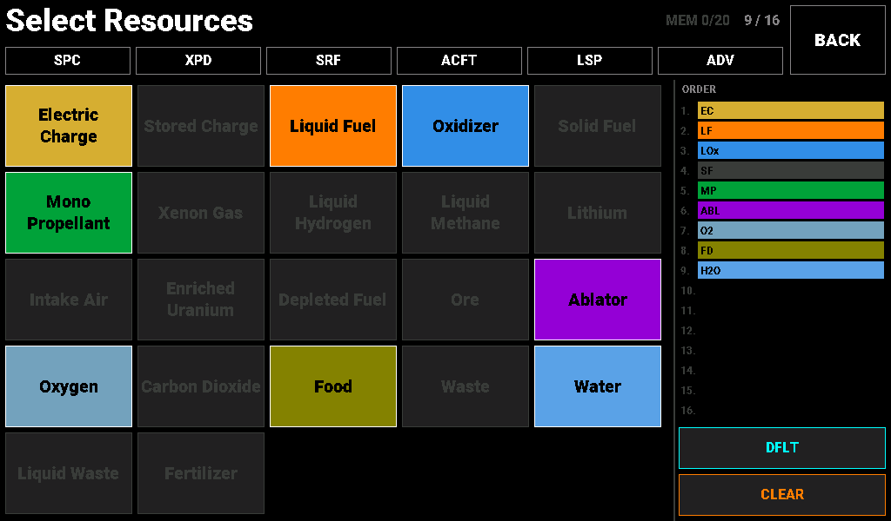
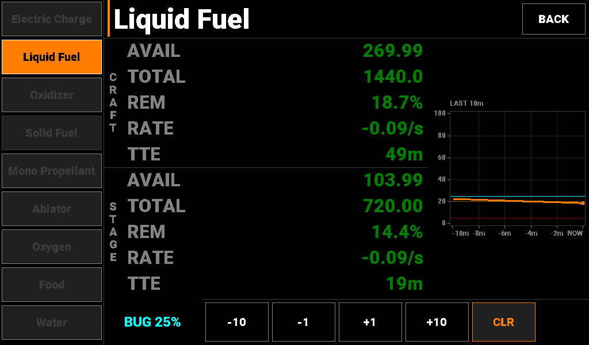

# Resource Display — Screen Reference

**Document type:** User
**Location:** `Documents/User/Resource_Display_Reference.md`
**Applies to:** KCMk1_ResourceDisp firmware 3.14.3

Every picture in this document is a true rendering: the firmware's own drawing code, run
on a computer against a model of the display controller, in the flight state the caption
describes. Thresholds are the firmware defaults in `AAA_Config.ino` and the shared
`KCMk1_SystemConfig.h`. The same content forms the Resource Display section of the
Technical Information Manual.

The Resource Display is the resource monitor of the controller system. It shows the levels of up to 16 resources at once as a row of tape meters grouped by subsystem, flags any that are running low, and gives the rate and time to empty for each. The set of resources shown is chosen by the pilot and remembered for each vessel.

The panel has four screens: Main (the tape meters, with an EVA layout while a Kerbal is on EVA), Select (choosing the resources), Detail (one resource in numbers), and Standby (splash screen when idle). Most resources require the Alternate Resource Panel mod; the life support resources require TAC Life Support, and the CRP resources require the Community Resource Pack plus two blocks in KerbalSimpit's `Settings.cfg` (see the panel's README). A meter for a resource the vessel does not carry, or whose mod is not installed, is not drawn.

## Main Screen

The Main screen is displayed whenever a KSP flight scene is active. It is divided into four areas:

- Sidebar keys (left edge)
- Alert strip (top)
- Tape meters (center)
- Counter rows (under each meter)

The picture below shows a ship in orbit carrying the default SPC resource set. Liquid fuel is below the reserve bug set at 25 %, monopropellant is in caution, and food has reached its time-remaining caution. Solid fuel is part of the set but not aboard, so it draws no meter.

### Sidebar Keys

The four sidebar keys on the left edge are described below. The keys are plain white on black so that the screen’s colors belong to the meters.

**Resource Display Sidebar Keys**

| Key | Definition |
|---|---|
| SEL | Opens the Select screen to choose the resources shown |
| DATA | Opens the Detail screen |
| TTE | Switches every counter row between percent and time to empty. The key reverses (black on grey) while time to empty is shown |
| CLR BUG | Removes every reserve bug on the vessel (orange, because it discards pilot-entered values) |

### Alert Strip

The strip across the top lists every meter in caution or alarm, worst first. A tap on a message opens the Detail screen on that resource. The right end of the strip shows the vessel name (cyan when the layout came from the vessel’s memory, grey when it is the default) and, when both liquid fuel and oxidizer are shown, the propellant balance indicator. The messages:

**Alert Strip Messages**

| Label | Description | Thresholds |
|---|---|---|
| LF LOW | A resource below its alarm level (DFu HIGH for Depleted Fuel filling up) | Warning: alarm; flashes for 3 s when new |
| MP CAUT | A resource below its caution level | Caution |
| LF BUG | A resource past the reserve bug the pilot set | Cyan |
| O2 TIME | A resource whose time remaining has reached a caution or alarm tier | Caution: caution tier; Warning: alarm tier |
| REFRESHING | The panel is waiting for KSP to resend resource data after a change | N/A |
| +N | More messages than fit on the strip | N/A |
| BAL | Propellant balance: deflects toward the propellant in surplus against KSP’s 9:11 burn ratio, with the surplus in units (for example LF +0.09) | N/A |

### Tape Meters

Each meter is a narrow tape filled in the resource’s own color to the vessel total. Its parts are described below. Meters are arranged in subsystem groups: PWR, PROP, NUC, MISC, LS and AGR. Up to nine meters draw at standard size; ten to sixteen draw compact.

**Tape Meter Elements**

| Element | Description |
|---|---|
| Group label | Bracketed label over each subsystem group, with a divider between groups. |
| Limit band | Left of the tape: the alarm (red) and caution (yellow) levels painted on the scale, visible at all times. Consumables band at the bottom, Depleted Fuel at the top; Ore, Intake Air and the life-support waste resources (CO2, Waste, Liquid Waste) have none. |
| Tape frame | Grey when nominal; yellow or red when the level is in a band; cyan when past the reserve bug. |
| Stage column | For Liquid Fuel, Oxidizer, Solid Fuel, Xenon and Ablator the tape is split: the wide column is the vessel total, the narrow half-bright column the active stage, with a white line at the stage level. |
| Reserve bug | A cyan index and its percent, set by the pilot. Crossing it turns the meter cyan and adds a BUG message; a bug never raises an alarm. |
| Scale | Shared 0–100 % axis beside the sidebar; ticks every 5 % on each tape. |

Touch a meter to open the Detail screen on it. Hold a finger still on a tape for 1 s to set a reserve bug at that level (on a 5 % step); hold on an existing bug to clear it, or drag it to move it in 1 % steps.

### Counter Rows

Under each meter are its label, a counter and the raw amount. The counters are described below, followed by the same ship with the TTE key engaged.

**Resource Counter Parameter Guide**

| Label | Description | Thresholds |
|---|---|---|
| Percent | Level as a percentage of capacity (TTE key off) | Nominal: white text; Caution: below the caution level; Warning: below the alarm level; Cyan: past the reserve bug |
| TTE | Time to empty at the current rate (time to full for a waste resource), with the TTE key engaged: M:SS, MMm, H.Hh, Dd Hh | As Percent; Dark grey: --- when steady or filling |
| Trend arrow | Right of the counter: rising or falling while the level is moving | N/A |
| Units | Raw amount aboard (1.23, 12.3, 123, 1234, 12.3k) | N/A |
| ... | Waiting for the resource’s first reading after a change | N/A |

Caution and alarm levels are set per resource, as listed below. Electric charge, oxygen, water and food also alert on the time they have left at the current rate. These are the same levels the Annunciator uses for its PROP LOW, RCS LOW and LIFE SUPPORT tiles.

**Resource Caution and Alarm Levels**

| Label | Description | Thresholds |
|---|---|---|
| Consumables | Every resource that runs down: EC, LF, LOx, SF, MP, Xenon, O2, Food, Water and the rest | Caution: <20%; Warning: <5% |
| Depleted Fuel | Depleted Fuel, which fills up | Caution: >80% full; Warning: >95% full |
| Ore, Intake Air, LS waste | No limit bands. CO2, Waste and Liquid Waste still count time to full | N/A |
| EC time | Time to empty electric charge | Caution: <15 min; Warning: <5 min |
| O2 time | Time to empty oxygen | Caution: <30 min; Warning: <10 min |
| H2O time | Time to empty water | Caution: <12 h; Warning: <4 h |
| Food time | Time to empty food | Caution: <72 h; Warning: <24 h |

## Resource Reference

The table lists all 23 supported resource types with their short label (used on the meters and in the Detail selector), full name (used on the Select screen buttons) and meter fill color.

**Resource Type Reference**

| Group | Label | Full Name | Color | Hex (RGB24) |
|---|---|---|---|---|
| Power | EC | Electric Charge | GOLD | #D6AE31 |
| Power | StC | Stored Charge | LIME | #C6FF42 |
| Propellant | LF | Liquid Fuel | ORANGE | #FF7D00 |
| Propellant | LOx | Oxidizer | FRENCH BLUE | #318EE7 |
| Propellant | SF | Solid Fuel | BRICK | #C65129 |
| Propellant | MP | Mono Propellant | MEDIUM GREEN | #00A239 |
| Propellant | EVA | EVA Propellant | MINT | #A5DFB5 |
| Propellant | XE | Xenon Gas | MAGENTA | #FF00FF |
| Propellant | LH2 | Liquid Hydrogen | SKY | #73C3FF |
| Propellant | LMe | Liquid Methane | OCEAN | #003C8C |
| Propellant | Li | Lithium | ROSE | #F7797B |
| Propellant | AIR | Intake Air | SILVER | #C6C3C6 |
| Nuclear | EUr | Enriched Uranium | NEON GREEN | #39FF10 |
| Nuclear | DFu | Depleted Fuel | SAP GREEN | #527D29 |
| Other | ORE | Ore | TAN | #B58E52 |
| Other | ABL | Ablator | VIOLET | #9400D6 |
| Life Support | O2 | Oxygen | AIR SUPPLY BLUE | #73A2BD |
| Life Support | CO2 | Carbon Dioxide | PLUM | #943C84 |
| Life Support | FD | Food | OLIVE | #848200 |
| Life Support | WST | Waste | BROWN | #844100 |
| Life Support | H2O | Water | AQUA | #5AA2E7 |
| Life Support | LWS | Liquid Waste | STRAW | #EFC773 |
| Agriculture | FER | Fertilizer | UPS BROWN | #634118 |

## EVA Screen

While a Kerbal is on EVA, the Main screen shows a fixed set of five resources as 270° ring gauges: one large gauge for EVA Propellant and four small ones for Electric Charge, Oxygen, Food and Water. The vessel’s own layout is restored when the Kerbal boards again. The sidebar, alert strip and gestures work as on the Main screen, and the Kerbal’s name replaces the vessel name.

The picture shows a Kerbal on EVA with the jetpack at 47 %.

Each ring fills clockwise from the lower left in the resource’s color. The limit bands are thin red and yellow arcs outside the ring at the low end, and a reserve bug is a cyan dot. Inside each ring are the percent counter with its trend arrow and, always shown, the time to empty; the large gauge adds the raw amount. While on EVA no other resources can be added on the Select screen.

## Select Screen

The Select screen chooses which resources the Main screen shows. It is opened with the SEL key and closed with BACK. The picture shows it for the ship on the Main screen above.

Tap a resource in the grid to add or remove it; selected resources fill in their own color, and a resource the vessel does not carry is dimmed and cannot be selected. The ORDER list on the right shows the meters in the order the Main screen draws them. The counter at the top shows the slots in use (up to 16) and how many vessels are remembered (up to 20). The keys:

**Select Screen Keys**

| Key | Definition |
|---|---|
| SPC | Spacecraft preset: EC, LF, LOx, MP, SF, O2, Food, Water, Ablator. Also the built-in default layout |
| XPD | Expedition preset: nuclear and hydrogen deep-space craft |
| SRF | Surface preset: rover, lander or ISRU base, including Stored Charge and Ore |
| ACFT | Aircraft preset: EC, LF, Intake Air, MP, O2, Food, Water (no oxidizer) |
| LSP | Life support preset: every TAC Life Support resource |
| ADV | Advanced preset: every modded resource, sixteen meters |
| DFLT | Makes the current set, with its reserve bugs, the default for vessels not in memory. Lit cyan when the current set is the default. CLEAR then DFLT returns to the SPC default |
| CLEAR | Empties the set. Leaving a vessel with an empty set forgets that vessel. Hold for 3 s to forget every vessel; the default layout is kept |
| BACK | Returns to the Main screen |

Presets replace the current set and skip anything the vessel does not carry. Each vessel’s set and its reserve bugs are remembered by vessel name and kept through power cycles; a vessel not in memory starts from the default layout.

## Detail Screen

The Detail screen shows one resource in numbers, with a ten-minute history of its level. It is opened with the DATA key, or by tapping a meter or an alert-strip message, and closed with BACK. The picture shows liquid fuel during a slow burn, with a reserve bug at 25 %.

The selector column on the left has one key per resource in the set; a resource the vessel does not carry is dimmed. Resources with stage data (Liquid Fuel, Oxidizer, Solid Fuel, Xenon and Ablator) show CRAFT and STAGE sections; the rest show CRAFT only.

**Detail Screen Parameter Guide**

| Label | Description | Thresholds |
|---|---|---|
| AVAIL | Amount available, in units | N/A |
| TOTAL | Capacity, in units | N/A |
| REM | Amount remaining as a percentage of capacity | N/A |
| RATE | Signed rate of change per game second (per minute or hour when smaller) | N/A |
| TTE / TTF | Time to empty, or time to full for a waste resource | Dark grey: --- when steady |
| History | Level over the last ten minutes on a fixed 0–100 % scale, newest at the right, with the caution and alarm levels as faint lines and the reserve bug in cyan | N/A |
| BUG | The resource’s reserve bug. The −10, −1, +1 and +10 keys set it to an exact percent; CLR removes it | Cyan |

## Standby Screen

Outside a flight scene the Resource Display shows the standby splash. No action is required; the panel switches to the Main screen when a flight scene starts.

