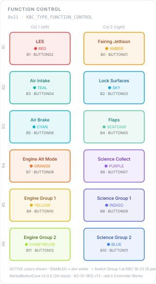

# KCMk1_Function_Control

**Module:** Function Control  
**Version:** 2.1  
**Date:** 2026-10-27  
**Author:** J. Rostoker — Jeb's Controller Works  
**License:** GNU General Public License v3.0 (GPL-3.0)  
**Hardware:** KC-01-1812 Wide Button Module Base v1.1  
**Library:** KerbalButtonCore v2.0.0 (24-input)  

---

## Overview

The Function Control module provides launch, flight-system, aerodynamic, and engine/science group functions for Kerbal Space Program over 12 NeoPixel RGB buttons, plus the eight **Switch Group 1** panel switches read as discrete inputs.

This module reads **24 inputs** via three daisy-chained 74HC165 shift registers: the 12 NeoPixel buttons at KBC indices 0–11, and Switch Group 1 at KBC indices 16–23. KBC indices 12–15 are no-connects. The 24-input variant is selected in the sketch via `#define KBC_INPUT_COUNT 24` / `KBC_SHIFTREG_COUNT 3`.

The button layout and colours follow the confirmed panel layout in Module UI Reference v6.0 §9.2. Each button toggles a custom action group on the master, with the control-group offset: CAG = base + (control group − 1) × 40 (Module UI Reference §4).

---

## Module Identity

| Parameter | Value |
|---|---|
| I2C Address | `0x21` |
| Module Type ID | `0x02` (KBC_TYPE_FUNCTION_CONTROL) |
| Capability Flags | `0x00` (core states only) |
| Extended States | No |
| NeoPixel Buttons | 12 (KBC indices 0–11) |
| Switch Group 1 inputs | 8 (KBC indices 16–23, discrete, no LED) |
| Not Installed | KBC indices 12–15 (no-connect) |
| Data packet | 9 bytes (3-byte header + 6-byte payload) |

---

## Panel Layout

Physical panel orientation: 6 rows × 2 columns, viewed from the front. Column 1 is leftmost and holds the odd KBC indices (B1 LES at the top); Column 2 is rightmost and holds the even KBC indices (B0 Fairing Jettison at the top). B0 is the top-right button.



Active state colors shown. All buttons illuminate dim white in the ENABLED state.

---

## Button Reference

### NeoPixel Buttons (KBC indices 0–11)

| KBC Index | PCB Label | Function | Base CAG | Active Color | Color Family |
|---|---|---|---|---|---|
| B0 | BUTTON01 | Fairing Jettison (FAIRING JETT) | 26 | AMBER | Awareness |
| B1 | BUTTON02 | LES (Launch Escape System) | 25 | RED | Irreversible |
| B2 | BUTTON03 | Lock Surfaces | 34 | SKY | Awareness |
| B3 | BUTTON04 | Air Intake | 33 | TEAL | Atmosphere family |
| B4 | BUTTON05 | Flaps | 39 | SEAFOAM | Atmosphere family |
| B5 | BUTTON06 | Air Brake | 38 | CYAN | Atmosphere family |
| B6 | BUTTON07 | Science Collect | 28 | PURPLE | Science family |
| B7 | BUTTON08 | Engine Alt Mode | 27 | ORANGE | Engine family |
| B8 | BUTTON09 | Science Group 1 | 30 | INDIGO | Science family |
| B9 | BUTTON10 | Engine Group 1 | 29 | YELLOW | Engine family |
| B10 | BUTTON11 | Science Group 2 | 32 | BLUE | Science family |
| B11 | BUTTON12 | Engine Group 2 | 31 | CHARTREUSE | Engine family |
| B12–B15 | — | No-connect (PCB) | — | — | — |

Each button toggles its CAG (base + (control group − 1) × 40). The CAG numbers stay with the function, so the swap to the confirmed layout does not change vessels' action-group setups. The B4 panel label still reads RW DISABLE until the label is replaced with FLAPS (Module UI Reference §15).

### Switch Group 1 (KBC indices 16–23, discrete inputs, no LED)

Reported in the button-event payload (inputs 16–23). Switch semantics and controller actions are resolved on the main controller; the module reports raw input state only.

| KBC Index | Switch | OFF / ON |
|---|---|---|
| B16 | MSTR | OPER / RESET |
| B17 | DISP | OPER / CLR |
| B18 | SCE | NORM / AUX |
| B19 | UPTLM | INHIB / XMIT |
| B20 | LTG | NORM / TEST |
| B21 | A/P | INHIB / ARM |
| B22 | ENGINE | SAFE / ARM |
| B23 | THRTL | STD / FINE |

### Color Design Notes

- **Engine family (ORANGE → YELLOW → CHARTREUSE)** — warm gradient from Engine Alt Mode through Engine Groups 1 and 2.
- **Science family (PURPLE → INDIGO → BLUE)** — gradient from Science Collect down through the groups.
- **Atmosphere family (TEAL, CYAN, SEAFOAM)** — Air Intake, Air Brake and Flaps.
- **LES (RED)** — irreversible jettison action; strongest possible visual warning.
- **Awareness (AMBER / SKY)** — Fairing Jettison (amber); Lock Surfaces (sky).

---

## LED States

This module uses core LED states only. No extended states (WARNING, ALERT, ARMED, PARTIAL_DEPLOY) are implemented.

| State | Behavior | Trigger |
|---|---|---|
| OFF | Unlit | Controller sends `0x0` for this button |
| ENABLED | Dim white backlight | Controller sends `0x1` — button ready |
| ACTIVE | Full brightness, button color | Controller sends `0x2` — function engaged |

---

## Wiring

Button inputs are connected to the three-register shift chain (U14/U15/U16):

| PCB Connector | PCB Label | KBC Index | Function |
|---|---|---|---|
| P2 | BUTTON01 | 0 | Fairing Jettison |
| P2 | BUTTON02 | 1 | LES |
| P2 | BUTTON03 | 2 | Lock Surfaces |
| P2 | BUTTON04 | 3 | Air Intake |
| P3 | BUTTON05 | 4 | Flaps |
| P3 | BUTTON06 | 5 | Air Brake |
| P3 | BUTTON07 | 6 | Science Collect |
| P3 | BUTTON08 | 7 | Engine Alt Mode |
| P4 | BUTTON09 | 8 | Science Group 1 |
| P4 | BUTTON10 | 9 | Engine Group 1 |
| P4 | BUTTON11 | 10 | Science Group 2 |
| P4 | BUTTON12 | 11 | Engine Group 2 |
| — | (no-connect) | 12–15 | Not connected |
| DB127S #1 | SW1–4 | 16–19 | Switch Group 1: MSTR, DISP, SCE, UPTLM |
| DB127S #2 | SW5–8 | 20–23 | Switch Group 1: LTG, A/P, ENGINE, THRTL |

---

## Installation

### Prerequisites

1. Arduino IDE with megaTinyCore installed
2. KerbalButtonCore library installed (`Sketch → Include Library → Add .ZIP Library`)
3. ShiftIn library installed (InfectedBytes/ArduinoShiftIn)
4. tinyNeoPixel_Static included with megaTinyCore — no separate install needed

### Arduino IDE Settings

| Setting | Value |
|---|---|
| Board | ATtiny816 (megaTinyCore) |
| Clock | 10 MHz internal or higher |
| tinyNeoPixel Port | **Port A** — critical for NeoPixel timing |
| Programmer | jtag2updi or SerialUPDI |

### Flash Procedure

1. Open `KCMk1_Function_Control.ino` in Arduino IDE
2. Confirm IDE settings above
3. Connect UPDI programmer to the module's UPDI header
4. Click Upload

### Verify Operation

After flashing, the module powers on dark (BOOT_READY → DISABLED). Once the controller sends `CMD_ENABLE`, all 12 NeoPixel buttons illuminate in a dim white ENABLED state. Verify the Switch Group 1 inputs (KBC indices 16–23) are reported in the data packet. Use the `DiagnosticDump` example sketch from the KerbalButtonCore library to verify button/switch inputs and LED outputs before installing in the controller chassis.

---

## I2C Bus Position

This module occupies address `0x21`. The system controller expects `KBC_TYPE_FUNCTION_CONTROL` (0x02) at this address during startup enumeration.

Full bus address map:

| Address | Module |
|---|---|
| `0x20` | UI Control |
| `0x21` | **Function Control** ← this module |
| `0x22` | Action Control |
| `0x23` | Stability Control |
| `0x24` | Vehicle Control |
| `0x25` | Time Control |
| `0x26`–`0x2E` | Reserved / future modules |

---

## Protocol Reference

Full I2C protocol specification: `I2C_Protocol_Specification.md` v2.10 (§9.1.1 switch-group variant)

Button state packet (module → controller, INT-triggered, 9 bytes):
```
Byte 0:   Status byte   (lifecycle bits 1:0, fault bit 2, data-changed bit 3)
Byte 1:   Module Type ID
Byte 2:   Transaction counter
Byte 3:   Button events  0  (bit N = input N)        — buttons 0-7
Byte 4:   Button events  1  (bit N = input 8+N)      — buttons 8-15
Byte 5:   Button events  2  (bit N = input 16+N)     — Switch Group 1 (16-23)
Byte 6:   Change mask    0
Byte 7:   Change mask    1
Byte 8:   Change mask    2                            — Switch Group 1
```

LED state command (controller → module):
```
CMD_SET_LED_STATE (0x02) + 8 bytes nibble-packed
Two buttons per byte, high nibble first, values 0x0-0x2.
Only the 12 NeoPixel positions have LED hardware.
```

---

## Revision History

| Version | Date | Notes |
|---|---|---|
| 1.0 | 2026-04-07 | Initial release |
| 2.0 | 2026-06-28 | Relaid out to the v5.x panel (LES / Fairing Jettison / Air Intake / Lock Surfaces / Airbrake / RW Disable / Engine Alt / Science Collect / Engine Grp 1-2 / Science Grp 1-2) and added Switch Group 1 at KBC indices 16–23 via the 24-input / 3-byte shift-register variant (KerbalButtonCore v2.0, I2C protocol v2.6). Packet is now 9 bytes (3-byte header + 6-byte payload); module powers on dark until CMD_ENABLE. PCB designator corrected to KC-01-1812. |
| 2.1 | 2026-10-27 | Colour table follows the confirmed layout (Module UI Reference v6.0 §9.2): each left / right pair swapped, so B0 is Fairing Jettison (AMBER), B1 LES (RED), and so on, with each colour kept with its function. B4 is Flaps (SEAFOAM, base CAG 39), replacing Reaction Wheel Disable. Switch Group 1 order at KBC 16–23 is now MSTR, DISP, SCE, UPTLM, LTG, A/P (INHIB / ARM), ENGINE (SAFE / ARM), THRTL. Base CAGs added to the button table. |
